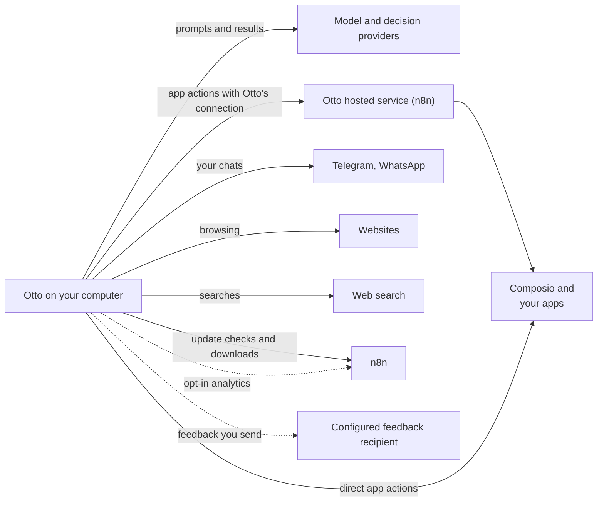

This page explains where Otto keeps your data, what leaves your computer and to whom, and how to delete it.

By default, desktop and source installs keep Otto's database, workspace and browser on your computer. Requests go to your model and decision providers, and the apps you choose. With Easy Connect, app requests and results pass through n8n's hosted connection service and Composio. If you use your own Composio key instead, they go through your Composio project.

The desktop app checks n8n's update service for new versions, which sees your IP address, app version and platform. Feedback and usage analytics are optional. An operator can configure a different feedback collector; the feedback dialog names its recipient before you send.

## Where your data lives

|                              | Desktop app                                                                                                                          | From source                                     | Hosted                                    |
| ---------------------------- | ------------------------------------------------------------------------------------------------------------------------------------ | ----------------------------------------------- | ----------------------------------------- |
| Otto server                  | Your computer                                                                                                                        | Your computer                                   | The operator's infrastructure             |
| Database, workspace, browser | A private virtual machine on your computer                                                                                           | Docker containers on your computer              | A separate runtime and storage per user   |
| Data folder                  | `~/Library/Application Support/Otto/` and `~/.otto-desktop/` on a Mac. `%APPDATA%\Otto\` and the `Otto-` WSL distribution on Windows | `.local/` (`OTTO_DATA_ROOT`) and Docker volumes | The operator's database and storage       |
| Who can read it              | You                                                                                                                                  | You                                             | You, and the operator, who holds the keys |

For what Otto stores and how long it keeps it, see the [Security review guide](/trust/security-review/#what-otto-stores).

## What leaves your computer

| Goes to                                   | What                                                                                                                                                                                                                                                                                                                                                                                                                                                                                                                                                                                                                                                                                                                                                                               |
| ----------------------------------------- | ---------------------------------------------------------------------------------------------------------------------------------------------------------------------------------------------------------------------------------------------------------------------------------------------------------------------------------------------------------------------------------------------------------------------------------------------------------------------------------------------------------------------------------------------------------------------------------------------------------------------------------------------------------------------------------------------------------------------------------------------------------------------------------- |
| The model provider you choose             | Your conversation, tool results and screenshots. With Gmail connected: your text from recent sent emails for writing style, plus inbox subjects and snippets for first tasks. Desktop and personal web installs can instead use the latest-message text from up to 40 recent inbox conversations for a setup summary. When an action needs your yes, the proposed action with its arguments and details is also sent to write and check the question, plus the page’s visible text for a browser step. Without a decision service, your replies to confirmations are read here too, and so are the sender, subject and text of each email Otto reads through your apps (up to 8,000 characters, the start and end of a longer one), to check whether it gives access to an account |
| Decision services                         | When one is set up (an OpenAI API or OpenRouter connection, or `TYPESAFE_API_KEY`), your replies to confirmations and the sender, subject and text of each email Otto reads through your apps, each checked on its own, instead of your model provider.                                                                                                                                                                                                                                                                                                                                                                                                                                                                                                                            |
| Apps and services you connect             | The actions Otto runs in them                                                                                                                                                                                                                                                                                                                                                                                                                                                                                                                                                                                                                                                                                                                                                      |
| Composio, if you connect apps through it  | Those app connections, the actions Otto sends and files attached to them, in n8n's project or in your own. An attached file is uploaded only when its action runs, never for an action you decline                                                                                                                                                                                                                                                                                                                                                                                                                                                                                                                                                                                 |
| Telegram and WhatsApp, if you set them up | The messages in those chats                                                                                                                                                                                                                                                                                                                                                                                                                                                                                                                                                                                                                                                                                                                                                        |
| Websites Otto visits                      | Whatever Otto browses, fills in or submits there                                                                                                                                                                                                                                                                                                                                                                                                                                                                                                                                                                                                                                                                                                                                   |
| Exa, for web search                       | Otto's search queries. With a ChatGPT plan, OpenAI runs the search instead                                                                                                                                                                                                                                                                                                                                                                                                                                                                                                                                                                                                                                                                                                         |
| n8n                                       | App requests and results when you use Easy Connect. Desktop update checks and downloads, which show your IP address, app version and platform. Masked usage analytics if you opt in, and feedback when using the default collector                                                                                                                                                                                                                                                                                                                                                                                                                                                                                                                                                 |
| Your configured feedback recipient        | Feedback and attachments you choose to send, including an optional diagnostic report                                                                                                                                                                                                                                                                                                                                                                                                                                                                                                                                                                                                                                                                                               |

OpenAI API connections use GPT Decisions at OpenAI. OpenRouter sends decision checks to TypeSafe. An optional `TYPESAFE_API_KEY` selects TypeSafe directly, regardless of your chat connection. See [Decision checks](/connect/models/#decision-checks) for routing and billing.

Google sign-in for Easy Connect sends identity information to Google and n8n's connection service. That service stores your verified email, Google account identifier, installation admission, and expiring sign-in state. It discards Google's access and ID tokens after validation. Signing in doesn't grant access to Gmail. Removing proxy access doesn't delete provider accounts.

Your model keys and your Composio key, if you use one, stay on your installation. Keys you save in the app are stored encrypted, and Otto only shows the last four characters of a Composio key. Otto's connection doesn't need a Composio key. Provider keys never enter a prompt, Otto's workspace or its browser.

## Usage analytics

Usage analytics are off until you turn on **Share usage data** in onboarding or in **Settings**. They record which screens you open, how you move through them, and product events such as a task starting or a setting changing.

The recipient is the Otto team at n8n, through its EU PostHog project. This also applies to self-hosted installations. Operators can disable collection for everyone with `OTTO_ANALYTICS_ENABLED=false`.

Analytics have no fields for raw messages, Vault values, full page addresses, names or email addresses. Recordings block credential-entry and model-key forms, the remote browser view and images. Events can include normalized public domains for connections and Vault logins, Vault item types, task categories, inferred outcomes, timing and signs of friction. Your selected model analyzes bounded chat text using your model account. Only allowed generic task type, action and subject labels can leave Otto as task categories; raw text and invented labels are rejected. These classifications can still be wrong. Measurements are associated with a pseudonymous installation or account ID. See [Analytics](/deploy/analytics/) for the full list, limitations and deployment switch.

## Feedback

The feedback dialog shows who receives your submission. The default is the Otto team at n8n; an operator can set a different HTTPS collector. By default feedback includes a diagnostic report of your recent chat, actions and their results. Select **Review** to read the report first, or untick **Include diagnostic report** to leave it out. Otto removes known secret values from the report before you see it. From the desktop app, feedback also includes the app version, your platform and your computer's name. Feedback is a separate, deliberate submission and does not turn on usage analytics.

Operators can disable submission and status checks with `OTTO_FEEDBACK_ENABLED=false`. See the [configuration reference](/deploy/configuration/#analytics-and-feedback) for custom collectors and operation without either upstream collector.

## What memory learns from

Memory notes come only from your own short messages, never from Otto's replies, tool results or web pages. Otto also writes learned skills, the steps of a flow it did, from what it did and read; your model is told to replace names, contact details, account and order numbers, amounts and message content with placeholders, and Otto removes known secrets and refuses card numbers, keys and links with logins before it saves one. When you connect Gmail, your model also reads your recent sent email and writes one short note on your writing style. During setup on desktop and personal web installs, it can also summarise the latest-message text from up to 40 recent inbox conversations to suggest first tasks. That summary is never saved to memory and is deleted once the cards are posted. When no summary is available, and in hosted mode, task suggestions use recent subjects and snippets instead. The model is told to leave out facts, names and quotes, and Otto drops a note with an email address or link. See [Memory](/use/memory/).

## Delete your data

- **Memories.** Open **Settings → Memory**, select a note and choose **Forget**. This deletes the note and its earlier versions. You can also ask Otto to forget something.
- **Vault items.** Open the item in **Trust → Saved** and delete it. For a saved browser session, select **Sign out**.
- **Apps.** Disconnect an app in **Apps**.
- **Composio key.** Sign in to Easy Connect and confirm the switch in **Settings → App connections**. This deletes your saved key and disconnects the apps you connected through your project.
- **Everything.** Quit Otto and delete its data folders from the table above. Uninstalling the app alone keeps your data. In hosted mode, ask your operator.

:::caution
Released builds don't have a button to clear your chat history yet. To remove it, delete Otto's data folders.
:::

## Where this is enforced

[`src/server/memory-learning.ts`](https://github.com/n8n-io/otto/blob/main/src/server/memory-learning.ts) (memory sources) · [`src/server/analytics.ts`](https://github.com/n8n-io/otto/blob/main/src/server/analytics.ts) (analytics opt-in and events) · [`src/web/lib/analytics-privacy.ts`](https://github.com/n8n-io/otto/blob/main/src/web/lib/analytics-privacy.ts) (recording masks) · [`src/server/bug-report.ts`](https://github.com/n8n-io/otto/blob/main/src/server/bug-report.ts) (report redaction)

## Related resources

- [Trust and Vault](/trust/)
- [Security review guide](/trust/security-review/)
- [Security model and limits](/trust/security-model/)
- [Memory](/use/memory/)
