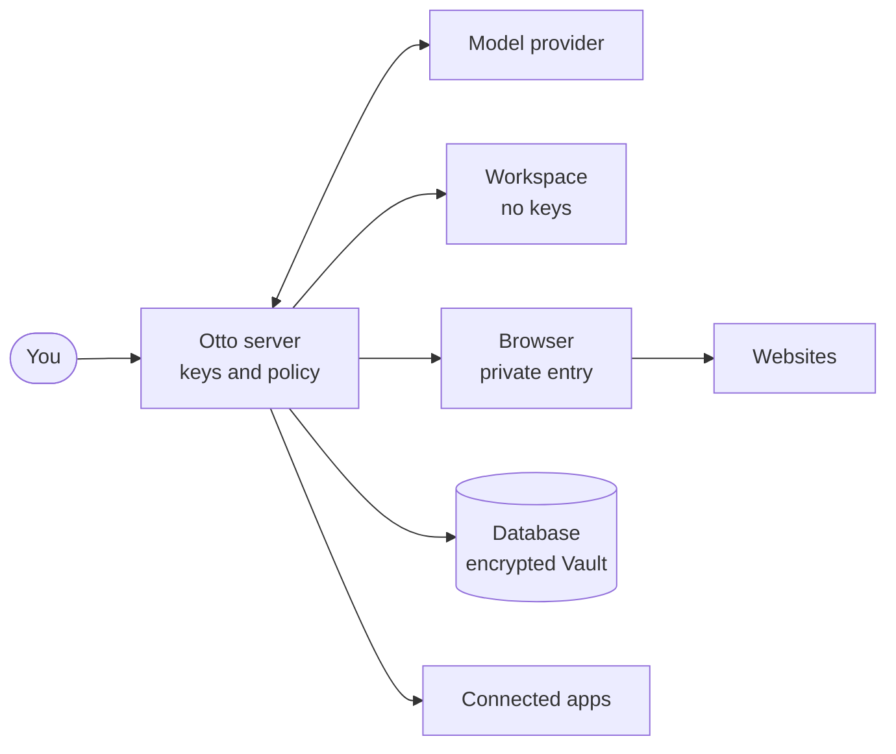

This page sets out who Otto trusts with what, which rules the server enforces, and what those rules don't cover. It's written for security reviewers. For data flows and threats, see the [Security review guide](/trust/security-review/).

## Who holds what authority

| Part             | What it can do                                                                                     | What it's trusted with                                                                                                                                                                                                                                         |
| ---------------- | -------------------------------------------------------------------------------------------------- | -------------------------------------------------------------------------------------------------------------------------------------------------------------------------------------------------------------------------------------------------------------- |
| You              | Ask for work, approve actions, choose accounts, change permissions                                 | Everything                                                                                                                                                                                                                                                     |
| Otto server      | Hold keys, check policy, decrypt values, record every use                                          | Keys and secret values                                                                                                                                                                                                                                         |
| Browser provider | Check field origins and pages, enter values, submit                                                | Secret values during entry                                                                                                                                                                                                                                     |
| Model            | Plan, choose accounts, fields and buttons                                                          | Account names, statuses and website results                                                                                                                                                                                                                    |
| Checker          | Decide each app action and browser step from your messages or a schedule's or standing instruction | Your recent messages, a schedule's instruction or your standing instruction, and the action. For a browser step: the website, page address, control label, the form a click or Enter sends, dialog text or file, what Otto typed or set; never the page's text |
| Website          | Receive what's submitted to its origin                                                             | The values entered on it                                                                                                                                                                                                                                       |

## Trust boundaries

Only the server holds keys and decides what runs. The model, the workspace and anything the browser loads are on the other side of that line.

## Rules the server enforces

### Authority

- Only your messages, a schedule's instruction, your standing instruction and your approvals carry authority. Pages, emails, files and tool results can't create permission.
- App actions beyond reads and drafts need a review match against your request or your yes. See [Approvals](/trust/approvals/).
- A confirmation is bound to the exact action and arguments, and runs once.
- Background work Otto starts itself reads and drafts, and does only what your [standing instruction](/trust/approvals/#standing-instructions) asks. Anything else waits for your yes, and a payment always needs your approval.

### Secrets

- No tool returns a saved password, code or card to the model.
- Otto is told never to ask for a password, code, card or API key in chat; it opens private entry instead. While a verification code is pending in the conversation that asked for it, a message that ends with its only 4–8 digit number (digits 0–9) is taken as the code, whatever the wording around it, and a message with a code-length number anywhere else is refused. While a card's security code is pending, only a code sent by itself or labeled CVV, CVC or security code, as in "my CVC is 123", is taken, and any other message with a 3- or 4-digit number is refused. A code sent as a reply to a closed request, or by itself until 10 minutes after Otto starts on a newer message, is refused too. None of these reach the model. Digits in other scripts and any other secret you type into chat reach the model.
- Known secret values are removed from tool output and masked in screenshots.
- Provider keys never enter the workspace, the browser or a prompt.

### Browser

- A login is entered only into a field whose real frame origin matches the login's exact origin. Card fields must match the approved destinations.
- Entry and submission happen in one step that the model can't observe or act during. Scripts on the destination page can read the entered values, as with any form.
- A page changed by the model's own JavaScript must reload before entry. After a failed entry, the model's view stays locked until the filled page changes.
- After Otto fills a private value on a page, the model's page scripts stay paused on that page until it reloads or moves on, so a script can't read the value back even once the field is gone.
- The browser and the web tools reach only public addresses, never the host, the local network or other containers. The address is checked when each connection opens, so a name can't switch to a private address after the check. Otto drops any proxy for a web tool, whether the model names it or the web extension's settings set it.

### One use

- Every private entry and payment is claimed once before browser work starts. It never runs twice, and an interrupted one becomes uncertain. See [One use, one result](/trust/outcomes/).

### Isolation

- The workspace runs as an unprivileged user with no host home folder, Docker socket, provider keys, access key or browser profiles.
- A connected command-line tool's token reaches only a sealed install of its declared source, run as its own user with a clean environment, apart from other tools.
- Every query and route is scoped to one owner.

### Local access and hosted mode

- Loopback isn't treated as identity. Every local `/api` request needs the owner key from `OTTO_DATA_ROOT/access-key`, or the desktop app's per-launch token. Only verified webhooks, OAuth callbacks, the key exchange and the privacy notice go without it.
- Hosted mode runs one runtime per user with a fixed owner, its own database role and schemas. The gateway signs each request with an HMAC envelope bound to owner, environment, generation, method, target, body, nonce and expiry, and rejects replays.
- The hosted master key stays in the gateway. Each runtime gets only keys derived for its own user.

## Limits

:::caution[What these rules don't cover]

- The server and browser provider can read secret values. There's no isolated key service or hardware-backed key release.
- The website receives what's submitted, and can store, encode or show it again. Masking replaces only the exact known values.
- The model can type any value it knows into a page, including a secret you typed into chat.
- Otto checks each email in app results and connected-app events on its own, with a decision model or the connection's smaller model, and hides any that gives access to an account: codes, sign-in and reset links, temporary passwords, recovery codes and keys sent by email. The check reads the sender, subject and up to 8,000 characters of text (the start and end of a longer email), so it can miss access in the middle of a very long message, and an email downloaded as a file isn't checked. A failed check hides the email.
- Once signed in, Otto can act anywhere on that website. Vault doesn't review each click. The trust check judges a browser step from what it does (a click, a key press or a script), the website and page, the control's label when there is one, the method and address of a form it sends, any dialog text or file name, and what Otto typed. It never sees the page's text. A deceptive site can still mislabel a control that acts through page scripts, or send a form to an address that doesn't say what it does.
- The checker can be wrong, and the model isn't immune to prompt injection.
- Otto writes [learned skills](/how-it-works/memory/#learned-skills) from what it did and read, so a page or an email can shape one, and a skill can steer later tasks. A skill never grants permission, and the trust check never sees it.
- A standing instruction runs for any new email or update that matches it, including one that only claims to come from the sender you named.
- Reads, drafts and links Otto opens or fetches aren't checked. In a source install the workspace has no outbound firewall; the desktop app blocks private and reserved addresses.
- A saved card can't make the issuer enforce the amount, and card support isn't a PCI DSS compliance claim.
- In hosted mode, the operator can decrypt stored data.
- Tests cover known failure cases. They don't prove that every injection or browser exploit is blocked.

:::

## Report a vulnerability

Report it privately through [GitHub private vulnerability reporting](https://github.com/n8n-io/otto/security/advisories/new), or through [n8n's Vulnerability Disclosure Program](https://n8n.io/report-a-vulnerability/). Don't open a public issue, and never include real passwords, keys or other people's data.

The team aims to acknowledge your report within 3 business days and to share a first assessment within 10 business days. Confirmed issues get a GitHub security advisory. Read the full [security policy](https://github.com/n8n-io/otto/blob/main/SECURITY.md) for scope and research rules.

## Where this is enforced

| Area                        | Source                                                                                                                                                                       |
| --------------------------- | ---------------------------------------------------------------------------------------------------------------------------------------------------------------------------- |
| Authority and confirmations | [`trust.ts`](https://github.com/n8n-io/otto/blob/main/src/server/trust.ts), [`approvals.ts`](https://github.com/n8n-io/otto/blob/main/src/server/approvals.ts)               |
| Vault and one use           | [`vault-access.ts`](https://github.com/n8n-io/otto/blob/main/src/server/vault-access.ts), [`vault-use.ts`](https://github.com/n8n-io/otto/blob/main/src/server/vault-use.ts) |
| Browser entry and proxy     | [`agent-browser`](https://github.com/n8n-io/otto/tree/main/src/providers/agent-browser)                                                                                      |
| Local access and hosting    | [`access.ts`](https://github.com/n8n-io/otto/blob/main/src/server/access.ts), [`gateway.ts`](https://github.com/n8n-io/otto/blob/main/src/server/gateway.ts)                 |

## Related resources

- [Trust and Vault](/trust/)
- [Security review guide](/trust/security-review/)
- [Our trust principles](/trust/principles/)
- [Your data and privacy](/trust/privacy/)
