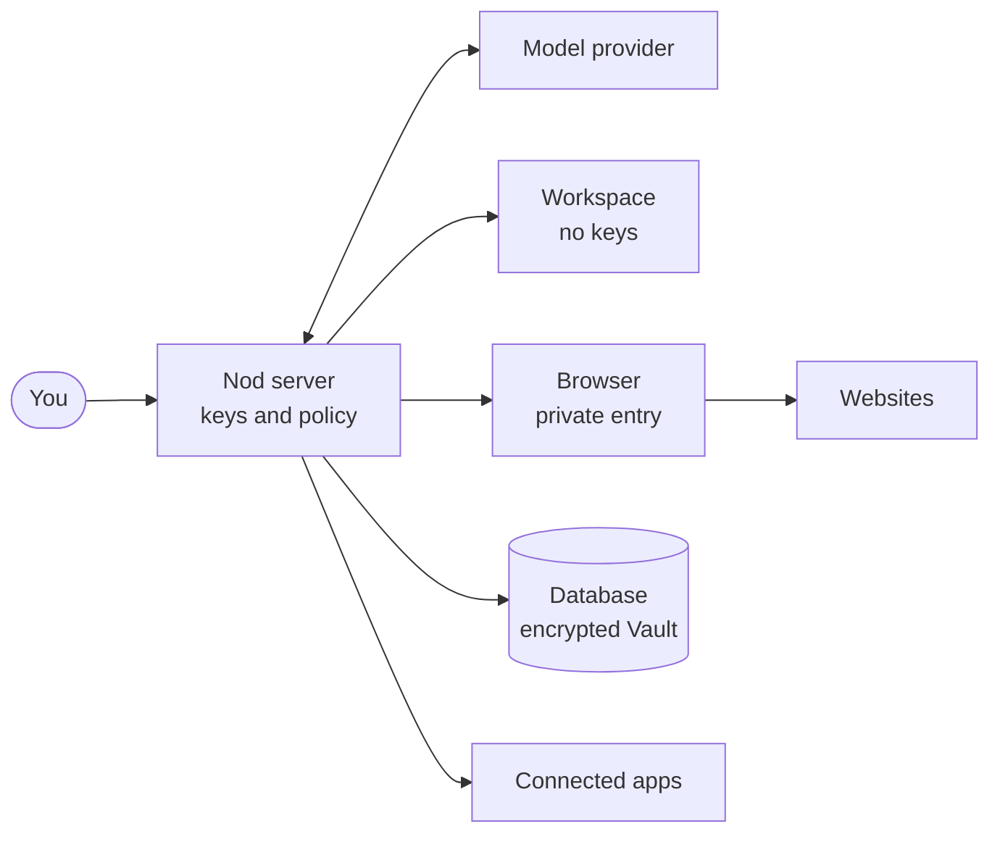

This page sets out who Nod trusts with what, which rules the server enforces, and what those rules don't cover. It's written for security reviewers. For data flows and threats, see the [Security review guide](/trust/security-review/).

## Who holds what authority

| Part             | What it can do                                                                                     | What it's trusted with                                                                                                                                                                                                                                                                                                                                                                                                                     |
| ---------------- | -------------------------------------------------------------------------------------------------- | ------------------------------------------------------------------------------------------------------------------------------------------------------------------------------------------------------------------------------------------------------------------------------------------------------------------------------------------------------------------------------------------------------------------------------------------ |
| You              | Ask for work, approve actions, choose accounts, change permissions                                 | Everything                                                                                                                                                                                                                                                                                                                                                                                                                                 |
| Nod server       | Hold keys, check policy, decrypt values, record every use                                          | Keys and secret values                                                                                                                                                                                                                                                                                                                                                                                                                     |
| Browser provider | Check field origins and pages, enter values, submit                                                | Secret values during entry                                                                                                                                                                                                                                                                                                                                                                                                                 |
| 1Password helper | Read the logins 1Password would fill on the website in front of you, and copy the one you pick     | Your 1Password account, from your approval until it is idle for 10 minutes                                                                                                                                                                                                                                                                                                                                                                 |
| Model            | Plan, choose accounts, fields and buttons                                                          | Account names, statuses and website results                                                                                                                                                                                                                                                                                                                                                                                                |
| Checker          | Decide each app action and browser step from your messages or a schedule's or standing instruction | Your recent messages, or a schedule's saved owner inputs, corrections, bound proposals and complete instruction approval, or your standing instruction; your current rules; and the action. Earlier owner context can explain references but cannot grant another action. For a browser step: the website, page address, control label, the form a click or Enter sends, dialog text or file, what Nod typed or set; never the page's text |
| Website          | Receive what's submitted to its origin                                                             | The values entered on it                                                                                                                                                                                                                                                                                                                                                                                                                   |

## Trust boundaries

Only the server holds keys and decides what runs. The model, the workspace and anything the browser loads are on the other side of that line.

## Rules the server enforces

### Authority

- Only your messages, a schedule's instruction, your standing instruction, your rules and your approvals carry authority. Pages, emails, files and tool results can't create permission.
- To run an action, the checker must quote the words that allow it. The server checks those words are in what the checker was shown, and asks you when they aren't. Usage shows them next to the action.
- App actions beyond reads and drafts need a review match against your request or your yes. See [Approvals](/trust/approvals/).
- A confirmation is bound to the exact action and arguments, and runs once.
- Background work Nod starts itself reads and drafts, and does only what your [standing instruction](/trust/approvals/#standing-instructions) asks. Anything else waits for your yes unless one of your [rules](/trust/approvals/#your-rules) allows it, a rule to ask first makes Nod ask even when the instruction covers the action, and a payment always needs your approval.

### Secrets

- No tool returns a saved password, code or card to the model.
- Nod is told never to ask for a password, code, card or API key in chat; it opens private entry instead. A verification code stays pending until the work that asked for it stops or finishes. While a code is pending in the conversation that asked for it, only a message that is the code by itself, 4–8 digits (0–9), is taken as the code. Any other message with a number of three or more digits is refused, whatever its wording or language, unless the number follows letters without a space and doesn't end the message, as in "SKU1042 arrived". Nod asks you to send the code by itself. While a card's security code is pending, only a code sent by itself or labeled CVV, CVC or security code, as in "my CVC is 123", is taken, and any other message with a 3- or 4-digit number is refused. A code sent as a reply to a closed request, or by itself or at the end of a message until 10 minutes after that work stops or Nod starts on a newer message, is refused too. None of these reach the model. Digits in other scripts and any other secret you type into chat reach the model.
- Known secret values are removed from tool output and masked in screenshots. Missing token values in an older saved sign-in do not stop removal of the other known secrets.
- Provider keys never enter the workspace, the browser or a prompt.

### Browser

- A login is entered only into a field whose real frame origin matches the sign-in request's exact origin. The saved login must match that website under the [Vault matching rules](/trust/vault/#website-matching). Card fields must match the approved destinations.
- Entry and submission happen in one step that the model can't observe or act during. Scripts on the destination page can read the entered values, as with any form.
- A page changed by the model's own JavaScript must reload before entry. After a failed entry, the model's view stays locked until the filled page changes.
- After Nod fills a private value on a page, the model's page scripts stay paused on that page until it reloads or moves on, so a script can't read the value back even once the field is gone.
- Reloading a page reached by a form submission, or one whose navigation Nod can't read, opens its address again with a GET, or is refused when no address can be read, so a reload never submits a form again.
- The browser and the web tools reach only public addresses, never the host, the local network or other containers. The address is checked when each connection opens, so a name can't switch to a private address after the check. Nod drops any proxy for a web tool, whether the model names it or the web extension's settings set it.

### One use

- Every private entry and payment is claimed once before browser work starts. It never runs twice, and an interrupted one becomes uncertain. See [One use, one result](/trust/outcomes/).

### Isolation

- The workspace runs as an unprivileged user with no host home folder, Docker socket, provider keys, access key or browser profiles.
- A connected command-line tool's token reaches only a sealed install of its declared source, run as its own user with a clean environment, apart from other tools.
- [Local files](/connect/local-files/) run in the server process, only in the desktop app, after the owner enables local file access. Access starts off. A file request can ask the owner to enable it in chat. The server checks the setting before it prepares or runs a file action. Only work whose chain of turns starts with an owner message or an owner-created schedule can use local files. Work Nod starts on its own reaches no file. Paths are checked after links are followed and must stay in the home folder or on an external drive, never in hidden files, Library or AppData, files named like secrets, Nod's own data or a folder on the owner's keep-out list. Nod can add to that list; only the owner removes entries. Listing is a read, and opening a file needs the owner's words in the trust check. Nod never changes executable files, files reach the workspace only when Nod copies them there, and nothing is deleted outright.
- [Computer use](/connect/computer-use/) is off until the owner turns it on, is experimental, works only in the desktop app, and only in work whose chain of turns starts with an owner message or a schedule the owner set up; event work and helpers can't use it.
  - The bundled agent-desktop tool reads windows through the system's accessibility service (macOS accessibility, Windows UI Automation or Linux AT-SPI) and acts on them in the background where it can, with a pill at the top of the screen that names the app and offers Stop; the app runs one allowlisted command at a time with no network listener or link that starts it, never its clipboard, notification, close-app or sandbox commands.
  - A step that needs the app in front (keyboard shortcuts, rich-text message bodies, Chromium and Electron apps on macOS, typing on Windows, and a read whose window has no accessibility tree yet) waits until the owner pauses typing, brings only that window forward with a visible glow and Stop, and gives focus back afterwards (on Linux under Wayland Nod can't bring a window forward, so such steps don't run); text for a rich-text body is pasted, and the owner's clipboard is restored. Only a step agent-desktop reports as not delivered is retried in front; a failure whose outcome is uncertain is never retried.
  - Known terminals and script runners, system settings and security prompts, file managers, password managers, crypto wallets, Nod itself and apps on the owner's keep-out list are refused in server code, matched by app ID and program, so an app missing from that list is not refused; browsers and code editors are view-only; the Apple menu, with Restart, Shut Down and System Settings, and each app's own menu, with Services, are never shown, and system shortcuts are never sent. On Linux, Nod opens only installed desktop apps that don't run in a terminal, never a command, and none from inside the Flatpak sandbox.
  - Nod acts only on controls from its own snapshots in that request. Opening an app needs the owner's words and grants it only for that request. Text entry and other changes go through the trust check with the current accessible window content. The server binds each step to that content. The native helper checks the binding and control again immediately before input, after any wait for focus. A window too large to check whole is checked around the control the step acts on (for a shortcut, every selected item of the focused list) and marked incomplete. An incomplete read, more than 24,000 characters right around the control, or several look-alike controls in such a window refuse the step. Password fields are excluded from the checked content and refused before input. No shortcut or window picture runs while a password field has focus. Window text is untrusted data. These checks cannot see content the app does not expose, or stop changes between the last check and operating-system input.
- Every query and route is scoped to one owner.
- File previews never run a file in Nod's own page. HTML runs in a sandboxed frame inside a second sandboxed frame. The outer frame blocks navigation requests from the inner frame before they leave. Its content policy also blocks external resources. It runs Nod's handlers even when scripts in the file are disabled. Interactive HTML can run local scripts, but forms and pop-ups are blocked. When file scripts are disabled, links you select can open a new window outside the preview. The preview closes after a blocked navigation. Other formats are read as data. Files that can run code get no local preview before they upload.

### Client access

- API text in JSON bodies, voice message details, query values and route values cannot contain a null character (U+0000). Nod refuses the text with HTTP 400 before storage and leaves the submitted text unchanged.
- Desktop windows use process sandboxing and context isolation, with Node integration and webviews disabled. Packaged windows disable DevTools and remote debugging switches.
- Desktop setup uses a private protocol that serves only its five UI files. Its session denies permission requests, and its content policy blocks network access. Chat allows audio recording, clipboard writes, and notifications only from its owned main frame. Native notifications keep the app's existing controls.
- Packaged chat pages limit external scripts and connections to the selected server. Their content policy permits inline scripts in the chat page, so it does not block inline script injection. This keeps sandboxed HTML previews and stickers working. Those frames have separate policies that block network access. The policy blocks plugins and code evaluation. Map frames use OpenStreetMap.
- Desktop builds enable cookie encryption and disable Node option injection, Node inspector flags, and extra file-protocol privileges. Audio decoding still needs Node child processes.
- Loopback isn't treated as identity. Local `/api` requests need the owner key from `NOD_DATA_ROOT/access-key`, or the local desktop app's per-launch token. A self-hosted server uses `NOD_AUTH_TOKEN`, presented by desktop clients as a bearer token and exchanged for an access cookie by web clients. Verified webhooks, OAuth callbacks that carry exactly one well-formed state, the key exchange and the privacy notice don't require the owner's access cookie.
- Server app sign-in pages use a separate, expiring capability issued when an authenticated owner starts a connection. They don't require the owner's access cookie. Each page opens once, binds the connection to a private browser key, and accepts messages only from its own sign-in window at the connection service's exact origin. The capability grants no access to other API routes.
- Network access requires an explicit server token and HTTPS. The server checks the request's host and browser origin against its configured public address.

## Limits

:::caution[What these rules don't cover]

- The server and browser provider can read secret values. There's no isolated key service or hardware-backed key release.
- The website receives what's submitted, and can store, encode or show it again. Masking replaces only the exact known values.
- The model can type any value it knows into a page, including a secret you typed into chat.
- Nod gives each email in app results and connected-app events its own privacy decision, using a decision model or the connection's smaller model, and hides any that gives access to an account: codes, magic sign-in links, reset links, passwords, recovery codes and keys sent by email. An ordinary sign-in page link does not itself give access. A security warning without an access secret stays available for Nod to inspect, including a warning that could be phishing. The check reads the sender, subject, HTML link destinations and up to 8,000 characters of text (the start and end of a longer email), so it can miss access in the middle of a very long message, and an email downloaded as a file isn't checked. Each record is checked on its own. Nod does not reuse a decision from an earlier read. A missing, invalid or failed decision hides that record.
- Once signed in, Nod can act anywhere on that website. Vault doesn't review each click. The trust check judges a browser step from what it does (a click, a key press or a script), the website and page, the control's label when there is one, the method and address of a form it sends, any dialog text or file name, and what Nod typed. It never sees the page's text. A deceptive site can still mislabel a control that acts through page scripts, or send a form to an address that doesn't say what it does. A request to buy or book covers the steps it needs on the website it names, including a control without a label when even the worst it could do there stays within the request.
- A login with an authenticator key keeps both sign-in steps in Vault, so anyone who can open your Vault can complete that two-step sign-in. Add a key only where you want Nod to sign in on its own.
- 1Password's approval isn't narrower than your account: until it's idle for 10 minutes or you lock 1Password, Nod's helper could read any item. Nod's code asks it only for the logins for the website in front of you and the one you pick.
- The checker can be wrong in every mode. A decision model can give incorrect permission or select an incorrect source with a high probability. A probability threshold or a local classifier cannot guarantee safety. No checker is immune to prompt injection. See [Select the action checker](/connect/models/#select-the-action-checker).
- Private preparation screens each changed record on its own with the connection's smaller model. A record it wrongly judges routine gets no preparation until it changes again.
- Nod writes [learned skills](/how-it-works/memory/#learned-skills) from what it did and read, so a page or an email can shape one, and a skill can steer later tasks. A skill never grants permission, and the trust check never sees it.
- A standing instruction runs for any new email or update that matches it, including one that only claims to come from the sender you named. Your rules apply in every kind of work, so background work started by such an email can do what a rule to go ahead covers.
- The checker quotes your words, or says "read", to run an action. The server verifies that the words exist, not that they really ask for the action; that judgment is still the checker's.
- Browser snapshots and typing without submitting do not need an action check. Source installs and self-hosted servers block private and reserved workspace addresses. The desktop runtime does too. Public internet access can still send data outside Nod.
- A saved card can't make the issuer enforce the amount, and card support isn't a PCI DSS compliance claim.
- HTML that you download and open outside Nod does not have Nod's preview protections.
- [Computer use](/connect/computer-use/) can reach files through an allowed app's native Open and Save panels, which [local files](/connect/local-files/) path checks would refuse.
- A window picture with computer use isn't redacted, except that Nod takes none while a password field has focus. Whatever the window shows goes to your model service.
- Tests cover known failure cases. They don't prove that every injection or browser exploit is blocked.

:::

## Report a vulnerability

Report it privately through [GitHub private vulnerability reporting](https://github.com/n8n-io/nod/security/advisories/new), or through [n8n's Vulnerability Disclosure Program](https://n8n.io/report-a-vulnerability/). Don't open a public issue, and never include real passwords, keys or other people's data.

The team aims to acknowledge your report within 3 business days and to share a first assessment within 10 business days. Confirmed issues get a GitHub security advisory. Read the full [security policy](https://github.com/n8n-io/nod/blob/main/SECURITY.md) for scope and research rules.

## Where this is enforced

| Area                        | Source                                                                                                                                                                                                    |
| --------------------------- | --------------------------------------------------------------------------------------------------------------------------------------------------------------------------------------------------------- |
| Authority and confirmations | [`trust.ts`](https://github.com/n8n-io/nod/blob/main/src/server/trust.ts), [`approvals.ts`](https://github.com/n8n-io/nod/blob/main/src/server/approvals.ts)                                              |
| Vault and one use           | [`vault-access.ts`](https://github.com/n8n-io/nod/blob/main/src/server/vault-access.ts), [`vault-use.ts`](https://github.com/n8n-io/nod/blob/main/src/server/vault-use.ts)                                |
| Browser entry and proxy     | [`agent-browser`](https://github.com/n8n-io/nod/tree/main/src/providers/agent-browser)                                                                                                                    |
| Client access               | [`access.ts`](https://github.com/n8n-io/nod/blob/main/src/server/access.ts), [`network.ts`](https://github.com/n8n-io/nod/blob/main/src/server/network.ts)                                                |
| Local files                 | [`local-files.ts`](https://github.com/n8n-io/nod/blob/main/src/server/local-files.ts)                                                                                                                     |
| File previews               | [`attachment-frame.tsx`](https://github.com/n8n-io/nod/blob/main/src/web/components/attachment-frame.tsx), [`attachment-kind.ts`](https://github.com/n8n-io/nod/blob/main/src/web/lib/attachment-kind.ts) |

## Saved owner instructions

Chat, tasks and schedules use one server record for owner evidence. Each message keeps its identity and time. A reply keeps the exact proposal it answers. Background cannot grant permission. Each checker mode receives the same evidence roles. Internal owner, turn and run IDs stay on the server.

For an instruction update, the checker sees the current definition, requested field changes and complete proposed result. The writer saves the changed definition and its evidence together under the turn lock. It checks the target version and owner-input version again. An older proposal cannot overwrite a newer owner correction. Notification and lasting-rule changes also refuse a stale reviewed value.

A complete schedule approval is bound to the exact future work described in its question. The writer and its separate fact check must describe its targets, timing and limits. Hidden values in that complete instruction prevent the question from being asked. A metadata approval changes only its named fields. Each later outside action still passes Trust. An approval of one outside action never becomes recurring permission.

Each run keeps its execution request, run time and owner-evidence copy. Source messages are checked when the instruction is saved; a later Stop or model failure on that request does not revoke the saved instruction. A complete replacement can establish a new instruction. The server does not summarize permission or erase it after a fixed number of changes. A request that exceeds the selected provider's input context limit fails without saving the update. Existing schedules migrate their known instruction without guessed context. Old correction lists have no complete source records and require a complete replacement instruction.

Source checks establish where evidence came from. A model still judges whether that evidence covers the action, which corrections apply, and whether background describes the same work. A valid quote alone does not establish permission.

## Related resources

- [Trust and Vault](/trust/)
- [Security review guide](/trust/security-review/)
- [Our trust principles](/trust/principles/)
- [Your data and privacy](/trust/privacy/)
