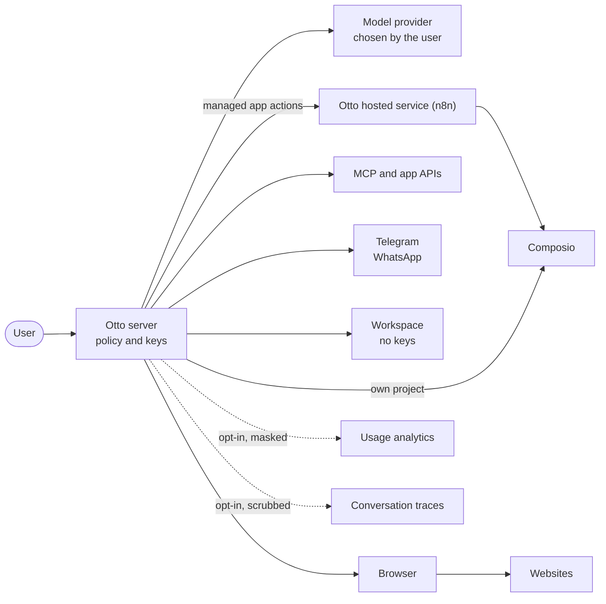

This page gives a security or IT team what it needs to assess Otto: where it runs, what it stores, which threats it addresses and where to verify each control in the code.

## Deployment options

|                     | Desktop app                            | From source                                             |
| ------------------- | -------------------------------------- | ------------------------------------------------------- |
| Runs on             | The user's Mac or Windows PC           | A macOS or Linux machine                                |
| Data stored         | On the device, in a private VM         | `.local/` and Docker volumes                            |
| Encryption key held | macOS Keychain or OS-protected storage | Keychain, private Linux profile key or `OTTO_VAULT_KEY` |
| Network exposure    | Loopback only, per-launch token        | Loopback only, owner access key                         |

## How data flows

Model requests go to the provider the user connects. Managed app requests and results pass through n8n's hosted connection service and Composio. Direct MCP connections and servers using their own Composio project bypass that service. Feedback, masked usage analytics and scrubbed [conversation traces](/trust/conversation-traces/) are optional.

## What Otto stores

| Data                               | Where                                | Protection                                                                                                   | Kept                |
| ---------------------------------- | ------------------------------------ | ------------------------------------------------------------------------------------------------------------ | ------------------- |
| Conversations, tasks and schedules | PostgreSQL                           | Every query scoped to the owner                                                                              | No automatic expiry |
| Saved logins and cards             | PostgreSQL                           | AES-256-GCM, bound to owner, record and purpose                                                              | Until removed       |
| Model and app keys users save      | PostgreSQL                           | AES-256-GCM, bound to owner, record and purpose                                                              | Until removed       |
| Server-managed model and app keys  | Server configuration                 | Not stored by Otto; never sent to the sandbox                                                                | Until unset         |
| Vault activity                     | PostgreSQL                           | Owner-scoped, no secret values                                                                               | No automatic expiry |
| Model costs and app actions        | PostgreSQL                           | Owner-scoped                                                                                                 | Permanent           |
| Memory                             | A private file outside the workspace | From owner messages, Settings and chosen imports, plus a sent-email style note; skills without personal data | Until forgotten     |
| Workspace files, browser profiles  | Local volumes                        | Separate containers per owner                                                                                | Until removed       |

## Threats and controls

| Threat                                                       | Control                                                                                                                                             | Verify in                                                                                                                                                                                                                                                                       |
| ------------------------------------------------------------ | --------------------------------------------------------------------------------------------------------------------------------------------------- | ------------------------------------------------------------------------------------------------------------------------------------------------------------------------------------------------------------------------------------------------------------------------------- |
| An email or web page tells Otto to send data or delete files | Server trust check on the action as sent; the review never sees tool results                                                                        | [`trust.ts`](https://github.com/n8n-io/otto/blob/main/src/server/trust.ts), [`untrusted.ts`](https://github.com/n8n-io/otto/blob/main/src/shared/untrusted.ts), [`approvals.test.ts`](https://github.com/n8n-io/otto/blob/main/tests/approvals.test.ts)                         |
| A spoofed email triggers a standing instruction              | The instruction names the action and target; any other change asks, and reads and drafts run as usual; the review never sees the email              | [`trust.ts`](https://github.com/n8n-io/otto/blob/main/src/server/trust.ts), [`untrusted.ts`](https://github.com/n8n-io/otto/blob/main/src/shared/untrusted.ts), [`approvals.test.ts`](https://github.com/n8n-io/otto/blob/main/tests/approvals.test.ts)                         |
| The model leaks a password or card number                    | Secrets never enter its context; private entry; masking in output and screenshots                                                                   | [`vault-access.ts`](https://github.com/n8n-io/otto/blob/main/src/server/vault-access.ts), [`browser-sign-in.test.ts`](https://github.com/n8n-io/otto/blob/main/tests/browser-sign-in.test.ts)                                                                                   |
| A saved login is used on a lookalike site                    | Exact-origin check on the real field, including frames                                                                                              | [`agent-browser`](https://github.com/n8n-io/otto/tree/main/src/providers/agent-browser), [`vault.test.ts`](https://github.com/n8n-io/otto/blob/main/tests/vault.test.ts)                                                                                                        |
| A payment or message runs twice                              | Durable claim before work; no automatic retries; uncertain state                                                                                    | [`vault-use.ts`](https://github.com/n8n-io/otto/blob/main/src/server/vault-use.ts), [`approvals.ts`](https://github.com/n8n-io/otto/blob/main/src/server/approvals.ts)                                                                                                          |
| Code in the sandbox steals provider keys                     | Keys never enter the workspace; connected CLI tokens only reach a sealed install                                                                    | [`docker`](https://github.com/n8n-io/otto/tree/main/src/providers/docker), [`sandbox.test.ts`](https://github.com/n8n-io/otto/blob/main/tests/sandbox.test.ts)                                                                                                                  |
| A web page steers Otto to a local address                    | The browser and web tools connect only to public addresses, checked when each connection opens; Otto drops proxies from the model or saved settings | [`network.ts`](https://github.com/n8n-io/otto/blob/main/src/providers/agent-browser/network.ts), [`pi/index.ts`](https://github.com/n8n-io/otto/blob/main/src/providers/pi/index.ts), [`url-guards.test.ts`](https://github.com/n8n-io/otto/blob/main/tests/url-guards.test.ts) |
| Another local process calls Otto's API                       | Owner access key on every request; loopback isn't treated as identity                                                                               | [`access.ts`](https://github.com/n8n-io/otto/blob/main/src/server/access.ts)                                                                                                                                                                                                    |

Tests use synthetic data and disposable databases. They never call a live model or a real account. Capability evals run the real agent against fake apps and lookalike websites. See [Checks and tests](/contribute/checks-and-tests/) and [Capability evals](/contribute/evals/).

## Built on published research

| Pattern                                      | Source                                                                                                             | In Otto                                                                                                                                   |
| -------------------------------------------- | ------------------------------------------------------------------------------------------------------------------ | ----------------------------------------------------------------------------------------------------------------------------------------- |
| Privileged decisions from trusted input only | [CaMeL](https://arxiv.org/abs/2503.18813), [agent design patterns](https://arxiv.org/abs/2506.08837)               | Only the user's own words carry authority. The review also sees the action and the message the user answered, as data, never tool results |
| Review the proposed action, not the content  | [Chrome agent security](https://blog.google/security/architecting-security-for-agentic/)                           | Confirmations show the request as sent                                                                                                    |
| Fill credentials outside the model           | [1Password agentic autofill](https://1password.com/blog/closing-the-credential-risk-gap-for-browser-use-ai-agents) | Private entry on a verified origin                                                                                                        |
| No token passthrough                         | [MCP authorization](https://modelcontextprotocol.io/specification/2025-11-25/basic/authorization)                  | Connection secrets stay server-side                                                                                                       |
| Classifiers are a layer, not the boundary    | [The Attacker Moves Second](https://arxiv.org/abs/2510.09023)                                                      | No pattern classifier; the trust check, Vault and payment approval decide                                                                 |

## Common questions

**Does n8n see our conversations?** Managed app requests and results pass through n8n and can include conversation content used in app actions. Feedback can also include a diagnostic report of recent chat and actions. Usage analytics are opt-in and mask content. Conversation traces are opt-in too: when a user turns them on, scrubbed model requests and replies go to the Otto team's LangSmith project for 14 days, without any account or device identifier.

**Does Otto train on our data?** Otto doesn't train models, and n8n doesn't use conversation traces to train AI models. The model provider you connect processes requests under its own terms.

**Can we choose the model?** Yes. Users connect OpenAI, Anthropic, OpenRouter or a ChatGPT plan. In local Otto they can also add an OpenAI-compatible server, such as Ollama, at any address. The trust check then runs on that model. Operators can also provide server-managed keys. There's no setting yet that limits which providers users can add.

**Is there single sign-on or an admin console?** No. Otto runs for one person on their own computer. There are no organization accounts.

**Which certifications does Otto have?** None. Otto is an early preview. Saved-card support is not a PCI DSS compliance claim.

## Limits and reporting

Read the honest limits in [Security model and limits](/trust/security-model/). Report a vulnerability privately through the [security policy](https://github.com/n8n-io/otto/blob/main/SECURITY.md). The team aims to acknowledge within three business days and to share an assessment within 10.

## Related resources

- [Our trust principles](/trust/principles/)
- [How Otto compares](/trust/compare/)
- [Your data and privacy](/trust/privacy/)
