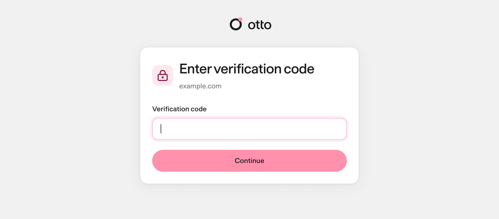

import { Steps } from '@astrojs/starlight/components';

**Vault** in the sidebar keeps your website logins and cards. Nod can sign in with a saved login, but the model never receives the password: the Nod server types it into the website for you.

While Vault is empty, it lists the ways to fill it: import passwords, add a login or a card, or sign in to a website.

## Add a login

<Steps>

1. Open **Vault**, select **Add**, then **Login**.
2. Enter a **Name** you'll recognize, such as "Work reports", and the **Website domain**.
3. Enter the username or email and the **Password**.
4. If the website asks for a code from an authenticator app, paste its setup key or `otpauth://` link into **Authenticator key**. Websites show it next to the QR code when you turn on two-step sign-in, and password managers keep it with the login.
5. Select **Save**.

</Steps>

**Website domain** accepts a domain or a full HTTPS URL, such as `https://www.example.com/uk/`. Nod saves only the protocol, host, and port. It removes the path, query, and fragment. Loopback addresses, such as `http://localhost:4310`, can use HTTP.

If the website address or authenticator key is not valid, the error explains what to change.

**Import from a password manager.** Select **Add → Import passwords** and choose a CSV exported from Chrome, 1Password or another password manager. Nod imports the website logins and skips archived items. Authenticator keys come along when the export has them, as 1Password and Bitwarden exports do, and a login you already saved gets its missing key. Passkeys, cookies and other items aren't imported. Delete the exported file afterwards, because it isn't encrypted.

**Add one during a task.** When a task needs a login you haven't saved, Nod opens a private **Sign in** form. Its fields use the website's own names, such as **Username** or **Email address**; an account the site took on an earlier page gets a generic label. Enter the account and password, then select **Save and continue**. Nod saves both under the website's name, even when the site took the account on an earlier page, and types only the fields that page asks for. The values never pass through chat or the model.

Select the sign-in action in chat to open the private form beside the conversation. On a narrow window it fills the chat area. Close it with **Escape** or the close button; unsent values are cleared. Reopen the action to read the current status. Closing the panel does not cancel an entry already submitted to the website. Browser handoff links still open a standalone private form.

When a website offers several sign-in methods, Nod uses the method you chose or, if one saved login uniquely applies, that login with the website's password method. If the method remains ambiguous, Nod shows the choices it found on that page. Select one to continue in Nod's browser. Email, password and verification-code steps appear in the same private panel as the website asks for them. A choice opens the website's real control; it does not mean sign-in succeeded.

Method choices expire after 30 minutes. If the page or control changes, Nod refuses the old choice. A result that cannot be confirmed stays **unknown** and is never replayed automatically. Ask Nod to check the page before trying again. The panel follows fresh steps from the same task and browser for up to 30 minutes; a new task needs its own private link.

A private form stays available while its task waits for you. It stops accepting input once used, when Nod asks for a newer one, when Nod starts on a newer message in the same conversation, or when you select **Stop**. A scheduled run or background task has its own session, so chatting with Nod never closes its form.

## Use a login from 1Password

In the private **Sign in** form, select **Use 1Password**. The first time, enter your 1Password account name as it appears at the top of the 1Password sidebar. Approve the request in 1Password, then choose the login. Nod saves a copy in Vault, with its authenticator key, and signs in.

This needs the 1Password 8 app alongside Nod's runtime, signed in, with **Settings → Developer → Integrate with other apps** turned on. It works with a local desktop assistant or source install. A desktop client connected to a remote server doesn't give that server access to the client's 1Password app. You can import a CSV into Vault instead.

- **What Nod reads.** To list them, the helper reads the logins 1Password itself would fill on the website in front of you, on your computer. Only the one you choose is copied to Vault, and the model never sees the list or any value.
- **Where it runs.** A small helper process talks to 1Password; the Nod server never loads 1Password's code. 1Password's approval lets that helper read your account until it's idle for 10 minutes or you lock 1Password, and Nod closes it after 10 idle minutes.
- **Why a copy.** Scheduled and background tasks can then sign in without waiting for you to approve in 1Password. If you change the password in 1Password, choose the login from 1Password again the next time Nod asks, and the copy is updated.

## How sign-in works

Nod picks the account, the fields and the submit button. The server enters and submits in one private step that Nod can't watch, then Nod carries on with the live page.

| Item               | What the model receives                                                                |
| ------------------ | -------------------------------------------------------------------------------------- |
| Saved login        | Its name, its website and the first two characters of the username                     |
| Saved card         | Its name, brand, last four digits and expiry                                           |
| Password or code   | Only whether the private step finished                                                 |
| Authenticator key  | Nothing; Nod enters the current code itself                                            |
| Page after sign-in | The live page, with the password and codes removed from text and masked in screenshots |

The private sign-in page shows you the full username of each saved login it can open, so you can pick the right account.

## Exact website origins

A login works only on its exact origin: the protocol, host and port. The browser checks the real origin of each field, including fields inside frames, so a lookalike page can't receive your password. For a login saved for `https://reports.example.com`:

| Page                                 | Can use the login?           |
| ------------------------------------ | ---------------------------- |
| `https://reports.example.com/weekly` | Yes, the path doesn't matter |
| `https://login.example.com`          | No, a different host         |
| `http://reports.example.com`         | No, a different protocol     |
| `https://reports.example.com:8443`   | No, a different port         |

## When Nod asks first

- **Which account.** Nod reuses the one saved login that fits. If several could apply and you haven't said which, it asks.
- **Whether to sign in.** The same [checker](/trust/approvals/) that decides app actions checks whether your recent messages or [your rules](/trust/approvals/#your-rules) need this website. If not, or if a rule says to ask first, Nod asks, for example "Sign in to reports.example.com?". Mentioning a domain isn't consent.
- **Scheduled runs** are checked against the instruction that created the schedule and your rules.
- **Background work** Nod starts itself is checked against your [standing instruction](/trust/approvals/#standing-instructions) and your rules. If they don't need this website, or a rule says to ask first, Nod asks you first.

A yes covers that website and account for the rest of the task. A new task is checked again.

When a saved login needs your approval, Nod uses its saved name and username hint to identify the account.

## Verification codes

**From an authenticator app.** When a saved login holds an authenticator key, Nod enters the current code itself when the website asks for one, after the same check as signing in with that login. It uses the key only for the account the task signed in with, or the login it named, and only once per sign-in; if the website asks again, Nod opens the private form. The key never leaves the Nod server.

**By email.** When a website emails you a code, Nod can fetch it privately from your connected mailbox. The server checks the sender, recipient, time and account before entering it, and the model never sees it. It reads only mail that arrived after Nod entered your sign-in details on that site, or after the task started, allowing 30 seconds for clock differences and going back at most five and a half minutes. It waits up to a minute for the email to arrive. Otherwise, enter the code in the private form, or send it by itself, such as `482913`, in the chat where Nod asked, including Telegram or WhatsApp. Nod submits it privately and keeps it out of the chat history. While a code is pending, Nod refuses a message with the code and other words, in any language, such as "mi código es 482913", and a message with another number of three or more digits, such as a question about invoice NS-1042. It doesn't submit that message or show it to the model, and asks you to send the code by itself. When Nod reads mail through your apps, a separate model check (a decision service, or your connection's smaller model) checks each email before Nod's model sees it, and hides the content of any email that gives access to an account: a one-time or verification code, a sign-in or magic link, a password-reset or account-recovery link, a temporary or initial password, backup or recovery codes, or an API key or access token. Mail that only mentions your accounts, such as a receipt or a new sign-in alert without a code or link, stays visible. OpenAI Decisions and the smaller model can check several emails together, with a separate decision for each. If a check fails or its decisions are incomplete, Nod hides those emails too. The check reads up to 8,000 characters, the start and end of a longer email, and like any model it can miss one, so treat it as a strong guard rather than a guarantee. An email Nod downloads as a file isn't checked.

## Private steps from Telegram or WhatsApp

Private forms never open in a chat app. Finish the step in the same conversation in Nod's web or desktop app, and Nod replies in the original chat. See [Telegram and WhatsApp](/use/channels/).

## Review and change access

**Usage** lists every sign-in, code, saved-session use, question, held attempt, reveal and permission change, with the task and the reason, next to what Nod did in your apps.

**Vault** lists your logins, cards and saved sessions. Open one to edit, reveal, copy or delete it. Every reveal is recorded.

## How Vault stores secrets

Saved logins, their authenticator keys and cards are encrypted with AES-256-GCM. Each value is bound to you, its record and its purpose, so a copied value won't open anywhere else. The key is kept outside the database.

Vault fails closed. Nod checks the key against your existing data before it uses or writes anything, and a wrong or missing key stops Vault without overwriting anything. A login the key can't open shows **Can't be opened** and can still be deleted.

Where the key lives

| Where Nod runs          | Key                                                                                  |
| ----------------------- | ------------------------------------------------------------------------------------ |
| Local desktop assistant | Generated by the app, protected by the system's safe storage                         |
| From source on macOS    | The macOS Keychain, or `NOD_VAULT_KEY` if you set it                                 |
| From source on Linux    | A private file at `NOD_DATA_ROOT/vault/master-key`, or `NOD_VAULT_KEY` if you set it |
| Self-hosted server      | `NOD_VAULT_KEY` in the server's private environment file                             |

A connected desktop client uses the server's Vault and key. Its operating system protects only the client's saved server token.

:::caution[Back up NOD_VAULT_KEY]
If you set the key yourself, keep a copy somewhere safe. Saved logins can't be read without it.
:::

## Where this is enforced

[`src/server/vault-access.ts`](https://github.com/n8n-io/nod/blob/main/src/server/vault-access.ts) (permission and activity) · [`src/server/authenticator.ts`](https://github.com/n8n-io/nod/blob/main/src/server/authenticator.ts) (authenticator codes) · [`src/providers/onepassword`](https://github.com/n8n-io/nod/tree/main/src/providers/onepassword) (1Password helper) · [`src/server/vault-use.ts`](https://github.com/n8n-io/nod/blob/main/src/server/vault-use.ts) (one use) · [`src/server/vault-crypto.ts`](https://github.com/n8n-io/nod/blob/main/src/server/vault-crypto.ts) (encryption) · [`src/providers/agent-browser`](https://github.com/n8n-io/nod/tree/main/src/providers/agent-browser) (origin checks and private entry)

## Related resources

- [Trust and Vault](/trust/)
- [Saved browser sessions](/trust/browser-sessions/)
- [Payments](/trust/payments/)
- [One use, one result](/trust/outcomes/)
- [Security model and limits](/trust/security-model/)
