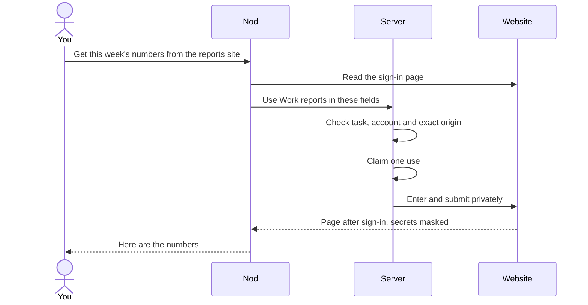
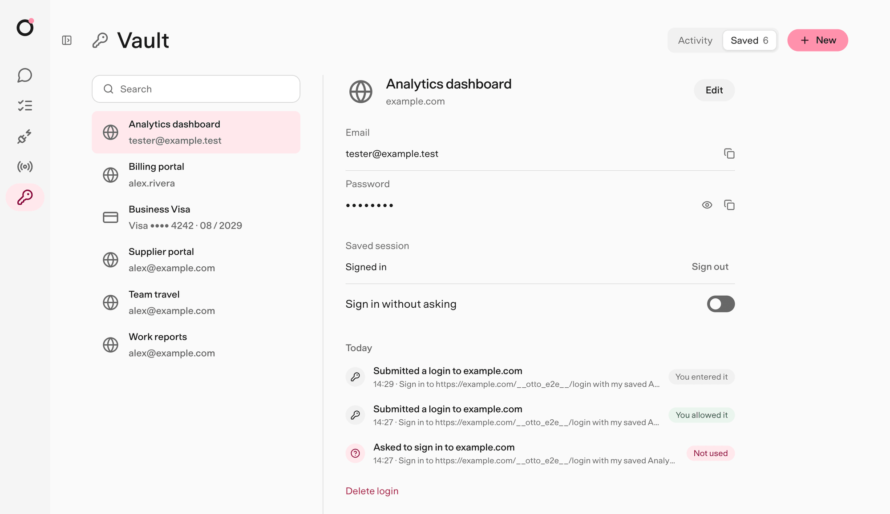

import { Steps } from '@astrojs/starlight/components';

**Vault** in the sidebar keeps your website logins and cards. Nod can sign in with a saved login, but the model never receives the password: the Nod server types it into the website for you.

While Vault is empty, it lists the ways to fill it: import passwords, add a login or a card, or sign in to a website.

If you stop the task while Nod enters a saved login or card, Nod stops the private entry too. **Stopped before entry** means that no values were entered in that step. An interrupted private operation may have reached the website. Nod does not repeat it. Check the result on the website before you start a new attempt.

## Add a login

<Steps>

1. Open **Vault**, select **Add**, then **Login**.
2. Enter a **Name** you'll recognize, such as "Work reports", and the **Website domain**.
3. Enter the username or email and the **Password**.
4. If the website asks for a code from an authenticator app, paste its setup key or `otpauth://` link into **Authenticator key**. Websites show it next to the QR code when you turn on two-step sign-in, and password managers keep it with the login.
5. Select **Save**.

</Steps>

**Website domain** accepts a domain or a full HTTPS URL, such as `https://www.example.com/uk/`. Nod saves only the protocol, host, and port. It removes the path, query, and fragment. Loopback addresses, such as `http://localhost:4310`, can use HTTP.

If the website address or authenticator key is not valid, the error explains what to change.

If Nod has a specific reason for a failed save or update, the form shows it. Password, card number, and authenticator key fields clear after submission. Enter any replacement secret values again before you repeat the save.

**Import from a password manager.** Select **Add → Import passwords** and choose a CSV exported from Chrome, 1Password or another password manager. Nod imports the website logins and skips archived items. Authenticator keys come along when the export has them, as 1Password and Bitwarden exports do, and a login you already saved gets its missing key. Passkeys, cookies and other items aren't imported. Delete the exported file afterwards, because it isn't encrypted.

## Sign in on the website

When a task needs a login you haven't saved, Nod opens the website's own sign-in page in [its live browser](/use/browser/#take-over-the-browser) in chat. The panel's title shows the page's address, such as **discord.com**, with a lock for a secure page. Check it before you type.

<Steps>

1. Sign in as you would in your own browser, including any code or method the website asks for.
2. Select **Return to Nod**. Nod looks at the page and carries on.
3. To let Nod sign in by itself next time, select **Save login to Vault**. Nod saves the website's address with the account and password you typed. If that account is already in Vault, Nod updates its password and keeps its name. If you typed only the password and Vault holds one login for the website, Nod updates that login. The button appears only for HTTPS websites and addresses on your computer.

</Steps>

Nod doesn't watch or act while you have the browser, and a password you type there is hidden from the model and from what Nod reads on the page afterwards. Nod's server keeps it only to offer the save. Nod's browser stays signed in for later tasks, so you usually sign in once. A saved login lets a scheduled run sign in again after the website signs Nod out.

To use a login from 1Password or another password manager, copy it into the page, or import a CSV into Vault.

If a browser check stops a saved login, the error keeps its safe reason and recovery step. For example, after a page script runs, Nod must reload the page before a new private entry. The previous entry cannot run again.

## How sign-in works

Nod picks the account, the fields and the submit button. Before the server uses a saved login, it checks that each one is on the page. If one is missing, it refuses the step, enters nothing and Nod reads the page again. The server enters and submits in one private step that Nod can't watch, then Nod carries on with the live page.

Some websites disable the submit button while they check a field. Nod waits up to 30 seconds for the button to become enabled. If it stays disabled, the page changes or the browser closes, Nod stops the private step. It does not activate the disabled control or repeat the submission. A failed private entry can keep the page unreadable until you reload it.

| Item               | What the model receives                                                                |
| ------------------ | -------------------------------------------------------------------------------------- |
| Saved login        | Its name, its website and the first two characters of the username                     |
| Saved card         | Its name, brand, last four digits and expiry                                           |
| Password or code   | Only whether the private step finished                                                 |
| Authenticator key  | Nothing; Nod enters the current code itself                                            |
| Page after sign-in | The live page, with the password and codes removed from text and masked in screenshots |

## Website matching

A login works on its saved origin: the protocol, host and port. It also works on the matching root or `www` host, with the same protocol and port. For a login saved for `https://example.com`:

| Page                         | Can use the login?           |
| ---------------------------- | ---------------------------- |
| `https://example.com/weekly` | Yes, the path doesn't matter |
| `https://www.example.com`    | Yes, the matching `www` host |
| `https://login.example.com`  | No, a different subdomain    |
| `http://example.com`         | No, a different protocol     |
| `https://example.com:8443`   | No, a different port         |

Only domains with a known public or private suffix get this match. Other subdomains, repeated `www` prefixes, local addresses, IP addresses and unknown suffixes keep exact matching.

The question shows the destination host and port. Your approval stays bound to the destination and account shown. An approval for `example.com` does not approve `www.example.com`.

The browser checks the real origin of each field against the current sign-in request, including fields inside frames. The saved entry keeps its original address.

## When Nod asks first

These checks run before Nod uses a saved login. Signing in yourself on the page needs no check.

- **Which account.** Nod reuses the one saved login that fits, or the one you named. If several could apply and you haven't said which, or a saved login doesn't get through, Nod shows you the website's page to sign in yourself.
- **Whether to sign in.** The same [checker](/trust/approvals/) that decides app actions checks whether your recent messages or [your rules](/trust/approvals/#your-rules) need this website. If not, or if a rule says to ask first, Nod asks, for example "Sign in to reports.example.com?". Mentioning a domain isn't consent.
- **Scheduled runs** are checked against the instruction that created the schedule and your rules.
- **Background work** Nod starts itself is checked against your [standing instruction](/trust/approvals/#standing-instructions) and your rules. If they don't need this website, or a rule says to ask first, Nod asks you first.

A yes covers that website and account for the rest of the task. A new task is checked again.

When a saved login needs your approval, Nod uses its saved name and username hint to identify the account.

## Verification codes

**From an authenticator app.** When a saved login holds an authenticator key, Nod enters the current code itself when the website asks for one, after the same check as signing in with that login. It uses the key for the saved login Nod signed in with in the same task. If Nod didn't sign in, it uses the login you named or the website's only login with a key. It enters one code per sign-in; if the website asks again, Nod shows you the page. A code sent by email or text message is always yours to type on the page. The key never leaves the Nod server.

**By email or text message.** Nod shows you the page to enter the code yourself.

When Nod reads mail through your apps, a separate model check (a decision service, or your connection's smaller model) checks each email before Nod's model sees it, and hides the content of any email that gives access to an account: a one-time or verification code, a sign-in or magic link, a password-reset or account-recovery link, a temporary or initial password, backup or recovery codes, or an API key or access token. Mail that only mentions your accounts, such as a receipt or a new sign-in alert without a code or link, stays visible. OpenAI Decisions and the smaller model can check several emails together, with a separate decision for each. If a check fails or its decisions are incomplete, Nod hides those emails too. The check reads up to 8,000 characters, the start and end of a longer email, and like any model it can miss one, so treat it as a strong guard rather than a guarantee. An email Nod downloads as a file isn't checked.

## Signing in from Telegram or WhatsApp

A chat app can't show the page, so Nod asks you to open Nod on your computer or the web. Sign in there and select **Return to Nod**, and Nod replies in the original chat. See [Telegram and WhatsApp](/use/channels/).

## Review and change access

**Usage** lists every sign-in, code, question, held attempt, reveal and permission change, with the task and the reason, next to what Nod did in your apps.

**Vault** lists your logins and cards. Open one to edit, reveal, copy or delete it. Every reveal is recorded.

## How Vault stores secrets

Saved logins, their authenticator keys and cards are encrypted with AES-256-GCM. Each value is bound to you, its record and its purpose, so a copied value won't open anywhere else. The key is kept outside the database.

Vault fails closed. Nod checks the key against your existing data before it uses or writes anything, and a wrong or missing key stops Vault without overwriting anything. A login the key can't open shows **Can't be opened** and can still be deleted.

Where the key lives

| Where Nod runs          | Key                                                                                  |
| ----------------------- | ------------------------------------------------------------------------------------ |
| Local desktop assistant | Generated by the app, protected by the system's safe storage                         |
| From source on macOS    | The macOS Keychain, or `NOD_VAULT_KEY` if you set it                                 |
| From source on Linux    | A private file at `NOD_DATA_ROOT/vault/master-key`, or `NOD_VAULT_KEY` if you set it |
| Self-hosted server      | `NOD_VAULT_KEY` in the server's private environment file                             |

A connected desktop client uses the server's Vault and key. Its operating system protects only the client's saved server token.

:::caution[Back up NOD_VAULT_KEY]
If you set the key yourself, keep a copy somewhere safe. Saved logins can't be read without it.
:::

## Where this is enforced

[`src/server/vault-access.ts`](https://github.com/n8n-io/nod/blob/main/src/server/vault-access.ts) (permission and activity) · [`src/server/authenticator.ts`](https://github.com/n8n-io/nod/blob/main/src/server/authenticator.ts) (authenticator codes) · [`src/server/vault-use.ts`](https://github.com/n8n-io/nod/blob/main/src/server/vault-use.ts) (one use) · [`src/server/vault-crypto.ts`](https://github.com/n8n-io/nod/blob/main/src/server/vault-crypto.ts) (encryption) · [`src/providers/agent-browser`](https://github.com/n8n-io/nod/tree/main/src/providers/agent-browser) (origin checks and private entry)

## Related resources

- [Trust and Vault](/trust/)
- [Payments](/trust/payments/)
- [One use, one result](/trust/outcomes/)
- [Security model and limits](/trust/security-model/)
