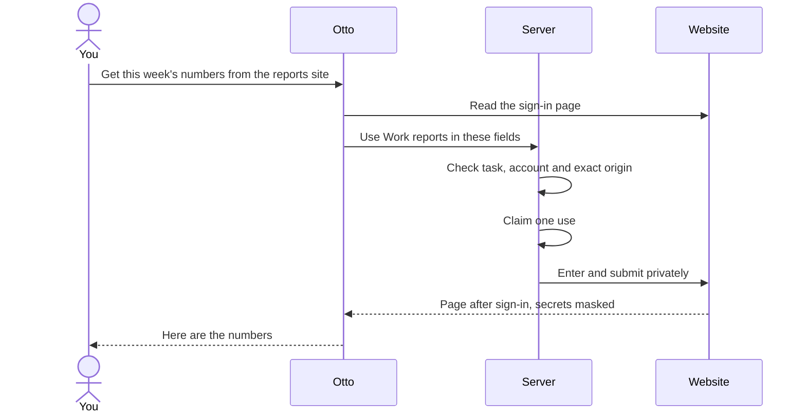
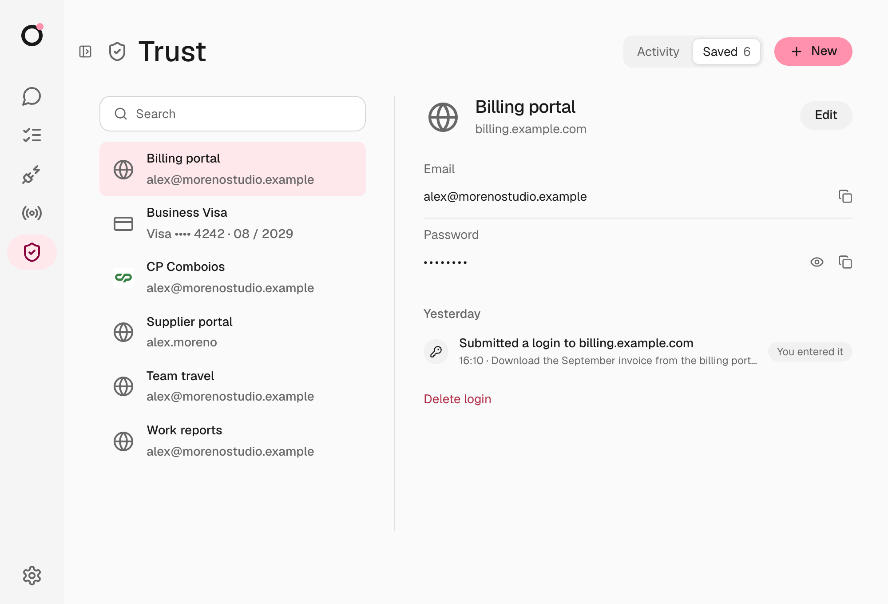

import { Steps } from '@astrojs/starlight/components';

Vault keeps your website logins and cards, under **Trust → Saved**. Otto can sign in with a saved login, but the model never receives the password: the Otto server types it into the website for you.

## Add a login

<Steps>

1. Open **Trust**, select **New**, then **New login**.
2. Enter a **Name** you'll recognize, such as "Work reports", and the **Website domain**.
3. Enter the username or email and the **Password**, then select **Save**.

</Steps>

**Import from a password manager.** Select **New → Import passwords** and choose a CSV exported from Chrome, 1Password or another password manager. Otto imports the website logins and skips archived items. Passkeys, cookies and other items aren't imported. Delete the exported file afterwards, because it isn't encrypted.

**Add one during a task.** When a task needs a login you haven't saved, Otto opens a private **Sign in** form. Enter the details and select **Save and continue**. The values never pass through chat or the model.

A private form stays open while its task waits for you. It closes once it's used, when Otto asks for a newer one, when Otto starts on a newer message in the same conversation, or when you select **Stop**. A scheduled run or background task has its own session, so chatting with Otto never closes its form.

## How sign-in works

Otto picks the account, the fields and the submit button. The server enters and submits in one private step that Otto can't watch, then Otto carries on with the live page.

| Item               | What the model receives                                                                |
| ------------------ | -------------------------------------------------------------------------------------- |
| Saved login        | Its name, its website and the first two characters of the username                     |
| Saved card         | Its name, brand, last four digits and expiry                                           |
| Password or code   | Only whether the private step finished                                                 |
| Page after sign-in | The live page, with the password and codes removed from text and masked in screenshots |

## Exact website origins

A login works only on its exact origin: the protocol, host and port. The browser checks the real origin of each field, including fields inside frames, so a lookalike page can't receive your password. For a login saved for `https://reports.example.com`:

| Page                                 | Can use the login?           |
| ------------------------------------ | ---------------------------- |
| `https://reports.example.com/weekly` | Yes, the path doesn't matter |
| `https://login.example.com`          | No, a different host         |
| `http://reports.example.com`         | No, a different protocol     |
| `https://reports.example.com:8443`   | No, a different port         |

## When Otto asks first

- **Which account.** Otto reuses the one saved login that fits. If several could apply and you haven't said which, it asks.
- **Whether to sign in.** The same [checker](/trust/approvals/) that decides app actions checks whether your recent messages need this website. If not, Otto asks, for example "Sign in to reports.example.com?". Mentioning a domain isn't consent.
- **Scheduled runs** are checked against the instruction that created the schedule.
- **Background work** Otto starts itself asks you first, because no words of yours stand behind it.

A yes covers that website and account for the rest of the task. A new task is checked again.

## Verification codes

When a website emails you a code, Otto can fetch it privately from your connected mailbox. The server checks the sender, recipient, time and account before entering it, and the model never sees it. It reads only mail that arrived after Otto entered your sign-in details on that site, or after the task started, allowing 30 seconds for clock differences and going back at most five and a half minutes. It waits up to a minute for the email to arrive. Otherwise, enter the code in the private form, or reply with it in the chat where Otto asked, including Telegram or WhatsApp, in any language, such as `482913` or "mi código es 482913". Otto submits it privately and keeps it out of the chat history. While a code is pending, a message with a code-length number anywhere but at its end is refused, so send the code at the end or by itself. Verification emails Otto reads through your apps come back without their content.

## Private steps from Telegram or WhatsApp

Private forms never open in a chat app. Finish the step in the same conversation in Otto on your desktop, and Otto replies in the original chat. See [Telegram and WhatsApp](/use/channels/).

## Review and change access

**Trust → Activity** lists every sign-in, code, saved-session use, question, held attempt, reveal and permission change, with the task and the reason, next to what Otto did in your apps.

**Trust → Saved** lists your logins, cards and saved sessions. Open one to edit, reveal, copy or delete it. Every reveal is recorded.

## How Vault stores secrets

Saved logins and cards are encrypted with AES-256-GCM. Each value is bound to you, its record and its purpose, so a copied value won't open anywhere else. The key is kept outside the database.

Vault fails closed. Otto checks the key against your existing data before it uses or writes anything, and a wrong or missing key stops Vault without overwriting anything. A login the key can't open shows **Can't be opened** and can still be deleted.

Where the key lives

| Where Otto runs      | Key                                                                                    |
| -------------------- | -------------------------------------------------------------------------------------- |
| Desktop app          | Generated by the app, protected by the system's safe storage                           |
| From source on macOS | The macOS Keychain, or `OTTO_VAULT_KEY` if you set it                                  |
| From source on Linux | A private file at `OTTO_DATA_ROOT/vault/master-key`, or `OTTO_VAULT_KEY` if you set it |
| Hosted               | Derived for each user from the operator's master key                                   |

:::caution[Back up OTTO_VAULT_KEY]
If you set the key yourself, keep a copy somewhere safe. Saved logins can't be read without it.
:::

## Where this is enforced

[`src/server/vault-access.ts`](https://github.com/n8n-io/otto/blob/main/src/server/vault-access.ts) (permission and activity) · [`src/server/vault-use.ts`](https://github.com/n8n-io/otto/blob/main/src/server/vault-use.ts) (one use) · [`src/server/vault-crypto.ts`](https://github.com/n8n-io/otto/blob/main/src/server/vault-crypto.ts) (encryption) · [`src/providers/agent-browser`](https://github.com/n8n-io/otto/tree/main/src/providers/agent-browser) (origin checks and private entry)

## Related resources

- [Trust and Vault](/trust/)
- [Saved browser sessions](/trust/browser-sessions/)
- [Payments](/trust/payments/)
- [One use, one result](/trust/outcomes/)
- [Security model and limits](/trust/security-model/)
