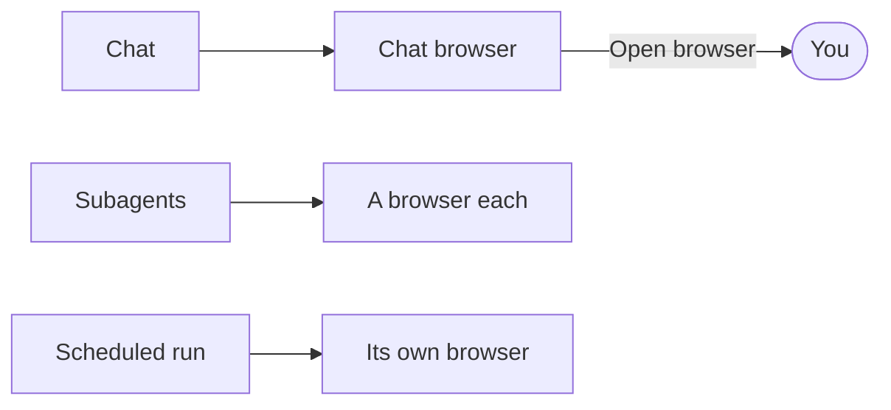

import { CardGrid, LinkCard, Steps } from '@astrojs/starlight/components';

Otto has its own browser, so it can use websites the way you would.

The browser runs on Otto's computer, separate from your own browser. It doesn't share your tabs, cookies or saved passwords.

## What Otto can do

- Open pages, click, type, fill forms and pick options.
- Read the page and look at screenshots, including canvas and visual controls.
- Run JavaScript on the page.
- Download files and upload files from its [workspace](/use/workspace/).
- Sign in with logins you saved in [Vault](/trust/vault/), without seeing the password.

Steps on the way to what you asked for just run, such as a cookie banner, adding to a basket or choosing delivery, unless you asked Otto to check with you first. Before a step that could send, submit, pay or change something you didn't ask for, Otto asks you. Paying with a card saved in Otto always needs your approval. See [Browser steps](/trust/approvals/#browser-steps) and [Payments](/trust/payments/).

## Take over the browser

When Otto needs you on a page, it asks in chat with an **Open browser** link.

<Steps>

1. Open Otto on the desktop or the web. The live page appears under Otto's message.
2. Click, type and scroll on the page. Use **Back** and **Reload** if you need them, or **Enlarge browser** for a bigger view.
3. When you're finished, select **Done**. Otto looks at the page to see what you did and carries on. Done doesn't post a message for you.

</Steps>

Otto doesn't watch or act while you have the browser. If you started on Telegram or WhatsApp, open Otto to take over, because chat apps can't show the page.

Pointer input follows the page’s zoom level in both the chat and enlarged views and keeps working while the next frame loads.

Changing the view or selecting **Done** waits for pending input to reach the browser. If input fails, Otto shows an error and doesn't repeat it. Check the page before trying again.

## CAPTCHAs and human checks

Otto tries a challenge first. It reads the instructions, looks at fresh screenshots and makes up to three informed attempts. It stops at a block, rate limit or lockout. Then it hands the browser to you and says what it tried.

:::caution
Solving a challenge is up to the model. Some challenges block automated browsers, and Otto won't always succeed.
:::

## Passkeys and sign-in on another device

- **Passkeys.** Your passkeys live on your own devices, so Otto's browser can't use them. A passkey request there fails right away instead of opening a prompt you can't see. Use another sign-in method, such as a password saved in Vault.
- **Approval on your phone.** When a site asks you to approve on another device, Otto tells you what the page says. Then it checks the page every 15 seconds, up to eight times, and continues once the page confirms. It stops if the request is denied or expires, and asks you if the result stays unclear.

## A browser for each job

The chat, every scheduled or background run and every subagent have their own browser. Each opens one only when it needs it.

When you ask for several independent things, such as prices from three shops, Otto can split the work between subagents that browse at the same time, then combine what they found.

The chat or a background task can hand its browser to you. Each view belongs to that specific question. **Done** continues that task. Subagents return blockers to the parent. Other browsers are deleted when their work ends.

Up to four browsers run at once. Other work waits when all four are busy. Otto never closes a browser used in the last five minutes for another job. One idle for longer can be closed, even in the middle of a task, but one waiting for you stays open for 30 minutes.

## Downloads

Otto downloads files into its workspace, up to 90 MB each, and uploads workspace files of the same size. In a conversation it also sends them to you, when your chat app takes files of that size. Downloads from background work stay private until Otto shares them.

## Sign in to websites

<CardGrid>
  <LinkCard
    title="Vault and saved logins"
    href="/trust/vault/"
    description="Save a login once. Otto signs in without seeing it."
  />
  <LinkCard
    title="Saved browser sessions"
    href="/trust/browser-sessions/"
    description="Reuse a signed-in browser on websites you allow."
  />
</CardGrid>

After you sign in by hand, Otto may offer **Save login in Vault** for next time.

## Related resources

- [Chat with Otto](/use/chat/)
- [Workspace and files](/use/workspace/)
- [Payments](/trust/payments/)
- [Sandbox and browser](/how-it-works/sandbox-and-browser/)
