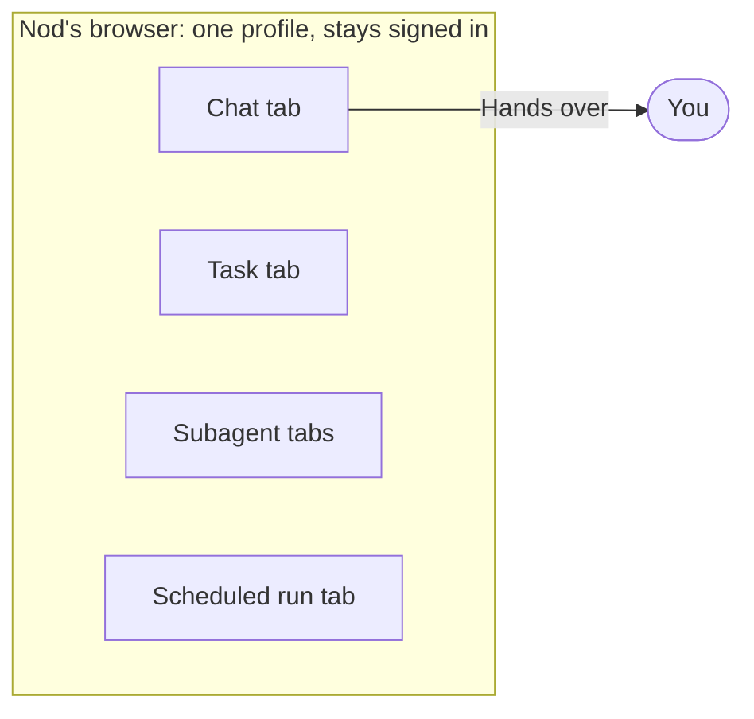

import { CardGrid, LinkCard, Steps } from '@astrojs/starlight/components';

Nod has its own browser, so it can use websites the way you would.

The browser runs on Nod's computer, separate from your own browser. It doesn't share your tabs, cookies or saved passwords.

## What Nod can do

- Open pages, click, type, fill forms and pick options.
- Read the page and look at screenshots, including canvas and visual controls.
- Run JavaScript on the page.
- Download files and upload files from its [workspace](/use/workspace/).
- Sign in with logins you saved in [Vault](/trust/vault/), without seeing the password.

Steps on the way to what you asked for just run, such as a cookie banner, adding to a basket or choosing delivery, unless you asked Nod to check with you first. Before a step that could send, submit, pay or change something you didn't ask for, Nod asks you. Paying with a card saved in Nod always needs your approval. See [Browser steps](/trust/approvals/#browser-steps) and [Payments](/trust/payments/).

## Take over the browser

When Nod needs you on a page, it pauses the task and opens its live browser in chat.

<Steps>

1. Open Nod on the desktop or the web. The live page appears in a **Browser** panel under Nod's message, and the chat scrolls to it. The panel says **You have control** when it is ready.
2. Click, type and scroll on the page. Use **Back** and **Reload** if you need them, or **Enlarge browser** for a bigger view.
3. When you're finished, select **Return to Nod**. Nod looks at the page to see what you did and carries on. Returning control does not post a message for you.

</Steps>

Select text in the **Browser** panel, then press `Command+C` on macOS or `Ctrl+C` on Windows or Linux to copy it to your computer's clipboard.

A task that is waiting for you in its browser shows **Open browser** on its card. If you can't find the panel, ask Nod in chat. A reply to the task closes the panel, and the task continues from what you wrote.

Nod doesn't watch or act while you have the browser. If you started on Telegram or WhatsApp, open Nod to take over, because chat apps can't show the page.

If the view disconnects, Nod keeps the task waiting. Select **Reconnect view** to try again. The tab stays open while the task waits. Reconnecting does not repeat your last input.

Pointer input follows the page’s zoom level in both the chat and enlarged views and keeps working while the next frame loads.

Changing the view or selecting **Return to Nod** waits for pending input to reach the browser. If input fails, Nod shows an error and doesn't repeat it. Check the page before trying again.

## CAPTCHAs and human checks

Nod tries a challenge first. It reads the instructions, looks at fresh screenshots and makes up to three informed attempts. It stops at a block, rate limit or lockout. Then it hands the browser to you and says what it tried.

:::caution
Solving a challenge is up to the model. Some challenges block automated browsers, and Nod won't always succeed.
:::

## Passkeys and sign-in on another device

- **Passkeys.** Your passkeys live on your own devices, so Nod's browser can't use them. A passkey request there fails right away instead of opening a prompt you can't see. Use another sign-in method, such as a password saved in Vault.
- **Approval on your phone.** When a site asks you to approve on another device, Nod tells you what the page says. Then it checks the page every 15 seconds, up to eight times, and continues once the page confirms. It stops if the request is denied or expires, and asks you if the result stays unclear.

## One browser, a tab for each job

Nod has one browser that remembers your sign-ins, like your own. The chat, each task, each scheduled or background run and each subagent get their own tab. Each opens one only when it needs it.

When you ask for several independent things, such as prices from three shops, Nod can split the work between subagents that browse at the same time, then combine what they found.

The chat or a background task can hand its tab to you. Each view belongs to that specific question. **Return to Nod** continues that task in its original channel. Subagents return blockers to the parent.

A tab stays open while its job runs, even while it waits for you. Popups and new tabs that a website opens belong to the same job, and Nod follows them. They all close when the job ends. The browser keeps your sign-ins and carts, so a later task on the same website doesn't sign in again. Jobs that run at the same time on one website share its cart. If the browser or Nod restarts, each job's tab opens again where it was on its next step, unless its last action had an unclear result.

## Downloads

Nod downloads files into its workspace, up to 90 MB each, and uploads workspace files of the same size. In a conversation it also sends them to you, when your chat app takes files of that size. Downloads from background work stay private until Nod shares them.

## Sign in to websites

<CardGrid>
  <LinkCard
    title="Vault and saved logins"
    href="/trust/vault/"
    description="Save a login once. Nod signs in without seeing it."
  />
</CardGrid>

When you sign in once, in a private form or by taking over the browser, Nod's browser stays signed in for later tasks. After you sign in by hand, Nod may offer **Save login in Vault** for next time.

## Related resources

- [Chat with Nod](/use/chat/)
- [Workspace and files](/use/workspace/)
- [Payments](/trust/payments/)
- [Sandbox and browser](/how-it-works/sandbox-and-browser/)
