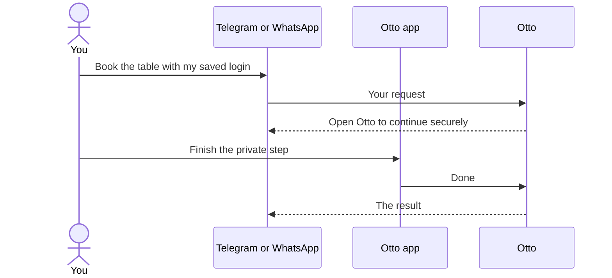

import { Steps, TabItem, Tabs } from '@astrojs/starlight/components';

You can chat with Otto from Telegram or WhatsApp. It's the same conversation, memory and tasks as in the Otto app.

Otto replies in the app you wrote from. A message from Telegram gets its answer on Telegram, and a schedule you set up there sends its results there too. Everything also shows in the chat in the Otto app.

## Before you start

|                      | Telegram                                  | WhatsApp                                                     |
| -------------------- | ----------------------------------------- | ------------------------------------------------------------ |
| You need             | A Telegram bot, made with BotFather       | A Meta app with the WhatsApp Cloud API and a business number |
| Works on a laptop    | Yes. Otto checks for new messages itself. | Needs a public HTTPS address that reaches Otto               |
| Who can message Otto | Only the Telegram account you pair        | Only the number you enter                                    |
| Files from Otto      | Sent as documents                         | Not sent. Open Otto to get them.                             |
| A task's document    | A PDF that replies to the task's result   | Not sent. Open Otto to read it.                              |
| Task buttons         | **Yes**, **No** and **Stop task**         | **Yes** and **No**                                           |
| When Otto can write  | Any time                                  | Only within 24 hours of your last message                    |

Otto reads the text of your messages. To give Otto a file, attach it in the Otto app.

On WhatsApp, a message Otto can't send because your last message is more than 24 hours old, such as a task's late result, shows only in the Otto app.

## Set up a channel

Open **Channels** in the sidebar, then select **Connect** on Telegram or WhatsApp. Otto checks your details before it saves them, and keeps them encrypted, outside the chat.

<Tabs syncKey="channel">
<TabItem label="Telegram">

<Steps>

1. In Telegram, open [BotFather](https://t.me/BotFather) and send `/newbot`. Choose a name and a username.
2. Paste BotFather's reply, or just the token, into **BotFather message or token**. Select **Connect bot**.
3. Scan the code or select **Open Telegram**, then press **Start**. The link works for 15 minutes.
4. Check that the name shown is yours, then select **Confirm**. Only this account can message Otto.
5. Select **Start conversation** and say hello. Otto must be running to reply.

</Steps>

If the link doesn't work for you, select **Enter your user ID instead** and use the ID that [@userinfobot](https://t.me/userinfobot) sends you.

</TabItem>
<TabItem label="WhatsApp">

<Steps>

1. In **Before you begin**, check that you have a Meta app with WhatsApp, a business sender number and a public HTTPS callback. Confirm the WhatsApp terms.
2. In **Choose the numbers**, enter the **Business phone number ID** from Meta and **Your WhatsApp number**, as digits without `+`.
3. In **Verify your business app**, paste the **Business access token** and **Meta app secret**.
4. In **Set up message delivery**, enter the **Public HTTPS callback** and choose a **Webhook verification token**. Select **Verify and save**.
5. In Meta, enter the same callback URL and token, then subscribe the app to messages.

</Steps>

This connects a business number, not your personal WhatsApp inbox.

:::caution[Keep Otto private]
Expose only the `/api/webhooks/whatsapp` route to the internet, never the rest of Otto. The desktop app doesn't provide a public address, so WhatsApp suits Otto running on a server.
:::

</TabItem>
</Tabs>

Configure channels in .env instead

When you run Otto from source, you can set the `TELEGRAM_*` and `WHATSAPP_*` values listed in `.env.example` and restart. The **Channels** page is easier, because it checks your details and pairs your account.

If you register the Telegram webhook yourself, allow `message` and `callback_query` updates. Without `callback_query`, Otto never hears the buttons you press.

## Private steps happen in the Otto app

Passwords, saved logins and payment approvals never go through a chat app. When a task started on Telegram or WhatsApp needs one, Otto asks you to open Otto. Finish the step there, and the task carries on and replies in the chat app.

If a website sends you a one-time sign-in code, you can reply with it in the chat where Otto asked. Otto uses it for that sign-in and keeps it out of its chat history. When more than one sign-in waits for a code, reply to the message that asked for it. Card security codes work only in the Otto app. See [Vault](/trust/vault/) and [Payments](/trust/payments/).

Taking over [Otto's browser](/use/browser/) also needs the Otto app, because chat apps can't show the page.

## Replies

Replies work as they do in the Otto app. To reply to a message, swipe it or select **Reply** in Telegram or WhatsApp.

- **Otto's replies.** Otto's "On it" message for a [task](/use/tasks/) replies to your request. The task's questions, check-ins and result reply to "On it", so each task stays in one thread of quotes.
- **Your replies.** A reply to any message of a task goes to that task, also after it finished. A yes or no that replies to a question answers that question. A reply to any other message, or a message that isn't a reply, goes to the chat.
- **Tasks.** In Telegram, a task's "On it" message shows its title, status, current step and steps done, and Otto changes it as the task works. A changed message doesn't notify you. WhatsApp can't change a message it sent, so there the task's card shows only in the Otto app. A "stop" reply asks the task to stop at its next step. See [Tasks in Telegram and WhatsApp](/use/tasks/#tasks-in-telegram-and-whatsapp).
- **Replies Otto can't match.** A reply to a message Otto can't find in the current conversation, such as one from before a reset, arrives as an ordinary message.

If the chat app refuses the reply link, Otto sends the message without it. If Telegram asks Otto to slow down, Otto waits as long as Telegram asks and sends the message again, keeping its messages to you in order. Otto never sends a message twice when it can't tell whether the first one arrived.

## Documents from tasks

When a [task](/use/tasks/)'s result is a document, such as a report, Telegram gets the result first and then the document as a PDF that replies to it. A PDF document arrives as it is. Other files of the result also reply to it.

- **How Otto makes the PDF.** Otto's server turns the task's Markdown file into a plain PDF: headings, paragraphs, lists, quotes, tables and code. It doesn't fetch the pictures or pages the document links to. A picture shows as its description, and a link shows its address after the text.
- **When you get the Markdown file instead.** A document arrives as the Markdown file when it has letters the PDF can't show, such as Cyrillic, Greek or Chinese, when it's larger than about 200 KB, or when Otto can't turn it into a PDF within a few seconds. It also does when the PDFs would make the files too large to send.
- **If the send fails.** When the result arrives but the document doesn't, Otto doesn't send either of them again. Open the task in Otto to get the document.
- **On WhatsApp.** Otto sends no files and no links to them. The result ends with a note that its file is in Otto.

## Buttons

A task's confirmation has **Yes** and **No** buttons in Telegram and WhatsApp. In Telegram, "On it" also has **Stop task** while the task is open. You can still reply instead.

- **Yes** or **No** answers that one confirmation and nothing else, as the buttons in the Otto app do. The task carries on and replies where it started.
- **Stop task** stops that task at once. The chat and your other tasks keep running.
- Only the account or number you paired can press a button, in your own chat with Otto. Otto ignores presses from anyone else, and from groups.
- A press on a question that was already answered, closed or expired runs nothing. Telegram shows a short note on the button. WhatsApp gets a short reply.
- Payment approvals never get buttons in a chat app. Approve them in the Otto app.
- In Telegram, Otto removes the buttons once the question is answered or the task ends. WhatsApp keeps them, but a late press runs nothing.

When Otto starts, it registers its Telegram webhook again, so a bot you connected before buttons existed also gets your presses.

## Commands

These commands answer straight away, without using the model or costing anything.

| Send      | To get                                                       |
| --------- | ------------------------------------------------------------ |
| `/usage`  | This month's spending and app actions, with a PDF statement  |
| `/memory` | A short summary of what Otto remembers, with the full export |

Telegram receives the PDF and the export as documents. On WhatsApp, open Otto to get them.

## Related resources

- [Chat with Otto](/use/chat/)
- [Spending and usage](/use/spending/)
- [Memory](/use/memory/)
- [Vault and saved logins](/trust/vault/)
- [Your data and privacy](/trust/privacy/)
