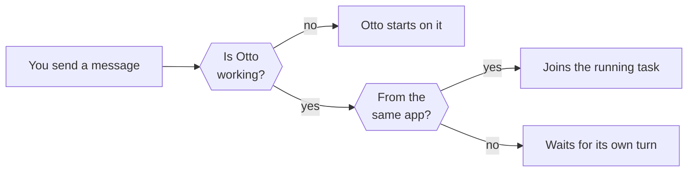

Chat is where you give Otto work, answer its questions and get the results.

Otto keeps one ongoing conversation with you. The desktop app, the web app, Telegram and WhatsApp all add to that same conversation, so Otto remembers what you said in any of them.

## Send a message

Type in the message box and press Enter. Press Shift+Enter for a new line.

- **Attach files.** Select **Attach files**, paste an image or drop files on the box. Each file can be 90 MB or smaller. Otto gets a copy in its [workspace](/use/workspace/). It sees PNG, JPEG and WebP images directly, up to 3.75 MB each and 16 MB per message, unless the model you chose can't read images.
- **Reply to a message.** Hover over a message and select **Reply** to point Otto at it.

## Keep talking while Otto works

You don't have to wait. The message box stays open while Otto works.

A follow-up, such as "also check Friday" or a screenshot of an error, joins the task that's running. Otto reads it before its next step. A message from another app waits in line and runs as its own request.

## Answer Otto's questions

When Otto needs a decision, an approval or your help in its browser, it asks and stops. Your next message is the answer, and Otto continues from there. For actions that need a yes or no, see [Approvals](/trust/approvals/).

Otto doesn't ask for passwords or card numbers in chat. It uses a saved login or a private form instead. See [Vault](/trust/vault/).

## Stop Otto

To stop Otto, select **Stop** next to the send button.

Stop ends the work that's running, including background runs, and cancels queued messages and open questions. It doesn't cancel your schedules. It can't undo something that already happened, such as an email that was already sent.

Otto never repeats a task on its own. If a task fails or Otto restarts in the middle of one, it tells you. Check what happened, then say "continue" if you want it to carry on.

## Choose the model

The model picker above the message box shows the model Otto uses. Select it to choose another model from your connected providers. See [Models](/connect/models/).

## See what a reply cost

Hover over Otto's final reply, or move keyboard focus to it, to see the time and the estimated model cost of that request. **Price unavailable** means part of the usage has no price, for example on a ChatGPT plan. See [Spending and usage](/use/spending/).

## Replies go back where you wrote

Otto answers each request in the app you sent it from. A message from Telegram gets its reply on Telegram. Everything also appears in the chat in Otto's own app. See [Telegram and WhatsApp](/use/channels/).

## Send feedback

Select **Send feedback** at the top of the chat, choose **Bug or issue**, **Idea** or **Other**, and describe what happened. Feedback goes to the Otto team at n8n.

By default it includes a diagnostic report of your recent chat, actions and their results. Select **Review** to see the report, or clear **Include diagnostic report** before you send.

## Start with an empty chat

Otto has no button for a new conversation in normal use. When you run Otto from source in development mode (`pnpm dev`), **Clear messages** at the top of the chat starts an empty chat and stops its running tasks.

| Starts fresh                                | Stays                                             |
| ------------------------------------------- | ------------------------------------------------- |
| The chat you see and Otto's working context | Your earlier messages, stored but no longer shown |
| The workspace folder                        | Memory, connected apps and Vault                  |
| The browser, with its temporary downloads   | Saved browser sessions                            |
| Running and queued work, which is cancelled | Tasks and schedules                               |

## Related resources

- [Track tasks](/use/tasks/)
- [Schedules and background work](/use/schedules/)
- [Workspace and files](/use/workspace/)
- [Telegram and WhatsApp](/use/channels/)
- [Approvals and the trust check](/trust/approvals/)
