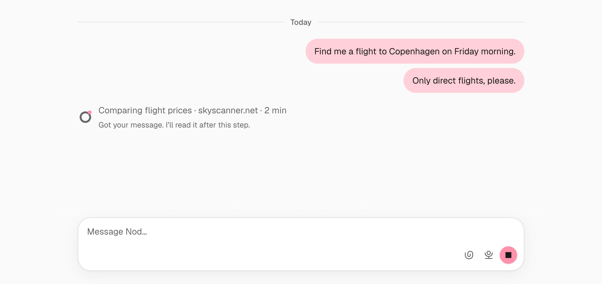

Chat is where you give Nod work, answer its questions and get the results.

Nod keeps one ongoing conversation with you. The desktop app, the web app, Telegram and WhatsApp all add to that same conversation, so Nod remembers what you said in any of them.

Nod follows your latest clear message's language, spoken or typed, including questions, confirmations and connection instructions. An explicit language request takes precedence. Only your own messages set it, never your email or other data, and before you've written anything, such as at the start of setup, Nod writes in English. Asking for an email or document in a different language applies to that output; a neutral acknowledgement such as "OK" keeps the preceding language. What Nod reads on websites, in email and in documents comes back translated. It keeps the original wording only in quotes, such as a menu or button name you need to find, with a short translation when the meaning isn't clear. Voice, region, date format and time zone are separate preferences.

## Send a message

Type in the message box and press Enter. Press Shift+Enter for a new line.

Pasted text stays literal. Nod uses the clipboard's plain text even when the source also offers formatting. Line breaks, indentation and Markdown-looking characters such as `*priority*`, `# call` and `<u>text</u>` stay as written in the composer, the sent message and Nod's request. An unsent pasted draft keeps them after a reload.

Messages can contain up to 100,000 characters. Some emoji and symbols count as two characters toward this limit. If your text is longer, the composer keeps your draft and asks you to shorten it or attach the content as a file.

Web and desktop chat limit text message attempts to 120 per minute and audio message attempts to 120 per minute. If you reach either limit, wait and send again.

Use the formatting toolbar when you want formatted text, including underline. Code stays literal, including text that looks like a link or a code fence.

- **Attach files.** Select **Attach files**, press Command+U on Mac or Ctrl+U on Windows and Linux while writing a message, paste an image or drop files anywhere in the conversation. Each file stays inside the composer while it uploads. Select it to open the same file viewer used for sent attachments, or retry or remove a failed upload. Each file can be 90 MB or smaller. Nod gets a copy in its [workspace](/use/workspace/). It sees PNG, JPEG and WebP images directly, up to 3.75 MB each and 16 MB per message, unless the model you chose can't read images.
- **Reply to a message.** Hover over a message and select **Reply**. On touch screens or in a narrow chat, hold or right-click the bubble to open **Reply**, **React** and **Copy**. You can also focus a message and press Shift+F10. Replies show a formatted excerpt in the composer and sent reply. Select it to jump to the original message, then select **Return to where you were** to go back. To see the time inside the bottom-right corner of a bubble, hover over the message, focus one of its controls, or tap its text.

Your unfinished draft stays on this device for your account and conversation. After a reload, Nod restores its text, reply target, and available uploaded files. It checks saved files before you can send them. If a check fails, select **Retry** or remove the file. An interrupted upload needs the original file again. Private entry values and recognized verification replies are excluded. A file that exceeds the limit is rejected individually; other valid files stay attached. Removing an uploaded draft file offers **Undo**.

Unsent files become eligible for cleanup 24 hours after upload or their last successful renewal. Existing unsent uploads get a fresh 24-hour grace period on the first upgrade that adds cleanup. Keeping the draft open renews its files every five minutes. Returning to the app or restoring a draft checks and renews them again. Removed files stop renewing. You can still renew or send a file until cleanup starts deleting it. After that, attach it again from your device. Sent attachments and files Nod publishes are kept.

Select a passage in a message, then **Reply to selection** to quote it. Selected passages keep their exact text, including literal symbols, and stay separate from your own message. Select a reply quote to visit its source. **Return to where you were** restores your reading position. Copy controls on code blocks and tables copy only that block. Table content pastes into spreadsheet cells. Message Copy includes formatted text where the clipboard supports it. **Copy Markdown** copies the source text.

Select **Search chat** to search stored messages in the current conversation. Search shows up to 50 recent matches, with the sender, date and highlighted text. Use the arrow keys to move between results and Enter to open a message. Escape closes search and returns focus to the control you used before opening it. Press Command/Ctrl+K outside an editor to open pages, files, and tasks. In the desktop app, Command/Ctrl+F opens conversation search outside an editor.

Nod loads earlier messages automatically as you scroll toward the top and keeps your reading position. Select **Back to latest** above the message box to return to the newest message.

Action confirmation cards show the action status after you answer. [Usage](/use/spending/) shows the recorded action results.

## Send an audio message

Press and hold the microphone beside the send button and allow microphone access. Release to finish recording, then select **Send**. You can also press Command+D on macOS or Ctrl+D elsewhere to start recording, then press it again to stop into preview. The shortcut does not send the message or replace an existing preview. To listen first, select **Preview**. You can discard the recording before sending. Recordings can be up to five minutes long. They stay in this window until you send them and are not restored after a reload.

Recording works without setting up a voice provider. Nod reuses a connected transcription service when available. Otherwise, the first recording starts an automatic download of the local transcription model, about 80 MB, on the computer hosting Nod. You can record and preview while it prepares. Send waits until preparation finishes; **Cancel sending** keeps your recording and caption. If preparation fails, send again to retry. Discarding the recording or leaving chat cancels its preparation request. This does not download reply voices or change your chosen voice.

Right-click the microphone to choose an input. Before you grant browser access, the menu only offers **Allow microphone access**. Device choices appear after access is granted. With the microphone focused, press Shift+F10 or Alt+Down to open the same settings. Nod remembers your choice in this browser. If that microphone is disconnected, Nod uses your system default.

Your message shows the recording and any caption you typed. Nod keeps an internal transcript for private verification and action authorization; the generated transcript is not shown in the message. Models marked **Audio input**, currently **GPT Audio 1.5** through an OpenAI API connection, also receive the actual recording. Text-only models use the transcript. If sending fails, your recording and typed text remain available. A recording that answers a private verification request is handled privately instead of being added to the conversation.

An audio model's **Text support** label shows its companion from the same connection. Requests to the selected model without recordings, including a new text conversation, trust checks and session summaries, use that companion. Background work can still use a smaller model from the same connection. Follow-ups that still include recent recordings use the audio model. Your saved model selection stays unchanged. An audio model is unavailable when its connection has no text companion.

With **Auto**, Nod chooses when a spoken reply helps. Ask it to answer in audio notes to keep a conversation in that format, or ask for text when you prefer reading. Select **Play audio** to listen; replies do not play automatically.

In **Settings → Voice & audio**, open **Voice** to search available voices and compare samples. Set **Spoken replies** to **Auto**, **After audio**, **Always**, or **Off**. Changes apply immediately; a failed save restores the previous choice. Off stops automatic spoken replies, but you can still explicitly request an audio file.

The **Microphone** control uses the same device preference as the chat composer. Select **Allow access** before choosing a device. Nod only requests permission when you select that action. Recording audio messages doesn't require setting up a spoken-reply voice.

**Automatic** uses the first connected speech service in this order: OpenRouter, OpenAI, ElevenLabs, then downloaded free voices. Multilingual voices follow the reply's language. For voices with a specific language, **Automatic** chooses a matching voice from that service. If the language is unclear or unsupported, it keeps the service's default. Select **Automatic** in the voice picker to restore this behavior. This default can change when your connections or provider's voice list change. To keep a particular voice, select it in the picker. Your chat model stays unchanged. Cloud speech uses the provider's credits; a chat subscription alone does not include it.

Native audio keeps the two most recent recording messages available across follow-ups and session compaction. Older recordings remain saved and their transcripts provide conversation context. Each recording is limited to five minutes and 25 MB. Browser recordings are converted to WAV for compatible models; externally uploaded native audio supports WAV, WebM, Ogg and MP3. Audio input uses the selected model's API credits, separately from your chosen spoken-reply voice.

Existing speech connections make their voices available in the picker. Open a provider under **Connections** or **More voices** to manage access. Sign in to OpenRouter for ElevenLabs and Kokoro voices, or connect ElevenLabs or OpenAI with an API key. OpenRouter doesn't need a separate ElevenLabs key. OpenAI speech requires API access, separate from a ChatGPT plan. Connecting a provider returns you to the chooser without selecting a voice for you.

A direct ElevenLabs connection brings in voices saved in your account. Give the key Text to Speech, Speech to Text, and Voices read access. Select **Browse voices** to add or create voices on ElevenLabs, then **Refresh voices** to see them in Nod. Saved keys have a **Disconnect** action. Samples and replies use the selected provider’s credits.

ElevenLabs and OpenAI voices are multilingual: they speak the language of the reply. Kokoro voices have a specific language, shown beside their name. Through OpenRouter, Kokoro offers English, Spanish, French, Hindi, Italian, Japanese, Brazilian Portuguese and Mandarin Chinese. Choose a specific voice to keep it across replies, or **Automatic** to follow the conversation language. Changing a voice doesn't change the language Nod writes in.

Under **Free voices**, select **Download** for a one-time download of about 180 MB, with no account needed. The chooser shows download progress, then preparation. Voices become selectable only when preparation completes. You can cancel your download or retry a failed attempt; your current voice stays selected. Local replies offer English, Spanish, French, Hindi, Italian and Brazilian Portuguese voices. Downloads need an internet connection; downloaded voices run on the computer hosting nod. Choose a local assistant voice to keep both transcription and replies local, including when you have an API connection. Local speech can take longer on slower computers. A ChatGPT or Claude subscription alone does not include those providers' speech APIs.

## See visual answers

When a visual makes an answer easier to understand, nod can include images, maps, flight itineraries and comparisons, seat plans, booking summaries, diagrams, or charts.

Each visual appears as a single preview. Hover over it or focus it with the keyboard to reveal its expand control, which stays visible on touch screens. Select that control to inspect it in the file panel. A self-contained card can be the whole answer. Nod adds text for useful context or caveats instead of announcing the card or repeating its contents. Supplied sources and freshness details remain available inside the card. Nod can capture a page it visits and include the screenshot with its answer; select the image to inspect it in the file panel.

When nod suggests apps to connect, it lists up to three below its message, each with a **Connect** button. Connect starts sign-in right there in the chat, the same as the email step in onboarding. If the app list fails to load, select **Try again** below the message. If catalog access is unavailable, select **Open Apps** to see the available connections. In Telegram and WhatsApp, nod names the apps to connect in [Apps](/connect/apps/) instead.

Location cards pair a numbered overview with a list of places. Select a marker or place, then **Open in Maps** to open its marked location in OpenStreetMap. Select **Map** to load the selected place's street map in chat, or **Overview** to return to relative positions. Maps load only when you choose. With a marker or place focused, use the arrow keys to change selection. A place's **Source** link opens its supplied reference separately.

Flight cards group each journey's date, flight number, route, and times. A different arrival date stays beside the destination. Booked trips keep price and booking reference under **Details**; comparisons can show a price beside the carrier. Details also contain terminals, baggage and source links when available. Connection airports, technical stops, airport changes and self-transfers stay visible. Missing information is never treated as proof of a nonstop flight or a protected connection. An itinerary overview shows the reservation as recorded. Ask for a status or check-in update when you need current information.

Seat plans group the supplied rows by cabin and deck, preserving different layouts, aisles and empty positions. The coverage states whether the source shows the whole aircraft, a cabin or selected rows. Each plan refers to one flight or aircraft configuration. The view is schematic; nod can show the original image when exact geometry matters. Inspecting a seat doesn't reserve it or confirm its availability.

Venue cards can include photos, review summaries with their source rating and review count, and notes such as access or cancellation conditions. Comparisons keep each venue's details together. A proposed booking stays an option until nod has evidence of confirmation.

Charts use bars for comparisons, lines for trends, and pie or donut charts for parts of a whole. Hover, select, or focus a category or point to inspect its values. With a point focused, use the arrow keys to move through the data. A chart request stays focused on its data and any gaps. Ask for a forecast or an explanation of the numbers when you need further analysis.

Telegram and WhatsApp receive the answer and visual details as text, with source links, even when the card has no accompanying message. Locations keep their marked map links. Flights keep their separate journey details and booking references. Telegram and the WhatsApp QR connection also receive image attachments up to 50 MB each. The WhatsApp Cloud API receives PNG and JPEG images up to 5 MB each. If a file cannot be delivered in the channel, the answer points you back to nod to open it. Interactive visuals stay in nod's chat.

## Listen to audio

Audio attachments play directly in chat. Select **Play audio** to listen, then **Pause audio** to pause. Starting another attachment pauses the previous one.

The waveform shows the sound in the file. Click or drag along it to move backward or forward. With the waveform focused, press the Left or Right arrow key to move five seconds.

Select the speed button to cycle through 1×, 1.25×, 1.5×, 2×, and 0.75×. Select **Download** to save the file.

For large files or formats whose waveform your browser can't read, the player shows a seek track instead. Playback remains available if your browser supports the audio format.

## Keep talking while Nod works

The message box stays open while Nod works, so you can send another message at any time. A status line beside the animated Nod mark always shows what's happening:

| The line says                                    | What it means                                                                                                                                                                                 |
| ------------------------------------------------ | --------------------------------------------------------------------------------------------------------------------------------------------------------------------------------------------- |
| A rotating word, such as **Joining the dots…**   | Nod is working but hasn't named a step yet. It appears the moment you send, while Nod prepares your request or for the first minute it waits on your model. Screen readers hear **Working…**. |
| A step, such as "Comparing flight prices"        | What Nod is doing now. A label after it, such as **· skyscanner.net** or **· Running code**, names the app, website, MCP server, local files or kind of work involved.                        |
| **Using Gmail** or **Using Slack**               | A tool is active without a more specific step. Nod names the app, website, MCP server, or local files it is using.                                                                            |
| **Running code** or **Searching the web**        | Nod is running code or a command, reading or writing files, searching or reading the web, using its browser, or working with helpers.                                                         |
| **Waiting for** and your model's name            | Your model has sent nothing for a minute or more. Slow and local models can take minutes.                                                                                                     |
| "Gemini 3.8 Flash failed, trying again (1 of 3)" | Your model returned an error, such as being overloaded, and Nod is sending the same request again. The line moves on when the model answers; if the last try fails, Nod says so.              |
| **· 3 min** at the end                           | Nothing new has happened for that long. Slow models and websites can take minutes; **Stop** ends it.                                                                                          |

The line describes the work instead of showing internal tool names. When Nod hasn't named a step, it names the app, website or kind of work that's active, or the model Nod is waiting for. It never counts seconds or guesses when Nod will finish. When Nod answers, the answer takes its place. It clears when Nod asks you something or stops, and hides while the app reconnects. A failed send clears the line and shows an error. Steps come from Nod's own short descriptions, which appear as soon as Nod starts the tool they describe, and, when your model shares a summary of its reasoning, from that summary's heading, such as "Researching Málaga travel ideas".

The line follows only the work on your messages. A task shows its progress on its own card, so a step never appears twice. While anything works, the message box says **Send another message to Nod…**. While a task works, a small dot pulses just above the top-right corner of the message box. A task that needs your answer shows a slightly larger pink dot with a question mark. Hover over a dot or focus it to see which task it is. Select it to open the task's card with a soft highlight: if the card is already on screen, the chat stays where it is; otherwise the chat scrolls to it.

### Send more while Nod works

When you send a message while Nod works, a second line says **Got your message. I'll read it after this step.** Nod reads it before its next step and answers it. If you send several messages, Nod reads them one at a time so each gets its own answer. If other messages come between your message and the answer, the answer quotes the message it answers.

### When Nod stops

Work ends with an answer, a question, or a short message saying what stopped it. A schedule, or a task Nod started on its own, also tells you by name when it fails. When you only share context, such as a routine, Nod can save it without replying. Nod can send a useful, verified partial result before it finishes; the status line continues while work remains.

In the sidebar, the Chat item shows a moving dot while Nod works and a solid dot when it's waiting for you.

### In Telegram and WhatsApp

- **typing…** shows while Nod works on something you asked for, and stays on during slow steps.
- A message you send while Nod works gets a 👀 reaction until Nod reads it.
- Telegram also shows a quoted progress section when its first message [supports live updates](/use/channels/#while-nod-works). Named steps use your conversation language; fallbacks such as **Using Gmail** or **Running code**, and retry notes, are in English. Telegram doesn't show the **Waiting for** line. A longer request has one short opening message so the progress has a place to update; a saved task uses its start message.
- WhatsApp Business Cloud connections stop typing when the 24-hour reply window closes. QR connections have no such limit.

None of these send a notification. See [Message cadence](/how-it-works/agent-runtime/#message-cadence). A file Nod shares is attached to its next answer, or sent on its own when none follows.

Reply to a task's message to continue that task. A message without a reply target goes to the main chat. If it clearly changes an existing task, Nod sends your message to that task. If the target is unclear, Nod asks which task you mean.

Nod keeps quick answers, simple lookups and status questions in chat. It starts a saved task for substantial work, including multi-step work it can finish in one sitting, such as research across sources, checked comparisons or report creation, and for an outside wait, such as a person, a reply or an action elsewhere, or work you ask it to track. You don't choose an execution mode: Nod starts the task itself. A new independent request while other work runs starts its own task, and each task keeps its goal; send a correction or a related update to the existing task by replying to its message. You can discuss other work while a task runs. Updates may wait for the current step to finish. Different tasks can continue in parallel. See [Track tasks](/use/tasks/).

## Notifications

Choose **Enable notifications** after the first introduction, or turn them on in **Settings → Notifications**. **Not now** dismisses the offer. Nod only asks your browser for permission after you choose to enable notifications. If you block the request, allow notifications in the browser’s site settings before trying again.

If your browser resets or blocks permission, the switch turns off. Once your browser allows requests again, turn on **Notifications** in **Settings → Notifications** to ask for permission. The switch stays off until permission is granted. Dismissing the request leaves it off; you can try again with the same switch. When enabled, **Send test notification** lets you check delivery.

On desktop, enabling notifications sends a confirmation. If it does not appear, allow Nod in your computer’s notification settings and check Focus or Do Not Disturb.

Notifications use Nod's name and icon. In the web app, they announce a new reply without showing its contents. Keep the Nod tab open to receive them while it is in the background. Select a notification to return to its message. Ordinary browser tabs may also show the browser’s name; the operating system controls that attribution.

When you return to Chat with unread replies, a **New messages** divider marks where they begin and Chat opens there. It stays for that visit, even after you reach the latest reply and clear the unread badge. Selecting a notification still opens that specific message. Replies arriving while you are already at the bottom do not add a divider or move you away.

The web choice applies to this account in this browser. Turning it off does not revoke the browser’s site permission. Quiet hours apply to web and desktop notifications.

### Notice new messages on macOS

With desktop notifications enabled, Nod's Dock badge shows how many replies you haven't read, up to **99+**. It stays visible after a banner disappears, while the window is closed, and when you reopen Nod. Read the latest messages in Chat to clear it; opening another screen doesn't clear it.

A new reply briefly bounces the Dock icon while Nod is in the background. Quiet hours suppress banners and bouncing, but keep the unread badge. Turning off desktop notifications clears the badge; turning them on restores unread replies.

macOS controls whether badges appear. In **System Settings > Notifications > Nod**, allow notifications and enable **Badge application icon**.

## Answer Nod's questions

When a task needs a decision, an approval or your help in its browser, it asks and waits. Reply to its question to continue the session that asked. Other tasks can keep working. For actions that need a yes or no, see [Approvals](/trust/approvals/).

For a question with a few useful answers, Nod shows the question as a card with its choices, each marked A, B, C, one line each. Select a choice to send it as a reply to that question, even when a newer question appears below it. When Nod says you can pick one or more, select every choice that fits, add your own in **Type your own answer** if you like, then select **Done** or press Enter.

To answer in your own words, type in **Type your own answer** at the bottom of the card, then press Enter or the send arrow that appears; on a card where you can pick several, press Enter or select **Done**. To attach files or write at length, reply to the question from the message box instead. After your answer is sent, the card keeps only what you chose or wrote, in place of a separate reply. An answer with a file or a voice recording appears as your own message below the question instead. Stopped or replaced questions no longer offer choices. Telegram and WhatsApp show the choices as text, which you can reply to normally.

An action that needs your approval appears as a card with Nod's question and two choices: the action and **Cancel**. An email or message shows the app, the recipients, subject or channel and the text instead, with **Cancel** and the action as buttons below it. Once you answer, the card stays in the conversation, greyed out, with what you chose and what happened. While a sign-in waits for a verification code, a card under Nod's message asks you to send the code by itself in the message box. In Nod web and desktop, a payment that waits for your card's security code shows the same card; the code is the only card detail Nod takes there, and [Approve payment](/trust/payments/) takes it too.

Nod doesn't ask for passwords or card numbers in chat. It uses a saved login or a private form instead. See [Vault](/trust/vault/).

## Stop Nod

While Nod works, the status line under the chat shows its work on your messages, and each task shows its progress on its card and as a dot above the message box.

While the message box is empty, **Stop** appears beside the send button while Nod is working. Select it to stop Nod. The send button stays in place and becomes available when you type a message.

The main Stop control ends active work, cancels queued messages and open questions, and closes all open tasks. To stop only one task, open its preview and select **Stop**. Your schedules stay configured. Stop can't undo something that already happened, such as an email that was already sent.

A request you stop, or one you started whose model request fails at the provider, stays in the chat, but Nod doesn't pick it up again on its own and your words in it no longer allow an action. To continue it, ask again. See [Stop and failures](/how-it-works/threads-and-turns/#stop-and-failures).

You can also tell Nod in the main chat, from any app, for example "stop everything" or "stop the flight search". Nod stops every task, scheduled run and app check, or only the task you name, and tells you what it stopped. Nod reads your message after its current step, or after its current reply if you write from another app. For an immediate stop, use the Stop control, or `/stop` in Telegram.

When a run you started stops on an error or on your spending limit, Nod tells you what failed in the main chat or as a reply to the affected task. For a failed agent model request, Nod shows the provider and model that handled it, the service's specific reason and status, and useful details after removing secrets.

The failure links to **Settings > Models**. You can check the connection or choose another model there. A connection or stream failure also keeps the available cause and request phase. It does not establish whether a provider outage or your network caused the failure. After a known Google daily or zero quota, automatic work on that model pauses on that connection. You can still start a new request yourself. See [Models](/connect/models/) for recovery details.

An explicit Google prepayment credit failure pauses automatic work on that connection. Nod can also end a run after five repeated failures for the same tool. These include invalid input, unavailable tools, and failed sign-in or action review checks. A successful call resets that tool's count. Nod keeps the last specific cause, so you can see what stopped the work. Approval and sign-in checks still apply when you ask again.

If the service reports an oversized tokens-per-minute request, the error keeps its requested and allowed token counts and suggests shortening the conversation or choosing a model with a higher limit. If a daily quota error includes a retry delay, Nod gives you an approximate wait time. For an account or workspace usage cap, wait for the limit to reset or check its settings; a workspace admin may need to raise it. Nod's next turn knows what went wrong.

If Nod restarts during a run you started, that run fails and Nod posts an interruption notice. Nod never repeats failed or interrupted work on its own. Saved tasks and waiting questions survive a restart.

If Nod may have sent or changed something, verify the result yourself or ask Nod to inspect it before continuing. Don't make a new attempt while the result is unclear.

## Choose the model

Open the **Settings** page, then **Models** to choose the model Nod uses from your connected providers. See [Models](/connect/models/).

## Adjust the sidebar

On a wide screen, move your pointer near the sidebar's right edge to reveal its middle button. Select it to expand or collapse the sidebar. You can also Tab to the button; on touch screens, it stays visible. Narrow screens use the navigation menu at the top.

## Desktop shortcuts

In the desktop app, hold Command on a Mac or Ctrl on Windows and Linux to reveal the navigation tooltips. These are the same tooltips shown on hover. Use that key with 1–6 for Chat, Scheduled, Apps, Channels, Usage and Vault, including while the chat message box is focused; B expands or collapses the sidebar, and comma opens Settings. Web browsers keep their own shortcuts.

## React to messages

To react to one of Nod's replies, hover over the bubble and select its reaction icon, or hold or right-click the bubble and choose **React**. Pick a quick reaction, or choose **More emoji** to search and scroll through the full picker. Your reaction appears at the bottom of the bubble without adding another chat message, and Nod can interpret it as a response to that message. A thumbs-up can answer a question. On an action confirmation, 👍 or 👎 confirms or declines the exact action Nod asked about. For other reactions, Nod asks for confirmation before acting outside chat. Select the reaction to remove it from the bubble. Removing or changing it does not undo a response or action already sent.

Nod sometimes reacts to your messages too, such as ✅ when you say yes to something it offered or ❤️ when you thank it. It reacts only now and then, and a reaction never replaces its reply.

## Open links in replies

Links to Nod screens open in the current window. A link to **Settings > Models** opens that Settings tab. Close Settings to return to the screen and control you used before. Browser Back and Forward also work.

| To see or change                          | Open                                      |
| ----------------------------------------- | ----------------------------------------- |
| Your conversation                         | **Chat** in the sidebar                   |
| Scheduled work                            | **Scheduled** in the sidebar              |
| App connections                           | **Apps** in the sidebar                   |
| Telegram and WhatsApp                     | **Channels** in the sidebar               |
| Spending and activity                     | **Usage** in the sidebar                  |
| Saved logins, cards, and browser sessions | **Vault** in the sidebar                  |
| General preferences                       | **Settings** at the bottom of the sidebar |
| Model connections and selection           | **Settings > Models**                     |
| Saved notes and skills                    | **Settings > Memory**                     |

In Telegram and WhatsApp, a screen link opens a public page. Select **Open in Nod** on the computer where Nod is installed. On a phone, use the location on that page to continue in Nod on your computer. The link contains only the screen name. It cannot change settings or approve an action.

You can also ask Nod to change supported settings from any channel. For example, ask it to use a connected model, set quiet hours, change the time zone or clock format, or set a spending limit. Nod uses its tools and reports the saved result. It asks when your request does not identify the target or value. Model sign-in and device settings, such as launch at login, still need the app.

Links stay inline in the reply. Hover over a link, or focus it with the keyboard, to see its full address. Select a link, or press Enter while it is focused, to open its page. In the desktop app, right-click a link and choose **Copy link address** to copy its destination. Nod sends Telegram and WhatsApp replies with link previews turned off.

## Replies go back where you wrote

Nod answers each request in the app you sent it from. A message from Telegram gets its reply on Telegram. Everything also appears in the chat in Nod's own app. See [Telegram and WhatsApp](/use/channels/).

## Send feedback

Select **Send feedback** at the top of the chat, choose **Bug**, **Idea** or **Other**, and describe what happened. The dialog names the recipient: the Nod team at n8n by default, or your server operator's configured collector.

After first-time setup, a short invitation points to **Send feedback**. Dismiss it with its close button or press Escape while the invitation or feedback button is focused; it stays dismissed on that device.

**Include diagnostic report** starts selected for every feedback category until you change it. It adds recent messages, tool inputs and results, errors, and app activity to help fix problems and improve Nod. Known secrets and recognized personal details are masked, but redaction can miss information.

Select **Review** to inspect the **Chat**, **Activity** and **Connections** tabs. Tool activity groups each input with its result and status. **Download** saves the same redacted report as a JSON file. Untick the checkbox to leave it out. Nod remembers your choice for your account on this device, including after sending or discarding a draft.

Preparing a report sends recent app activity and errors to your Nod runtime for redaction and assembly. The feedback recipient receives your submission only after you select **Send feedback**. If preparation fails, select **Continue without report**.

In the desktop app, a new draft includes a screenshot of the Nod window when capture is available. Reopening a draft keeps its original screenshot. Nod skips private screens, embedded browsers, open dialogs, and unsent text or files. You can annotate or remove the screenshot. It is separate from the diagnostic report. Your feedback text and attachments are sent as provided.

If delivery cannot be confirmed, Nod keeps the draft and checks its status for several minutes while the dialog is open. You can also select **Check submission status** or reopen the dialog later. **Send feedback** stays unavailable for that draft until Nod confirms the result, so an uncertain submission is not sent again. If only some attachments arrived, you can retry the missing files on the same feedback issue or finish without them. Discarding a draft removes its local text and files but cannot cancel feedback already received; sending the same feedback again could create a duplicate.

## Related resources

- [Track tasks](/use/tasks/)
- [Schedules and background work](/use/schedules/)
- [Workspace and files](/use/workspace/)
- [Telegram and WhatsApp](/use/channels/)
- [Approvals and the trust check](/trust/approvals/)
