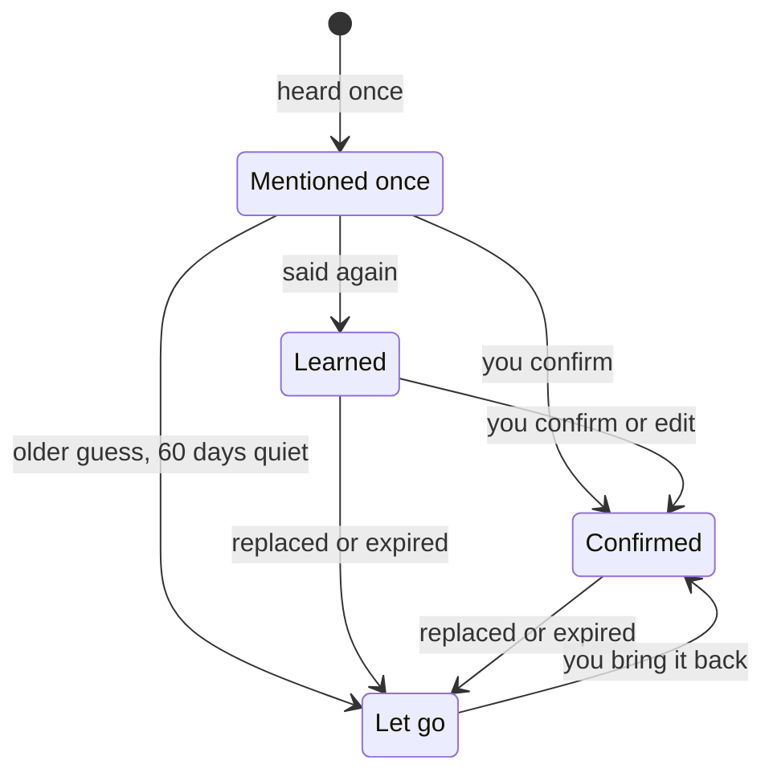
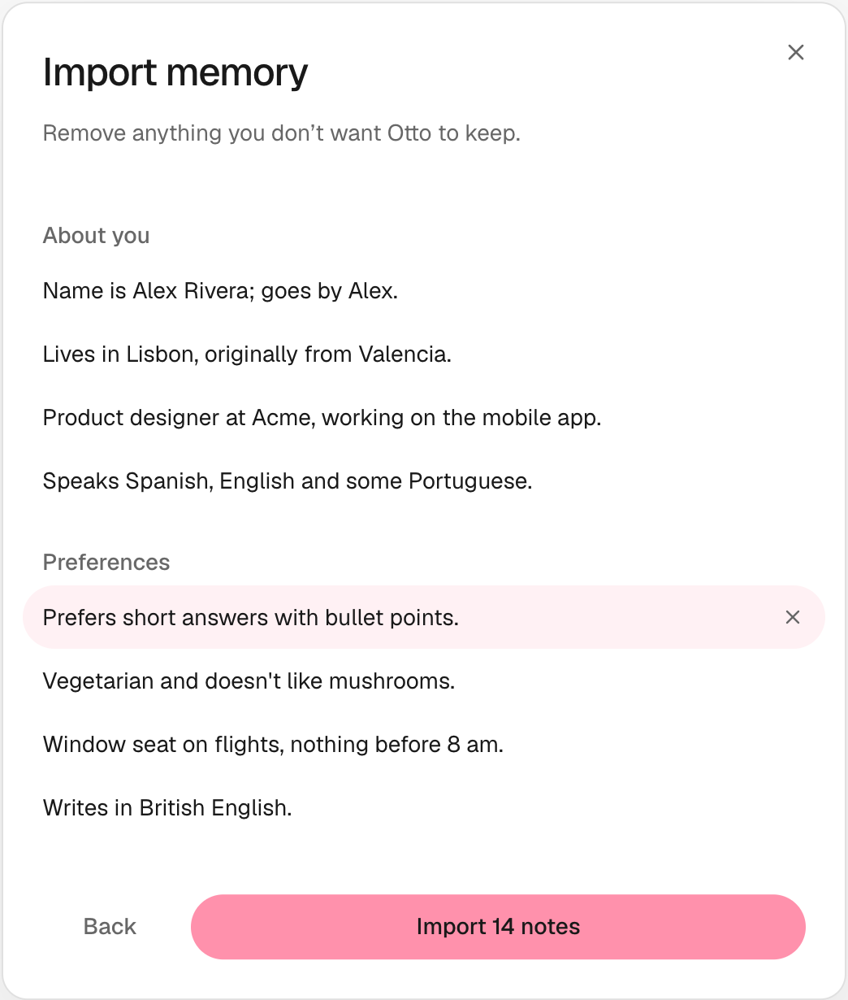

Nod remembers lasting facts and preferences about you, so you don't have to repeat yourself.

You can see everything Nod remembers, where it learned it, and change or forget it in **Settings → Memory**.

## What Nod remembers

| Kind            | For example                                  |
| --------------- | -------------------------------------------- |
| **About you**   | Where you work, your city, your languages    |
| **Preferences** | Window seats, short replies, metric units    |
| **People**      | Who your manager is, your partner's birthday |
| **Routines**    | You review invoices on Mondays               |
| **Lessons**     | Never send invoices from your personal email |

## Where Nod learns from

Notes come only from your own messages and what you write or paste in **Settings → Memory**. Nod never takes a note from its own replies, web pages, emails or tool results. Text from the web gets in only if you paste it yourself, into a short message or **Settings → Memory**.

- **When you tell it.** Say "remember that I'm vegetarian" or state a lasting fact, and Nod saves it as a short note, such as **Diet: vegetarian**. When you ask it to remember something, it tells you briefly what it saved; a fact you mention in passing is saved without a reply about it. It can be something you said a little earlier: "remember that address" saves the address from your last few messages. Each note keeps a reference to its source message, and Nod is told to keep your names and numbers exactly as you wrote them. Messages longer than 4,000 characters can't be saved this way; add a shorter note yourself.
- **In the background.** About once an hour, Nod looks through your recent messages for what you said about your life: people, places, plans, things you bought, events with their dates and what you like. It skips messages with attachments and messages over 4,000 characters.

Background saves and facts you mention in passing are silent: Nod doesn't post a notice in chat. Only an explicit request to remember gets a short confirmation.

## Skills Nod learns

After a task that took several steps or a workaround, Nod writes down how it did it: the steps on that site or app, the gotchas and what to check at the end. The next time the same job comes up, it follows its own skill instead of working it out again. When a site changes, Nod fixes the skill. Nod saves skills only while **Save new notes** is on, and not for a task you ask it not to remember.

Before a skill is saved, the memory model replaces names, addresses, contact details, order or account numbers, amounts and message content with placeholders. It's a model, so it can miss something; every skill is under **Skills** for you to check. Because Nod writes them from what it did and read, a web page can shape a skill. A skill never lets Nod act: sending, paying or deleting still goes through the [trust check](/trust/approvals/).

## How a memory grows

Something Nod picks up from one message is **Mentioned once**: Nod uses it, but as less certain. It becomes **Learned** when a second message repeats it.

Nod selects relevant facts for your current question and searches your earlier messages in the current conversation, so it can answer from the conversation itself, with the date you said it. It can use related concepts to find useful context, so advice can use a preference without the same words. These model steps can make mistakes and count toward usage. After you reset the conversation, the old one isn't searched.

Replaced and expired notes move to **Let go** instead of being deleted. You can also select **Archive note** in a note’s options menu to stop using it while keeping it available to restore. A plan or an older guess without fact details also moves there if Nod learned it automatically from only one message and it was not repeated for 60 days. Completed events and other notes with fact details stay until corrected or expired. When memory reaches its size limit, the oldest notes in **Let go** drop off first. To delete a note right away, select **Forget** or ask Nod to clear its memory.

## Sensitive topics

Nod doesn't learn about health, religion, politics, sexuality, gender identity, ethnicity, immigration status or criminal history unless you ask it to. To let Nod learn them, turn on **Include sensitive details** in **Settings → Memory**.

## Your writing style from Gmail

When you connect Gmail, Nod reads your own text from recent sent emails. If you connect email before choosing a model during setup, this waits until you finish setup with a model connected. Turning off memory saving prevents this learning. It removes quoted, forwarded and automated mail first. It saves only how you write, with no facts, names or quotes, as one **Preferences** note labelled **Learned from your sent email**. A newer version replaces the old one.

## Bring memory from another assistant

1. In **Settings → Memory**, select **Import**, then **Copy prompt**.
2. Paste the prompt into ChatGPT, Claude, Gemini or any other assistant, and copy its answer.
3. Paste the answer into Nod. Nod lists the notes it found under **About you**, **Preferences**, **People** and **Routines**.
4. Remove anything you don't want Nod to keep, then select **Import**.

Each note is saved as written and marked **Confirmed**. Nod skips notes you already have and lines that look like a password, code or card number.

Imported notes are like notes you add yourself: they help Nod understand you and never let it act.

## Review and change memory

Open **Settings → Memory**. The saving and sensitive-details switches sit above your notes. Filter by **All**, **Mentioned once**, **Learned**, **Confirmed**, **Let go** or **Skills**, or search.

Open **Details** on a note or skill to see its updated date and source. **View message** opens a note’s source in the current chat. **Back to Memory** restores the selected note, filters, search and open Details. A source from a reset conversation remains an excerpt instead of a link. Missing messages are marked unavailable. Skills show their original task as text.

Note and skill edits appear in the Settings save review. Save or discard them before selecting another memory item. Saving preserves any further edits you make while the request finishes.

| To                           | Do this                                               |
| ---------------------------- | ----------------------------------------------------- |
| Fix a note                   | Select **Edit**                                       |
| Tell Nod a guess is right    | Open note options, then **Confirm note**              |
| Keep a note only for a while | Open note options, then **Set end date**              |
| Stop using a note for now    | Open note options, then **Archive note**              |
| Remove a note for good       | Open note options, then **Forget note**               |
| Fix or remove a skill        | Open it under **Skills**, then **Edit** or **Forget** |
| Restore an older note        | Open it under **Let go**, then **Bring back**         |
| Add something yourself       | Select **Add note**                                   |
| Bring notes from ChatGPT     | Select **Import**                                     |
| Download everything          | Select **Export** for a Markdown file                 |
| Stop saving new notes        | Turn off **Save new notes**                           |

You can also tell Nod in chat, for example "forget my old address" or "stop remembering things".

## Check memory from Telegram or WhatsApp

Send `/memory` (or `/context`) for a short summary written by your selected model. That model call counts toward usage. Telegram and the WhatsApp QR connection also receive the full export as a document. With the WhatsApp Cloud API, open Nod to get it.

## Memory is context, not permission

:::caution
A note helps Nod understand you. It never lets Nod act. Sending, paying or deleting still goes through the [trust check](/trust/approvals/), whatever memory says.
:::

While editing a note, press Command/Ctrl+Enter to save. Escape keeps unsaved edits open; use **Cancel** to discard them. A failed save keeps the draft available.

## Related resources

- [Chat with Nod](/use/chat/)
- [Telegram and WhatsApp](/use/channels/)
- [Your data and privacy](/trust/privacy/)
- [How memory works](/how-it-works/memory/)
