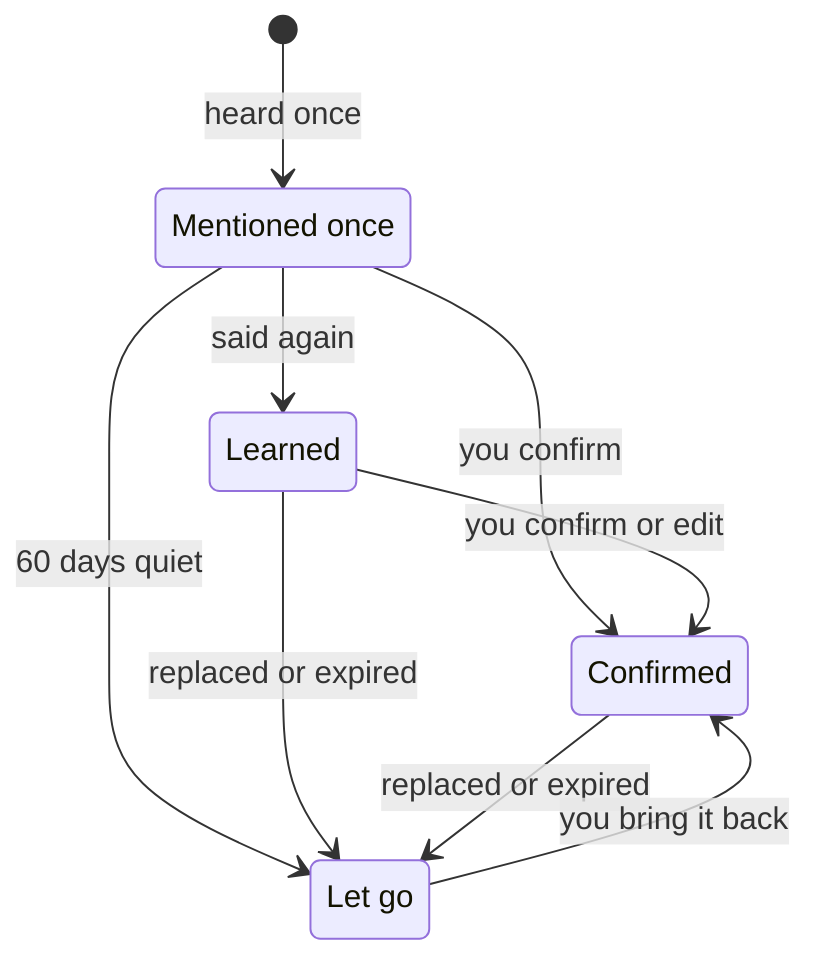

Otto remembers lasting facts and preferences about you, so you don't have to repeat yourself.

You can see everything Otto remembers, where it learned it, and change or forget it in **Settings → Memory** (⌘Y on a Mac, Ctrl+Y elsewhere).

## What Otto remembers

| Kind            | For example                                  |
| --------------- | -------------------------------------------- |
| **About you**   | Where you work, your city, your languages    |
| **Preferences** | Window seats, short replies, metric units    |
| **People**      | Who your manager is, your partner's birthday |
| **Routines**    | You review invoices on Mondays               |
| **Lessons**     | What worked or failed on an earlier task     |

Your profile, with your name, location and phone, sits next to these notes.

## Where Otto learns from

Otto learns only from your own messages. It never learns from its own replies, web pages, emails or tool results. Text from the web gets in only if you paste it into a short message yourself.

- **When you tell it.** Say "remember that I'm vegetarian" or state a lasting fact, and Otto saves it.
- **In the background.** About once an hour, Otto looks through your recent short messages for lasting facts. It skips messages with attachments.

Otto saves silently. It doesn't post a notice in chat.

## How a memory grows

Something Otto picks up from one message is only a guess. It becomes **Learned** when a second message repeats it.

Replaced and expired notes, and guesses not mentioned again for 60 days, move to **Let go** instead of being deleted. **Let go** keeps the latest 40, so older ones drop off over time. To delete a note right away, select **Forget** or ask Otto to clear its memory.

## Sensitive topics

Otto doesn't learn about health, religion, politics, sexuality, gender identity, ethnicity, immigration status or criminal history unless you ask it to. To let Otto learn them, turn on **Remember sensitive topics** in **Settings → Memory**.

## Your writing style from Gmail

When you connect Gmail, Otto reads your own text from recent sent emails. It removes quoted, forwarded and automated mail first. It saves only how you write, with no facts, names or quotes, as one **Preferences** note labelled **Learned from your sent email**. A newer version replaces the old one.

## Review and change memory

Open **Settings → Memory**. Filter by **All**, **Mentioned once**, **Learned**, **Confirmed** or **Let go**, or search. Notes from chat show the messages they came from.

| To                           | Do this                                       |
| ---------------------------- | --------------------------------------------- |
| Fix a note                   | Select **Edit**                               |
| Tell Otto a guess is right   | Select **Confirm**                            |
| Keep a note only for a while | Select **End date**                           |
| Remove a note for good       | Select **Forget**                             |
| Restore an older note        | Open it under **Let go**, then **Bring back** |
| Add something yourself       | Select **Add note**                           |
| Download everything          | Select **Export** for a Markdown file         |
| Stop saving new notes        | Turn off **Save new notes**                   |

You can also tell Otto in chat, for example "forget my old address" or "stop remembering things".

## Check memory from Telegram or WhatsApp

Send `/memory` (or `/context`) to get a short summary. It doesn't use the model or cost anything. Telegram also receives the full export as a document.

## Memory is context, not permission

:::caution
A note helps Otto understand you. It never lets Otto act. Sending, paying or deleting still goes through the [trust check](/trust/approvals/), whatever memory says.
:::

## Related resources

- [Chat with Otto](/use/chat/)
- [Telegram and WhatsApp](/use/channels/)
- [Your data and privacy](/trust/privacy/)
- [How memory works](/how-it-works/memory/)
