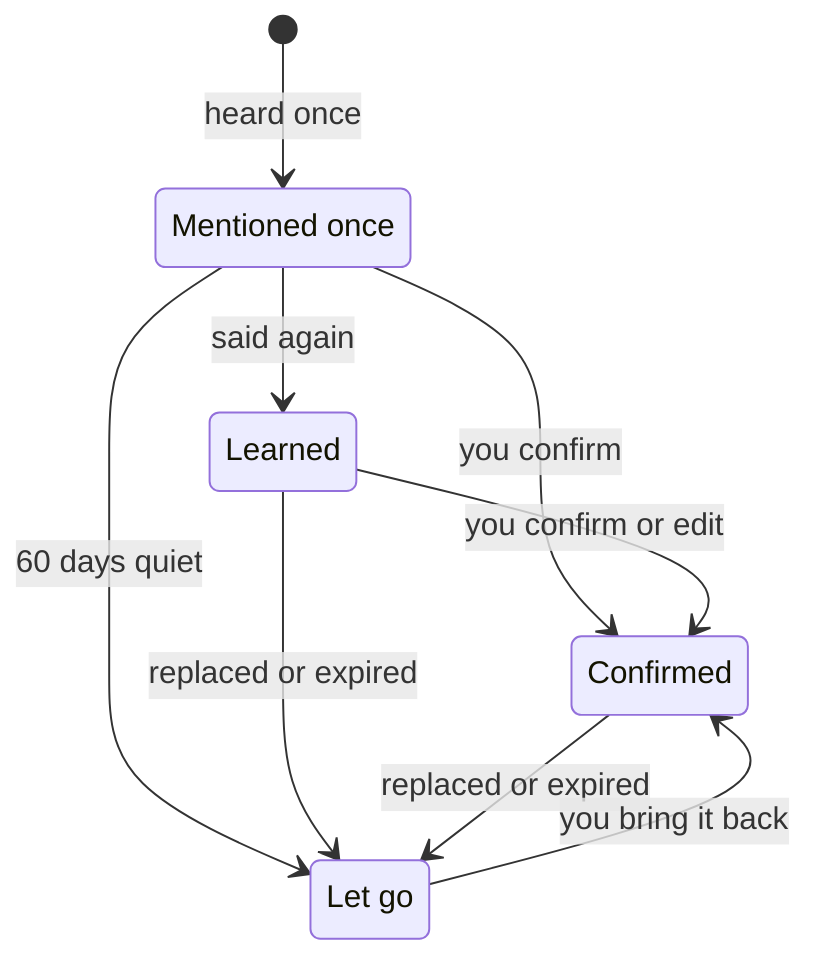

Otto remembers lasting facts and preferences about you, so you don't have to repeat yourself.

You can see everything Otto remembers, where it learned it, and change or forget it in **Settings → Memory** (⌘Y on a Mac, Ctrl+Y elsewhere).

## What Otto remembers

| Kind            | For example                                  |
| --------------- | -------------------------------------------- |
| **About you**   | Where you work, your city, your languages    |
| **Preferences** | Window seats, short replies, metric units    |
| **People**      | Who your manager is, your partner's birthday |
| **Routines**    | You review invoices on Mondays               |
| **Lessons**     | Never send invoices from your personal email |

## Where Otto learns from

Notes come only from your own messages and what you write or paste in **Settings → Memory**. Otto never takes a note from its own replies, web pages, emails or tool results. Text from the web gets in only if you paste it yourself, into a short message or **Settings → Memory**.

- **When you tell it.** Say "remember that I'm vegetarian" or state a lasting fact, and Otto saves it as a short note, such as **Diet: vegetarian**. It can be something you said a little earlier: "remember that address" saves the address from your last few messages. Each note links to the message it came from, and Otto is told to keep your names and numbers exactly as you wrote them. Messages longer than 4,000 characters can't be saved this way; add a shorter note yourself.
- **In the background.** About once an hour, Otto looks through your recent messages for what you said about your life: people, places, plans, things you bought, events with their dates and what you like. It skips messages with attachments and messages over 4,000 characters.

Otto saves silently. It doesn't post a notice in chat.

## Skills Otto learns

After a task that took several steps or a workaround, Otto writes down how it did it: the steps on that site or app, the gotchas and what to check at the end. The next time the same job comes up, it follows its own skill instead of working it out again. When a site changes, Otto fixes the skill. Otto saves skills only while **Save new notes** is on, and not for a task you ask it not to remember.

Before a skill is saved, the memory model replaces names, addresses, contact details, order or account numbers, amounts and message content with placeholders. It's a model, so it can miss something; every skill is under **Skills** for you to check. Because Otto writes them from what it did and read, a web page can shape a skill. A skill never lets Otto act: sending, paying or deleting still goes through the [trust check](/trust/approvals/).

## How a memory grows

Something Otto picks up from one message is **Mentioned once**: Otto uses it, but as less certain. It becomes **Learned** when a second message repeats it.

Otto also searches your earlier messages in the current conversation when you ask about something you told it, so it can answer from the conversation itself, with the date you said it. When you send a message, it also looks up your earlier messages that match it, so a recommendation can use what you told it weeks ago. After you reset the conversation, the old one isn't searched.

Replaced and expired notes, and guesses not mentioned again for 60 days, move to **Let go** instead of being deleted. When memory reaches its size limit, the oldest notes in **Let go** drop off first. To delete a note right away, select **Forget** or ask Otto to clear its memory.

## Sensitive topics

Otto doesn't learn about health, religion, politics, sexuality, gender identity, ethnicity, immigration status or criminal history unless you ask it to. To let Otto learn them, turn on **Remember sensitive topics** in **Settings → Memory**.

## Your writing style from Gmail

When you connect Gmail, Otto reads your own text from recent sent emails. It removes quoted, forwarded and automated mail first. It saves only how you write, with no facts, names or quotes, as one **Preferences** note labelled **Learned from your sent email**. A newer version replaces the old one.

## Bring memory from another assistant

1. In **Settings → Memory**, select **Import**, then **Copy prompt**.
2. Paste the prompt into ChatGPT, Claude, Gemini or any other assistant, and copy its answer.
3. Paste the answer into Otto. Otto lists the notes it found under **About you**, **Preferences**, **People** and **Routines**.
4. Remove anything you don't want Otto to keep, then select **Import**.

Each note is saved as written and marked **Confirmed**. Otto skips notes you already have and lines that look like a password, code or card number.

Imported notes are like notes you add yourself: they help Otto understand you and never let it act.

## Review and change memory

Open **Settings → Memory**. Filter by **All**, **Mentioned once**, **Learned**, **Confirmed**, **Let go** or **Skills**, or search. Notes from chat show the messages they came from, and skills show the task they came from.

| To                           | Do this                                               |
| ---------------------------- | ----------------------------------------------------- |
| Fix a note                   | Select **Edit**                                       |
| Tell Otto a guess is right   | Select **Confirm**                                    |
| Keep a note only for a while | Select **End date**                                   |
| Remove a note for good       | Select **Forget**                                     |
| Fix or remove a skill        | Open it under **Skills**, then **Edit** or **Forget** |
| Restore an older note        | Open it under **Let go**, then **Bring back**         |
| Add something yourself       | Select **Add note**                                   |
| Bring notes from ChatGPT     | Select **Import**                                     |
| Download everything          | Select **Export** for a Markdown file                 |
| Stop saving new notes        | Turn off **Save new notes**                           |

You can also tell Otto in chat, for example "forget my old address" or "stop remembering things".

## Check memory from Telegram or WhatsApp

Send `/memory` (or `/context`) to get a short summary. It doesn't use the model or cost anything. Telegram also receives the full export as a document.

## Memory is context, not permission

:::caution
A note helps Otto understand you. It never lets Otto act. Sending, paying or deleting still goes through the [trust check](/trust/approvals/), whatever memory says.
:::

## Related resources

- [Chat with Otto](/use/chat/)
- [Telegram and WhatsApp](/use/channels/)
- [Your data and privacy](/trust/privacy/)
- [How memory works](/how-it-works/memory/)
