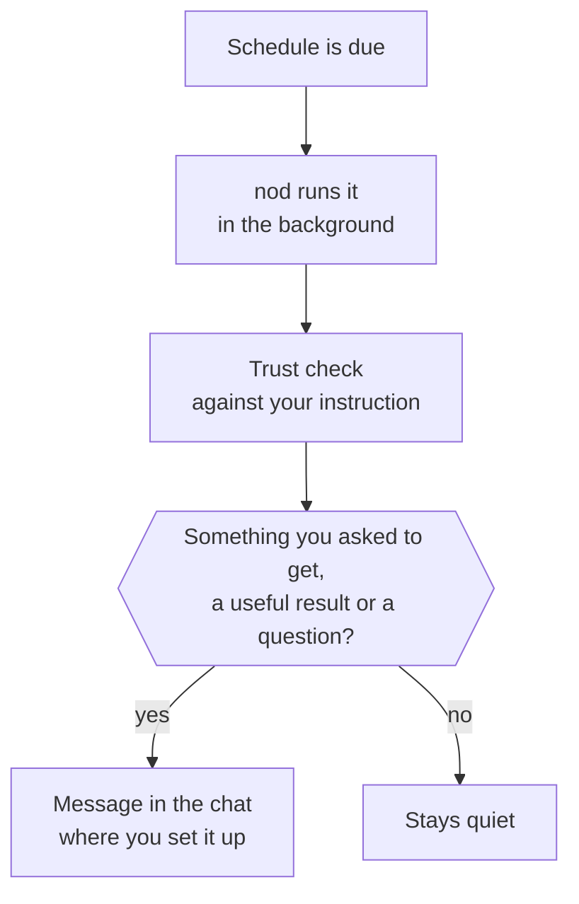

Ask nod to do something later or regularly, and it saves a schedule and does the work in the background.

When you ask, nod also notices new email and activity in your connected apps and prepares useful work on its own. This page covers both.

## Create a schedule

Ask in chat. For example:

- "Every weekday at 8:00, summarize my calendar and anything urgent in my inbox."
- "Tomorrow at 15:00, remind me to call the landlord."

A schedule runs **One time** or is **Recurring**. nod tells you when it's saved and when it runs next. When you hand nod work that needs follow-up, it can also plan its own check-in, such as "I'll look for a reply on Friday". Check-ins are schedules too.

nod uses your time zone, saved from your browser the first time you use nod. Change it in **Settings → General**. If nod doesn't know your time zone, it asks.

## Change or cancel a schedule

Open **Tasks → Scheduled**. Each schedule shows its timing and next run.

- Use the switch to pause or resume it.
- Select **See details** to read the instruction or change the timing.
- Select **Ask nod** to change it in your own words.
- Select **Delete schedule**. Future runs stop, and past runs stay in **Previous**.

You can also tell nod in chat, for example "stop the morning summary".

## What happens when a schedule runs

- **It runs next to your chat.** A schedule doesn't wait for the conversation, and the conversation doesn't wait for it.
- **What you asked to get arrives every time.** A summary, brief or reminder comes on every run. A watch or check-in messages you only when something needs you, such as a real price drop, a problem or a question. Routine checks stay quiet.
- **It replies where you asked.** A schedule you set up on Telegram sends its messages to Telegram.
- **Approvals still apply.** Each action is checked against the instruction that created the schedule. If an action isn't covered, nod asks you first. See [Approvals](/trust/approvals/).

Each run appears in **Tasks → Previous**. A run that messages you ends with a receipt of what it did and cost. A recurring schedule that has finished priced runs shows about what it costs a month, from the cost of its recent runs and how often it runs.

## Work nod starts on its own

nod keeps an eye on your connected apps only after you say so. Connecting an app doesn't start it.

- **nod offers once.** After a task that connects or uses an app like Gmail or Slack, nod asks in one line whether to flag what needs you there. Say yes and it starts. Ignore or decline it, and nod doesn't ask again for that app.
- **Or just tell it.** At any time, say what's worth interrupting you for, such as "tell me when a client emails" or "flag Slack messages that need my reply".

How nod checks:

- **Gmail.** nod checks for new inbox mail every five minutes. Once you've said yes, each new message starts a quiet background run that decides whether there's useful work, such as preparing a reply. Until then, nod only saves the message.
- **Other connected apps.** Each update works the same way. For an app without updates, nod checks the account for new activity in the same kind of quiet run, at most every 30 minutes per account.

Work nod starts on its own reads and drafts. It sends, deletes or changes something only when you've told it to do that on its own, such as "whenever Ana sends an invoice, forward it to accounting@acme.com". Anything else waits for your yes. [Your rules](/trust/approvals/#your-rules) can change both: a rule to go ahead lets an action run without asking, and a rule to ask first makes nod ask even when your standing instruction covers the action. See [Standing instructions](/trust/approvals/#standing-instructions). To change or stop it, select it in **Usage**, or tell nod, for example "stop flagging Slack messages".

The first time nod messages you about something on its own, such as a calendar change, it sends a short second message to say it will keep doing this. When that first message asks you something, the line goes in it, before the question, so a short reply still answers the question. Tell it to stop or to do less at any time. After a one-off job that will come up again, such as this week's top posts or a reply to a client, nod offers once, in its own message, to keep doing it, unless a schedule already covers it. It sets nothing up until you say yes. When you act on something background work brought you, such as asking nod to reply, and it will come up again, nod offers once to do it without asking next time.

## Quiet hours

Quiet hours are on by default, from 22:00 to 08:00. Change them in **Settings → General → Quiet hours**.

During quiet hours, nod keeps working on new mail and app activity, but messages you only for something that can't wait until they end. Schedules you created still run and deliver on time.

## Keep nod running

:::caution[Runs need nod open]
On the desktop app, schedules and background work run only while nod is open and your computer is awake. Closing the window keeps nod running in the menu bar or tray. **Quit nod** stops it. Turn on **Open at login** in **Settings → General** if you rely on schedules.
:::

If a run comes due while nod is closed, it runs once when nod is running again.

## Related resources

- [Track tasks](/use/tasks/)
- [Chat with nod](/use/chat/)
- [Telegram and WhatsApp](/use/channels/)
- [Approvals and the trust check](/trust/approvals/)
- [Connect apps](/connect/apps/)
