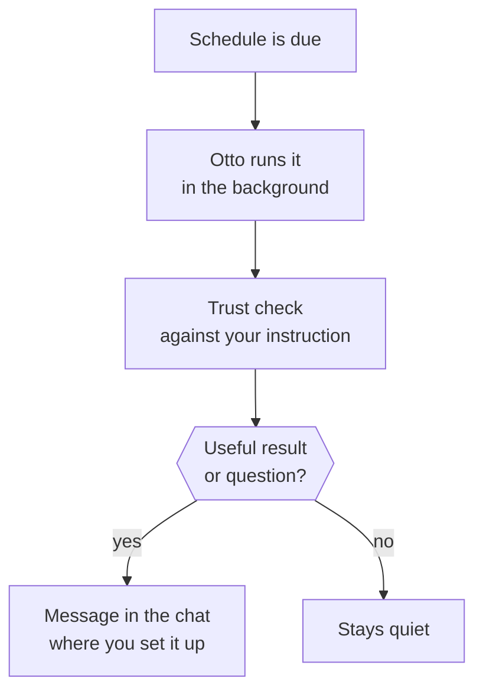

Ask Otto to do something later or regularly, and it saves a schedule and does the work in the background.

When you ask, Otto also notices new email and activity in your connected apps and prepares useful work on its own. This page covers both.

## Create a schedule

Ask in chat. For example:

- "Every weekday at 8:00, summarize my calendar and anything urgent in my inbox."
- "Tomorrow at 15:00, remind me to call the landlord."

A schedule runs **One time** or is **Recurring**. Otto tells you when it's saved and when it runs next. When you hand Otto work that needs follow-up, it can also plan its own check-in, such as "I'll look for a reply on Friday". Check-ins are schedules too.

Otto uses your time zone, saved from your browser the first time you use Otto. Change it in **Settings → Preferences**. If Otto doesn't know your time zone, it asks.

## Change or cancel a schedule

Open **Tasks → Scheduled**. Each schedule shows its timing and next run.

- Use the switch to pause or resume it.
- Select **See details** to read the instruction or change the timing.
- Select **Ask Otto** to change it in your own words.
- Select **Delete schedule**. Future runs stop, and past runs stay in **Previous**.

You can also tell Otto in chat, for example "stop the morning summary".

## What happens when a schedule runs

- **It runs next to your chat.** A schedule doesn't wait for the conversation, and the conversation doesn't wait for it.
- **It only messages you when it matters.** That means a useful result, a problem or a question. Routine checks stay quiet.
- **It replies where you asked.** A schedule you set up on Telegram sends its messages to Telegram.
- **Approvals still apply.** Each action is checked against the instruction that created the schedule. If an action isn't covered, Otto asks you first. See [Approvals](/trust/approvals/).

Each run appears in **Tasks → Previous**.

## Work Otto starts on its own

Otto keeps an eye on your connected apps only after you say so. Connecting an app doesn't start it.

- **Otto offers once.** After a task that connects or uses an app like Gmail or Slack, Otto asks in one line whether to flag what needs you there. Say yes and it starts. Ignore or decline it, and Otto doesn't ask again for that app.
- **Or just tell it.** At any time, say what's worth interrupting you for, such as "tell me when a client emails" or "flag Slack messages that need my reply".

How Otto checks:

- **Gmail.** Otto checks for new inbox mail every five minutes. Once you've said yes, each new message starts a quiet background run that decides whether there's useful work, such as preparing a reply. Until then, Otto only saves the message.
- **Other connected apps.** Each update works the same way. For an app without updates, Otto checks the account for new activity in the same kind of quiet run, at most every 30 minutes per account.

Work Otto starts on its own only reads and drafts. Sending, deleting or anything else waits for your yes. To stop, tell Otto, for example "stop flagging Slack messages".

The first time Otto messages you about something on its own, such as a calendar change, it sends a short second message to say it will keep doing this. Tell it to stop or to do less at any time. After a one-off job that will come up again, such as this week's top posts or a reply to a client, Otto offers once, in its own message, to keep doing it, unless a schedule already covers it. It sets nothing up until you say yes.

## Quiet hours

Quiet hours are on by default, from 22:00 to 08:00. Change them in **Settings → Preferences → Quiet hours**.

During quiet hours, Otto keeps working on new mail and app activity, but messages you only for something that can't wait until they end. Schedules you created still run and deliver on time.

## Keep Otto running

:::caution[Runs need Otto open]
On the desktop app, schedules and background work run only while Otto is open and your computer is awake. Closing the window keeps Otto running in the menu bar or tray. **Quit Otto** stops it. Turn on **Open at login** in **Settings → General** if you rely on schedules.
:::

If a run comes due while Otto is closed, it runs once when Otto is running again.

## Related resources

- [Track tasks](/use/tasks/)
- [Chat with Otto](/use/chat/)
- [Telegram and WhatsApp](/use/channels/)
- [Approvals and the trust check](/trust/approvals/)
- [Connect apps](/connect/apps/)
