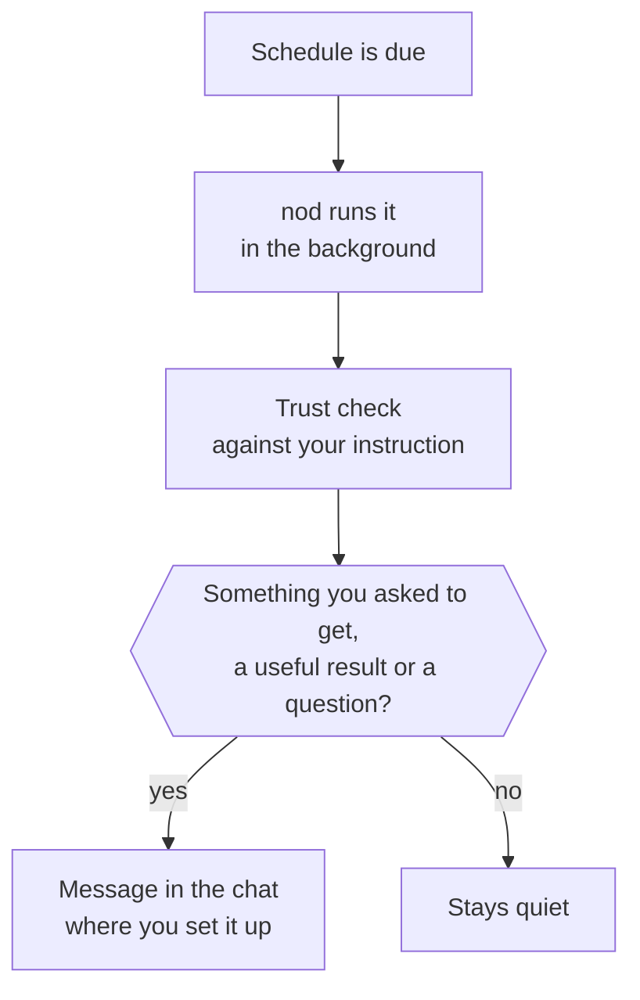

Ask nod to do something later or regularly, and it saves a schedule and does the work in the background.

When you ask, nod also notices new email and activity in your connected apps and prepares useful work on its own. This page covers both.

## Create a schedule

Ask in chat. For example:

- "Every weekday at 8:00, summarize my calendar and anything urgent in my inbox."
- "Tomorrow at 15:00, remind me to call the landlord."

A schedule runs **One time** or is **Recurring**. nod tells you when it's saved and when it runs next. When you hand nod work that needs follow-up, it can also plan its own check-in, such as "I'll look for a reply on Friday". Check-ins are schedules too.

nod uses your time zone, saved from your browser the first time you use nod. Change it in **Settings → General**. If nod doesn't know your time zone, it asks.

## Change or cancel a schedule

Open **Tasks → Scheduled**. Each schedule shows its timing and next run.

- Use the switch to pause or resume it.
- Select **See details** to read the instruction or change the timing.
- Select **Ask nod** to change it in your own words.
- Select **Delete schedule**. Future runs stop, and past runs stay in **Previous**.

You can also tell nod in chat, for example "stop the morning summary".

## What happens when a schedule runs

- **It runs next to your chat.** A schedule doesn't wait for the conversation, and the conversation doesn't wait for it.
- **What you asked to get arrives every time.** A summary, brief or reminder comes on every run. A watch or check-in messages you only when something needs you, such as a real price drop, a problem or a question. Routine checks stay quiet.
- **It replies where you asked.** A schedule you set up on Telegram sends its messages to Telegram.
- **Approvals still apply.** Each action is checked against the instruction that created the schedule. If an action isn't covered, nod asks you first. See [Approvals](/trust/approvals/).

Each run appears in **Tasks → Previous**. A run that messages you ends with a receipt of what it did and cost. A recurring schedule that has finished priced runs shows about what it costs a month, from the cost of its recent runs and how often it runs.

## Work nod starts on its own

nod prepares useful work from your connected sources on its own and messages you only when it's worth it. See [Nudges](/use/nudges/).

- **Preparation starts automatically** for Gmail, Google Calendar and the work nod saved for you. Tell nod "Pause preparation" to stop it.
- **Tell it what matters**, such as "prioritize travel problems" or "keep routine updates private". This standing instruction guides preparation.
- **Or ask it to act on its own**, such as "whenever Ana sends an invoice, forward it to accounting@acme.com". That runs through the trust check, as described in [Standing instructions](/trust/approvals/#standing-instructions).

How nod checks:

- **Gmail.** nod checks for new inbox mail every five minutes, and new mail starts a quiet assessment.
- **Google Calendar.** nod checks for changed events every 30 minutes without a model call.
- **Other sources.** Registered read-only sources declare their own periodic interval. Apps without a reader, such as Slack, are watched only when your standing instruction covers them.

The private worker can only read, prepare private work and nudge you. It cannot send, delete, submit, book, buy or change connected apps. Anything more starts from your request or an explicit standing instruction, through the trust check.

A schedule remains a separate request. Its saved instruction can cover app actions, subject to Trust and payment approval.

## Edit schedule details

Select a schedule title to rename it in place. Timing changes show the next run from the same schedule engine that runs the job. The preview does not change the saved schedule. Save applies the change. Undo restores its previous timing only if no newer change has replaced it. The Undo notice stays available while you hover over it, focus it, or switch away from nod.

## Quiet hours

Quiet hours are on by default, from 22:00 to 08:00. Change them in **Settings → General → Quiet hours**.

During quiet hours, nod keeps working on new mail and app activity, but messages you only for something that can't wait until they end. Schedules you created still run and deliver on time.

## Keep nod running

:::caution[The assistant must stay running]
A local desktop assistant runs schedules and background work only while nod is open and your computer is awake. A [self-hosted server](/deploy/self-host/) keeps running after you close its web or desktop client, provided the server stays awake and connected.
:::

For a local assistant, closing the window keeps nod running in the menu bar or tray. **Quit nod** stops it. Turn on **Open at login** in **Settings → General** if you rely on schedules.

If a run comes due while the assistant is stopped, it runs once when nod is running again.

## Related resources

- [Track tasks](/use/tasks/)
- [Chat with nod](/use/chat/)
- [Telegram and WhatsApp](/use/channels/)
- [Approvals and the trust check](/trust/approvals/)
- [Connect apps](/connect/apps/)
