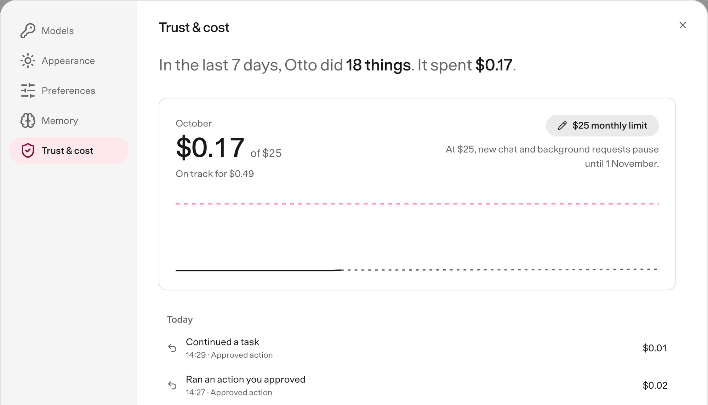
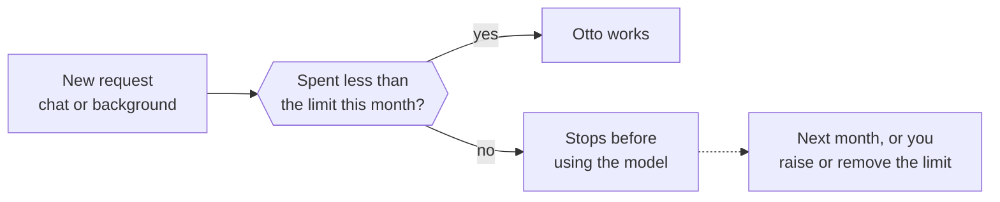

Otto shows what it spends on models and what it does in your apps, and lets you set a monthly spending limit.

Otto itself doesn't charge you. Your model provider bills you for the requests Otto makes with your key or plan.

## See your spending

Open **Settings → Trust & cost** (⌘I on a Mac, Ctrl+I elsewhere).

- **The last 7 days.** One line with how many things Otto did, how many times it used your apps and what it spent.
- **This month.** What Otto has spent so far, a chart and a forecast, such as "On track for $12.40".
- **The statement.** Every request that cost money or acted in a connected app, grouped by day. Each line shows where it came from, such as **Schedule**, **Activity check** or **Approved action**, what Otto did and the cost.

Every app action is recorded, reads included.

## Set a monthly limit

1. Open **Settings → Trust & cost**.
2. Select **Set a monthly limit**.
3. Enter an amount in US dollars, from $1 up, and select **Save**.

To change the limit, select it and enter a new amount. To remove it, select it, then **Remove**.

## What happens at the limit

When the month's spending reaches your limit:

- New chat messages, schedules and background work stop before Otto calls the model. Chat shows that it's paused.
- Work that's already running can finish.
- An action you already approved still runs once.

The pause lifts at the start of next month, or as soon as you raise or remove the limit.

:::caution[Some usage has no price]
Usage on a ChatGPT plan has no price, so it doesn't count toward the limit. In the statement it shows a dash instead of a cost, labelled **Included in your plan**. Costs are Otto's estimates. Your provider's bill is the final word.
:::

## See the cost of one reply

Hover over Otto's final reply, or move keyboard focus to it, to see the estimated model cost of that request. **Price unavailable** means part of the usage has no price.

## Check usage from Telegram or WhatsApp

Send `/usage` for the same summary. It doesn't use the model or cost anything. Telegram also receives this month's statement as a PDF.

## Ask Otto

You can ask Otto about its own spending and app actions, for example "How much have you spent this month?" Otto reads the same view. It can't change your limit.

## Related resources

- [Chat with Otto](/use/chat/)
- [Telegram and WhatsApp](/use/channels/)
- [Models](/connect/models/)
- [Trust and Vault](/trust/)
