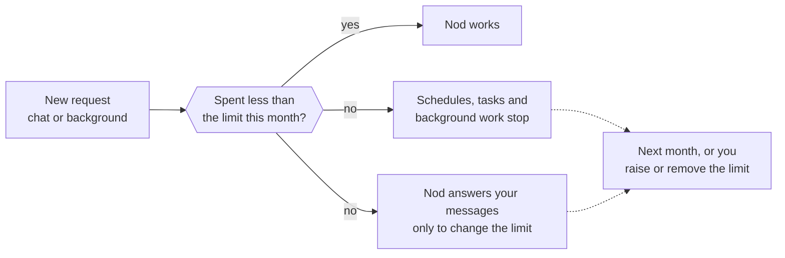
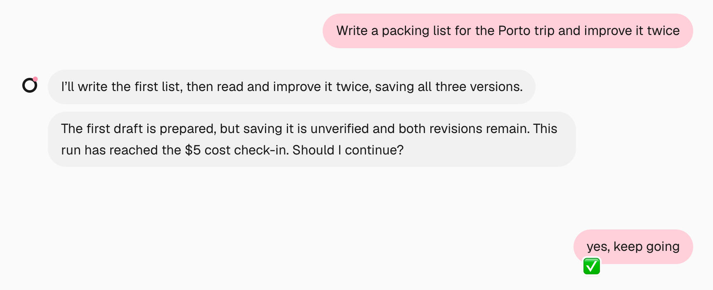

Nod shows which models it used and what it did in your apps. With an API connection, you can also review spending and set a monthly limit.

Nod itself doesn't charge you. Your model provider bills you for the requests Nod makes with your key or plan.

## See your spending

Open **Usage** in the sidebar (⌘5 in the Mac app, Ctrl+5 in the Windows or Linux app).

- **The sentence at the top.** With an API model selected, this month's API spending and your monthly limit. Select the total to inspect spending or the limit to change it. With a ChatGPT plan selected, it says your usage comes from that plan.
- **The list.** Model requests, connected app actions, sign-ins and card uses, grouped by day. Each line shows where it came from, such as **Schedule**, **Activity check** or **Task Nod started**, and what Nod did. A source check that found nothing to prepare says so, and a task's planned check reads **Checked on** with the task's name. Model requests show the models recorded for that run, including helpers and checks. Changing your selected model doesn't change these records. If an older request didn't record its model, the row says so. Under an action your words allowed, it shows those words, such as _You said "Send Lena the report"_.

With a ChatGPT plan selected, Usage hides cost amounts, forecasts and monthly limit controls, including amounts on older API requests. Those requests still identify their recorded models and API connection. With an API model selected, recorded API costs are visible again; plan usage stays labeled separately and its API-price estimate is never shown as a charge. A run that used both shows its recorded API cost and identifies the models that used the plan.

Scroll down to load earlier activity automatically.

Select an activity with an available chat message to open that message in the conversation, including older messages. Sign-ins and card uses open the saved Vault item when it is still available. Entries without an available destination remain plain rows.

To review or change [standing instructions](/trust/approvals/#standing-instructions), [rules](/trust/approvals/#your-rules) or task check-ins, ask Nod in chat.

Chat messages don't include cost or action receipts. Review spending and app actions in **Usage**. On **Scheduled**, an enabled recurring schedule shows its projected monthly cost once there's priced usage to base it on, and its details show its runs and their recorded costs. A new schedule's projection uses your other schedules' recent runs, your recent requests, or the request that set it up, until it has finished runs of its own. When Nod creates a recurring schedule or changes its timing, its reply states the projection. Plan usage and unpriced runs have no cost amount.

With an API model selected, select this month's total to see a chart and a forecast, such as "On track for $12.40". It also says how much was background work: source checks, schedules and tasks Nod started, plus work that runs outside any of them, such as email checks, memory upkeep and writing style. Point to or select a day on the chart to see that day’s spend and the total so far. You can also focus the chart and use the arrow keys. Every app action is recorded, reads included.

## How each model is priced

How Nod counts usage depends on how you pay for the model.

| You use                                                                                                            | Pricing                                      | Monthly limit | Task check-ins       |
| ------------------------------------------------------------------------------------------------------------------ | -------------------------------------------- | ------------- | -------------------- |
| A paid model through an API key or a cloud account, such as OpenAI, Anthropic, OpenRouter or Amazon Bedrock        | Estimated API cost                           | Counts        | Counts               |
| A ChatGPT plan                                                                                                     | API-price estimate of what your plan covered | Doesn't count | Counts at API prices |
| A model with no price, such as an [OpenAI-compatible server](/connect/local-models/), a free model or a token plan | **No price**                                 | Doesn't count | Doesn't count        |

Costs are Nod's estimates from each model's API price. Your provider's bill is the final word. Any request whose API price Nod doesn't know shows **No price**, on a ChatGPT plan too, as does a voice reply or transcription without a known price.

## Set a monthly limit

Nod sets a $200 monthly limit when you finish setup. If you set up Nod before it did this, you have no limit until you set one.

To change it:

1. Select an API model and open **Usage**.
2. In the sentence at the top, select **no monthly limit**, or your current limit.
3. Enter an amount in US dollars, from $1 up, and select **Save**.

To remove the limit, select it, then **Remove**. You can also tell Nod, for example "Set my monthly limit to $40". See [Ask Nod](#ask-nod).

## What happens at the limit

When the month's spending reaches your limit:

- Schedules, tasks and background work stop before Nod calls the model. Work you started gets one message that names the limit and asks whether to raise or remove it, in Nod and in the chat app you used.
- Your messages still reach Nod, in Nod, Telegram and WhatsApp, voice messages included. Nod tells you the limit is reached and asks whether to raise or remove it. Reply with what you want, for example "Raise it to $300" or "Remove the limit", and Nod changes it. Until then, it only replies, reads usage and changes limits. These replies use your model and are counted like any other request.
- Work that's already running can finish.
- An action you already approved still runs once.

The pause lifts at the start of next month, or as soon as you raise or remove the limit, in **Usage** or by telling Nod. Then send your request again.

Only paid usage with a known price counts toward the limit. See [How each model is priced](#how-each-model-is-priced).

Switching to a ChatGPT plan doesn't remove an existing monthly limit or its recorded API spending. If that limit is already reached, schedules, tasks and background work stay paused, and Nod answers your messages only to change the limit. Tell Nod to raise or remove it, or select an API model to review it in **Usage**.

## Task check-ins

A task checks in with you when its spending since your last message to it passes the check-in amount, $5 by default. Nod stops before its next step. It states the cost and what continuing would do, then asks whether to keep going. It includes a completed result only when that helps your decision and you can inspect the result.

- Say yes, and the task continues until it spends that amount again.
- Say no, and Nod stops the task.

The count covers every turn of the task and its helpers, so a task that works in small steps over several days checks in too. Chat, schedules, and the background observer check in the same way. The observer counts across its turns until you answer its check-in.

Trust checks, confirmation fact checks and the [decision check](/connect/models/#decision-checks) count toward the monthly limit. Those made during a running task, and its other model calls, also count toward its check-in. The approval-reply check runs before the task resumes. Each request counts once.

An action that your words cover needs one authorization review. If it needs approval, Nod also calls the model to write and check the question. Reading your answer adds another check. A rejected question can need one new draft and fact check. Each extra conversation turn also uses the main model with its session context.

To reduce repeated questions, set [rules for what Nod can do directly](/trust/approvals/#your-rules). Nod can change from an app tool to the same service's website when the account and requested outcome stay the same. It also reuses saved procedures and writing style. Routine drafts do not require fresh style samples, and optional offers do not require extra schedule or history reads.

Usage on a ChatGPT plan counts at the model's API price here, so plan tasks check in too, even though that usage costs you nothing extra. The check-in says how much of the amount is plan usage.

### Change when tasks check in

Tell Nod in chat, for example "Check in when a task passes $20" or "Stop checking in on tasks". You can also ask what the current check-in amount is.

:::note
Nod finishes an action that has already started before it checks in. If the model keeps trying to work after the check-in, Nod pauses and waits for you with a notice such as **Paused at the $5 check-in. Reply to keep going.** The task shows **Needs you**, and your reply continues it. The background observer works the same way: its checks resume once you reply.
:::

## Check usage from Telegram or WhatsApp

Send `/usage` for a summary written by your selected model. That model call counts toward usage. Telegram and the WhatsApp QR connection also receive this month's statement as a PDF. With the WhatsApp Cloud API, open Nod to get it.

## Ask Nod

You can ask Nod about its own spending and app actions, for example "How much have you spent this month?" Nod reads the same view.

You can also tell Nod to change a limit, for example "Raise my monthly limit to $40" or "Stop checking in on tasks". The same check that guards app actions decides: Nod changes a limit when your own words ask for it, and asks you first otherwise. A web page or email can't change your limits.

## Related resources

- [Chat with Nod](/use/chat/)
- [Telegram and WhatsApp](/use/channels/)
- [Models](/connect/models/)
- [Trust and Vault](/trust/)
