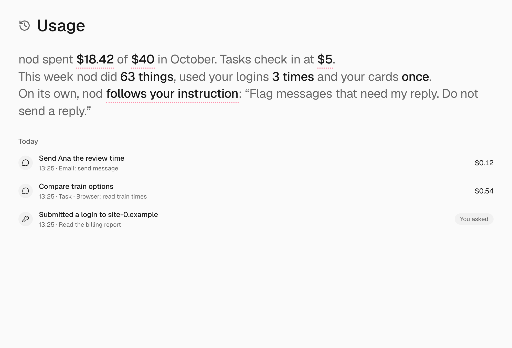
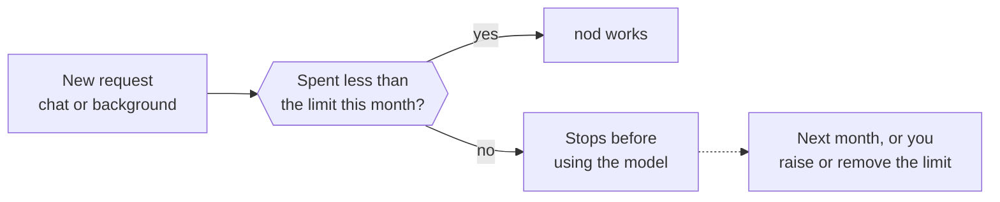
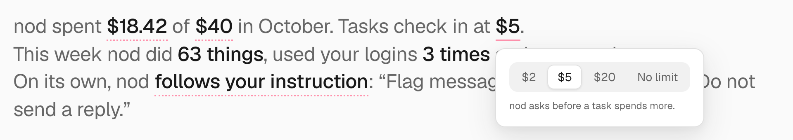

nod shows what it spends on models and what it does in your apps. You can set a monthly spending limit and choose when a task checks in with you before it spends more.

nod itself doesn't charge you. Your model provider bills you for the requests nod makes with your key or plan.

## See your spending

Open **Usage** in the sidebar (⌘5 in the Mac app, Ctrl+5 in the Windows or Linux app).

- **The sentence at the top.** This month's spending, your monthly limit and when a task checks in, then what nod did this week, the [standing instruction](/trust/approvals/#standing-instructions) it follows on its own and [your rules](/trust/approvals/#your-rules). Select a value to see more or change it.
- **The list.** Every request that cost money or acted in a connected app, and every sign-in and card use, grouped by day. Each line shows where it came from, such as **Schedule**, **Activity check** or **Approved action**, what nod did and the cost. Under an action your words allowed, it shows those words, such as _You said "Send Lena the report"_.

A finished task or scheduled run ends with a quiet receipt under its last message in chat, such as _Gmail: send email ×2 · $0.38_. Select it to see only that work in **Usage**. A recurring schedule that has finished priced runs shows about what it costs a month on **Tasks**, from the cost of its recent runs and how often it runs.

Select this month's total to see a chart and a forecast, such as "On track for $12.40". Every app action is recorded, reads included.

## Set a monthly limit

1. Open **Usage**.
2. In the sentence at the top, select **no monthly limit**, or your current limit.
3. Enter an amount in US dollars, from $1 up, and select **Save**.

To remove the limit, select it, then **Remove**. You can also tell nod, for example "Set my monthly limit to $40". See [Ask nod](#ask-nod).

## What happens at the limit

When the month's spending reaches your limit:

- New chat messages, schedules and background work stop before nod calls the model. Work you started gets one message saying it's paused, in nod and in the chat app you used.
- Work that's already running can finish.
- An action you already approved still runs once.

The pause lifts at the start of next month, or as soon as you raise or remove the limit.

:::caution[Some usage has no price]
Usage on a ChatGPT plan has no price, so it doesn't count toward the limit. In the list it shows no cost. nod doesn't know the prices of an [OpenAI-compatible server](/connect/local-models/), so it counts that usage at $0. It doesn't count toward the limit or task check-ins. Costs are nod's estimates. Your provider's bill is the final word.
:::

## Task check-ins

A task checks in with you when its spending since your last message to it passes the check-in amount, $5 by default. nod stops before its next step, says what's done and what's left, and asks whether to keep going.

- Say yes, and the task continues until it spends that amount again.
- Say no, and nod stops the task.

The count covers every turn of the task and its helpers, so a task that works in small steps over several days checks in too. A chat reply, a schedule and an event check in the same way. A schedule or event counts from when it started.

Trust checks, confirmation fact checks and the [decision check](/connect/models/#decision-checks) count toward the monthly limit. Those made during a running task, and its other model calls, also count toward its check-in. The approval-reply check runs before the task resumes. Each request counts once.

Usage on a ChatGPT plan counts at the model's API price here, so plan tasks check in too, even though that usage costs you nothing extra.

### Change when tasks check in

1. Open **Usage**.
2. In the sentence at the top, select the amount after **Tasks check in at**.
3. Choose **$2**, **$5**, **$20** or **No limit**.

Or tell nod, for example "Check in when a task passes $20".

:::note
nod finishes an action that has already started before it checks in. If the model keeps trying to work after the check-in, nod ends the turn with a notice such as **Paused at the $5 check-in. Reply to keep going.**
:::

## Check usage from Telegram or WhatsApp

Send `/usage` for the same summary. It doesn't use the model or cost anything. Telegram also receives this month's statement as a PDF.

## Ask nod

You can ask nod about its own spending and app actions, for example "How much have you spent this month?" nod reads the same view.

You can also tell nod to change a limit, for example "Raise my monthly limit to $40" or "Stop checking in on tasks". The same check that guards app actions decides: nod changes a limit when your own words ask for it, and asks you first otherwise. A web page or email can't change your limits.

## Related resources

- [Chat with nod](/use/chat/)
- [Telegram and WhatsApp](/use/channels/)
- [Models](/connect/models/)
- [Trust and Vault](/trust/)
