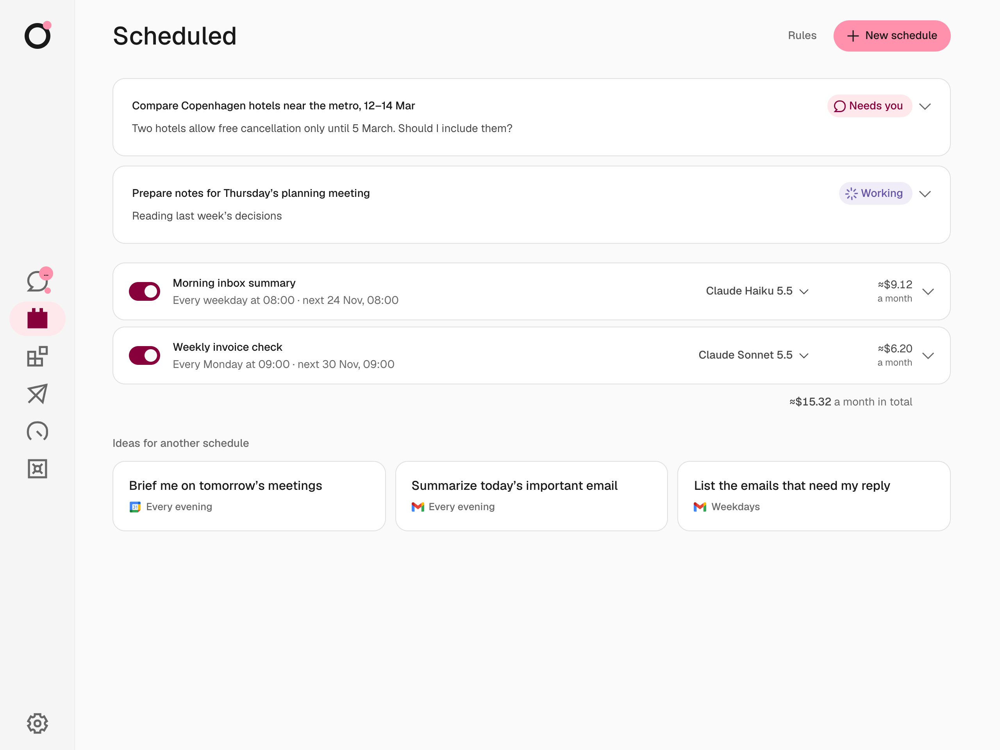
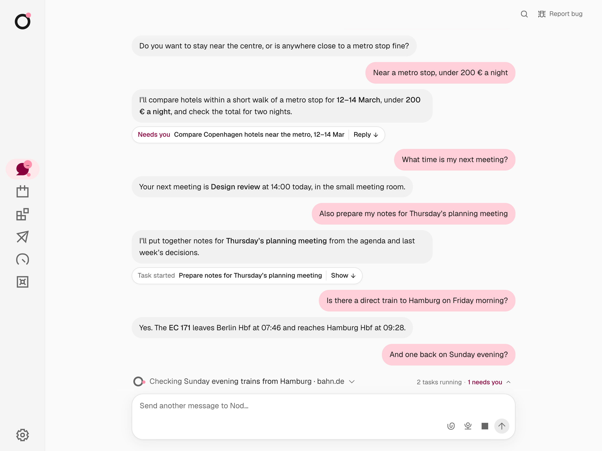
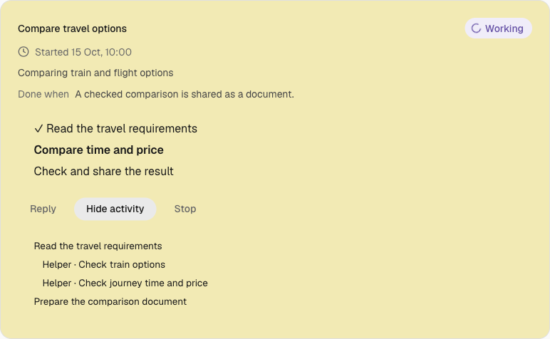
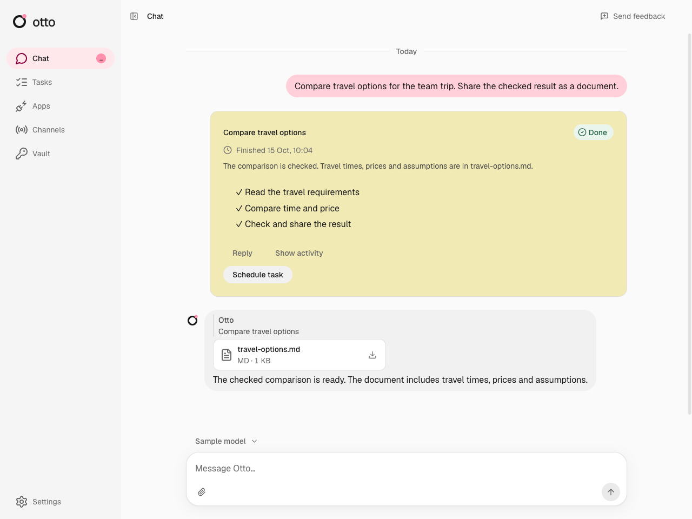
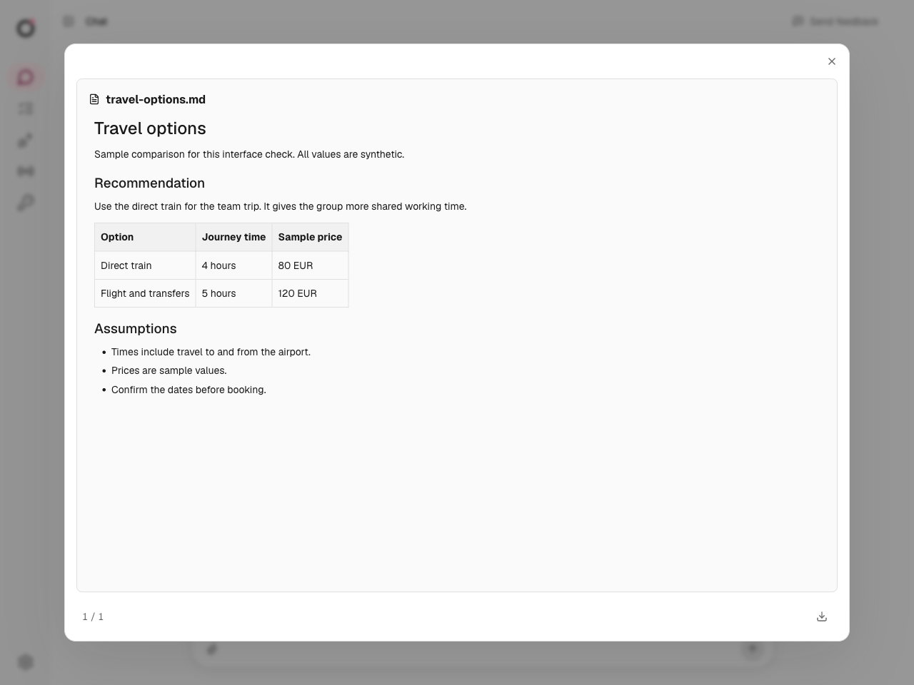
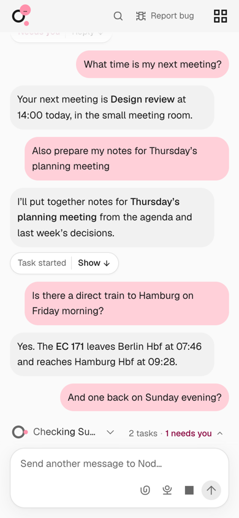
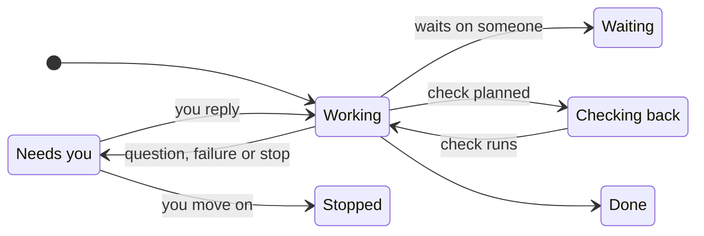

In chat, a chip under Nod's message and one tasks line at the end of the chat show what your tasks are doing and what needs your attention. The **Scheduled** page holds open and finished tasks, schedules and their recent runs. Select **New schedule** to open chat, where Nod helps you decide what to do and when.

Nod keeps quick answers, simple lookups such as flight searches, status questions and short work in your connected apps, such as reading, drafting, sending, forwarding or deleting a few emails, in chat. It starts a saved task for substantial work, including multi-step work it can finish in one sitting, such as research across sources, checked comparisons or report creation, and for an outside wait, such as a person, a reply or an action elsewhere, or work you ask it to track. You never pick an execution mode: Nod starts the task itself and lets it finish the assigned work.

| You write                              | What Nod does                    |
| -------------------------------------- | -------------------------------- |
| "What time is my next meeting?"        | Answers in chat.                 |
| "Compare hotels in Copenhagen."        | Starts task A.                   |
| "Also prepare my meeting notes."       | Starts task B while A continues. |
| "For the hotels, only near the metro." | Updates task A.                  |
| "How are the hotels going?"            | Reports task A's status in chat. |

The main chat stays available while tasks work. Each task keeps its goal and history, and its start message is its acknowledgement. Reply to a task's message to correct it or add a related update; a question about its progress is answered in chat. In the web and desktop apps, each message a task posts quotes your message it belongs to: your latest message that task had picked up when it posted, or else the one that started it. Select the quote to jump to that message.

Tasks share one [workspace](/use/workspace/#one-workspace-for-all-tasks) and owner memory. Each task has its own working folder and saved session. See [Task sessions](/how-it-works/task-sessions/) for the architecture.

## Scheduled work

Open **Scheduled** to review tasks and upcoming schedules. Open tasks appear first, and a working task shows a live line of what it is doing. Expand **Finished** for tasks that are done or stopped, and **Inactive** for paused schedules. Select a schedule’s name for its runs. See [Schedules](/use/schedules/).

Select **Rules** to ask Nod in chat to show the rules that apply to every task. Tell Nod in chat what to change.

## What a card shows

| Part           | What it tells you                                                                 |
| -------------- | --------------------------------------------------------------------------------- |
| Title          | The task in a few words                                                           |
| Status         | Where the task stands, such as **Working** or **Needs you**                       |
| Now line       | What Nod is doing, with the website it's working in, or the question it asked you |
| **Waiting on** | Who Nod is waiting for, and how, such as an email reply                           |
| **Next check** | When Nod will look again                                                          |
| **Done when**  | What finished looks like                                                          |
| **Model**      | The model the task uses. Select **Change** to give this task its own model        |

When Nod starts a task, a chip under its message says **Task started** with the task's title. The chip follows the task's [status](#statuses), such as **Needs you**, **Finishing**, **Task done**, **Task failed** or **Task stopped**. Select it while the task is active to open the task or, once it's done and has an answer, to jump to that answer. A task that is waiting, checking back, failed or finished keeps its chip in chat, and its card with every control is on **Scheduled**.

While tasks that started in the chat run, one line at the end of the chat sums them up, such as "2 tasks running · 1 needs you". It sits on the right of Nod's own status line, on its last line, and takes that line on its own when Nod isn't working on anything else. Select it to list the tasks, then select one to open its card. With one task, the card opens at once. The card shows the task's question when it needs you or what it is doing now, its plan as a checklist with how many steps are done, **Details** for when it counts as done, **Reply** and **Stop**. Nod's status line stays on one line until you open it. Hover over it or select it to read a long step in full. Selecting it also shows its recent steps.

When your message goes to a task, the status line's place shows that task's title and current step under your message. This happens when you reply to one of the task's messages or answer its question, or when Nod sends your message to the task. The task's progress stays there until it posts a message, finishes or needs you. Select it to open the task. When you start a new task, its progress stays on its card.

The live line keeps up to four recent completed steps, with the newest first. Tool calls under the same progress update share one entry; calls without a progress update appear separately. These details start closed for each turn. Select the line to show or hide them. This control works separately from the task's details.

On **Scheduled**, task details start closed, including failed tasks. The title, status, and current summary stay visible. Select the preview's title to see its controls and, when it has planned steps, its plan as a checklist; select it again to close it. Inside, **Show activity** lists Nod's steps and messages with its tool steps in between, never private model reasoning.

Tasks Nod starts on its own, such as a reply your notification rule asks for, show the same line on their card, with no typing indicator or chat status line. Useful, verified milestones arrive as chat messages, with what is complete and what remains.

The progress indicator shows the task title above its current step. Both wrap so you can read the full text.

## Reply or stop one task

Reply to a task message to continue that task. You can reply to its first message, a question or a result, even after the task finishes or stops. Telegram and WhatsApp use their reply controls.

A message without a reply target goes to the main chat. Nod can send that message to one or more open tasks when your intent is clear.

Say "Try again" just after Nod reports the result of a task you requested. In web or desktop chat, this also works for a result from Telegram or WhatsApp. In a chat app, the result must be in that chat. Nod continues the task with your original request and checks whether an action already happened before repeating it. If the target is unclear, Nod asks.

When a task waits for you in its browser, its card in chat and its preview on **Scheduled** show **Open browser**, which takes you to the live page. See [Take over the browser](/use/browser/#take-over-the-browser).

An owner update has a revision. **Owner update queued** means the task has not received it at an execution boundary. An outside action that has already started can still finish. Other tasks continue while one task waits for your answer.

Open a task's card from the tasks line or its chip, or its preview on **Scheduled**, and select **Stop** to stop that task and its helpers. Other tasks continue. When a task asks you to approve an action, **Skip this step** declines only that action and the task goes on with its other work; **Stop the task** stops it. The main Stop control stops active work and closes all open tasks. You can also ask Nod in the main chat to stop one task, or all background work, including scheduled runs and app checks. Reset also closes the old thread's open tasks.

A task checks in when its spending since your last message to it passes the check-in amount, $5 by default, and asks whether to keep going. Tell Nod in chat to change the amount. See [Task check-ins](/use/spending/#task-check-ins).

## Rename a task

On **Scheduled**, open its preview and select its title in the details. Change the display name, then select **Save**. The task goal and original request stay the same. **Cancel** or Escape discards the edit.

## Inspect task activity

On **Scheduled**, open a task preview and select **Show activity**. The details show planned steps, Nod's steps and messages, and the tool and helper steps between them, such as _Searched the web_ or _Gmail: send email_. Select **Show in chat** to return to the task's message.

To see the commands the task ran in Nod's workspace, select **Show commands**. See [Watch Nod's commands](/use/workspace/#watch-nods-commands).

## Read task results

A task delivers its result where you asked for it. When you ask for something a connected app holds, such as a sheet, a document or email drafts, Nod creates it in that app even if you don't name it. Research, guides, plans and other long reports come as a Markdown document with a short message giving the main finding, and long answers outside a task come the same way. If you ask for the result in the chat itself, Nod writes it there in full. With the WhatsApp Cloud API, open Nod to read the document. A follow-up, such as completing a sign-in, continues the same saved session.

Every longer task you request uses the same [feedback rule](/use/chat/#feedback-during-long-tasks), with any tool or source. It balances useful early results against missing context and interruptions, and follows your delivery instructions. A result must be checked and useful on its own. The task states what it checked and what remains uncertain, then continues the full task. Later related findings arrive together. Routine activity stays on the task's live line. An acknowledgement, repeated finding, or elapsed time alone does not trigger a result message.

Select the file to read it in a panel next to the chat. Select **Download** to save it. Press **Escape** to close the panel. See [Get files from Nod](/use/workspace/#get-files-from-nod) for every file type the panel opens.

Nod previews Markdown files up to 4 MB. For a larger file, select **Download**.

On **Scheduled**, the card of a task that is done has **Schedule task**, which turns the same work into a [schedule](/use/schedules/). Open [Usage](/use/spending/) to review the task's cost and recorded app actions.

## Use tasks on mobile

Mobile web shows the same chip and tasks line, with a shorter summary such as "2 tasks · 1 needs you". Select the tasks line to open a task's card, read its steps, reply or stop it.

## Telegram and WhatsApp without a task page

Telegram and WhatsApp show each task as messages Nod writes in your language. The first one says what it is starting. Questions, approval requests and the result reply to that message, so they stay linked to the task.

Use the chat app's **Reply** control to send an update or answer to a task. Other messages go to the main chat. These commands answer from Nod's task records, and Nod words the reply:

| Command   | Result                                                                                                             |
| --------- | ------------------------------------------------------------------------------------------------------------------ |
| `/tasks`  | List open tasks and their current state.                                                                           |
| `/status` | Show each open task's goal, steps and current state. Reply to a task message to see only that task.                |
| `/stop`   | Stop all active work and close open tasks. Reply to a task message with `/stop` to stop only that task.            |
| `/clear`  | Start fresh main-chat context and a clean view. Independent tasks keep running. Previous messages stay searchable. |

The task list sends one message per task. You can reply to that message, the task's first message, a question, a file, a result or a status response. If Nod cannot match a reply to a task, `/stop` asks you to select a task. It does not stop all work.

A status message that shows a pending question keeps a link to that exact question. Your approval applies only to the saved action it shows. An old status message cannot approve a later action.

Telegram, WhatsApp and web use the same task record and saved session. Task commands do not grant permission for an outside action. Signing in to a website and approving a payment still happen in the Nod app.

## Statuses

| Status            | Meaning                                                              |
| ----------------- | -------------------------------------------------------------------- |
| **Queued**        | The task is waiting for its session to run.                          |
| **Failed**        | The run failed. Reply to its message to continue.                    |
| **Working**       | Nod is on it right now.                                              |
| **Needs you**     | Nod asked you a question or needs an approval. Reply to its message. |
| **Waiting**       | Nod is waiting on someone else.                                      |
| **Checking back** | Nod has a check planned and resumes the task at that time.           |
| **Done**          | Finished, with the result on the card.                               |
| **Stopped**       | Closed before it finished.                                           |

A question stays **Needs you** until you reply to it or continue its session. An unrelated chat message does not answer it. Select a failed task's title to open its details and controls. A task that stops without a plan or a result shows **Needs you** with a note to reply to continue. A task that fails, including one Nod started on its own, says so in chat with the task's name and what stopped it. When a task reaches its spending check-in, it shows **Needs you** with the check-in question. A stopped task shows **Stopped**. Reply to the task to continue the same saved session. While a task works on your reply, the chat shows that Nod is working. In the web and desktop apps, the bottom of the chat shows the task's title and current step until it posts a message, finishes or needs you.

If you ask a question in main chat after a task's yes/no approval without replying directly, Nod closes that approval without running its action. The task remains open with a message that says its current work stopped. Reply to that message to continue what is unfinished.

If you pause or delete a schedule directly while a task is waiting for approval to change that schedule, the old confirmation expires. The task stays open and shows a new message you can reply to if it has more work to do.

## Task status and permission

A card is a view of the work. It does not grant permission. A planned check resumes the task's own session with the same permission as the task. **Schedule task** creates an ordinary [schedule](/use/schedules/). Every outside action still goes through the [trust check](/trust/approvals/).

To change a task, tell Nod in [chat](/use/chat/).

## Related resources

- [Chat with Nod](/use/chat/)
- [Schedules and background work](/use/schedules/)
- [Approvals and the trust check](/trust/approvals/)
