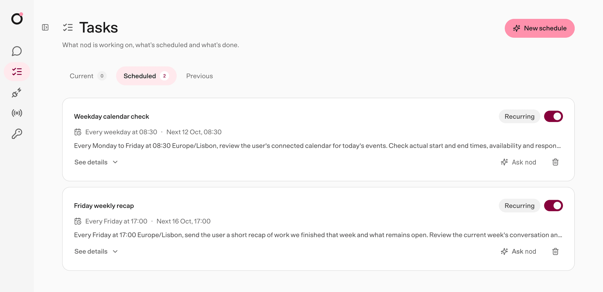
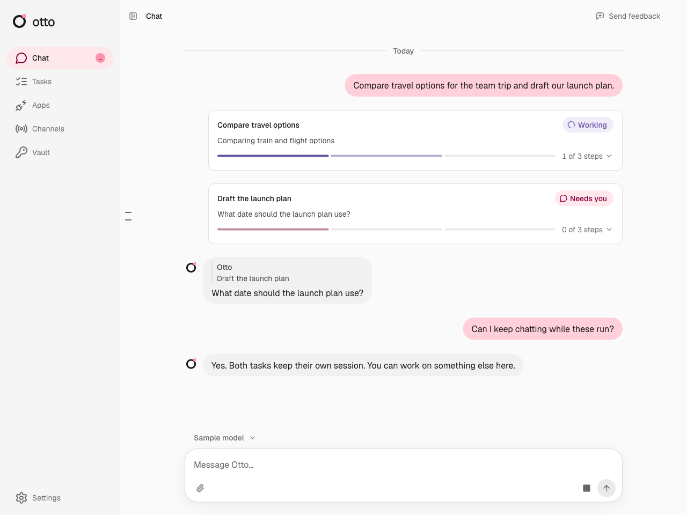
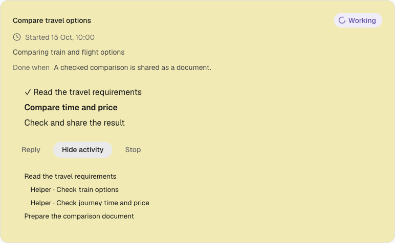
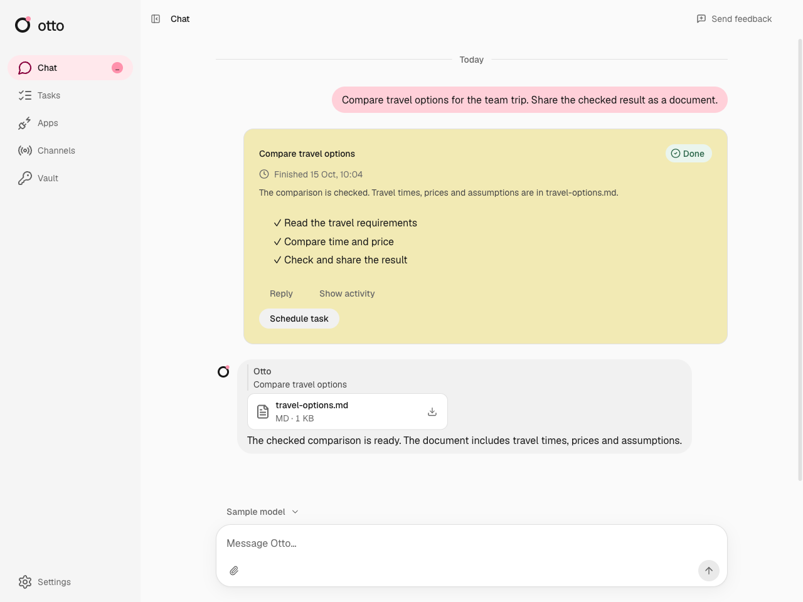
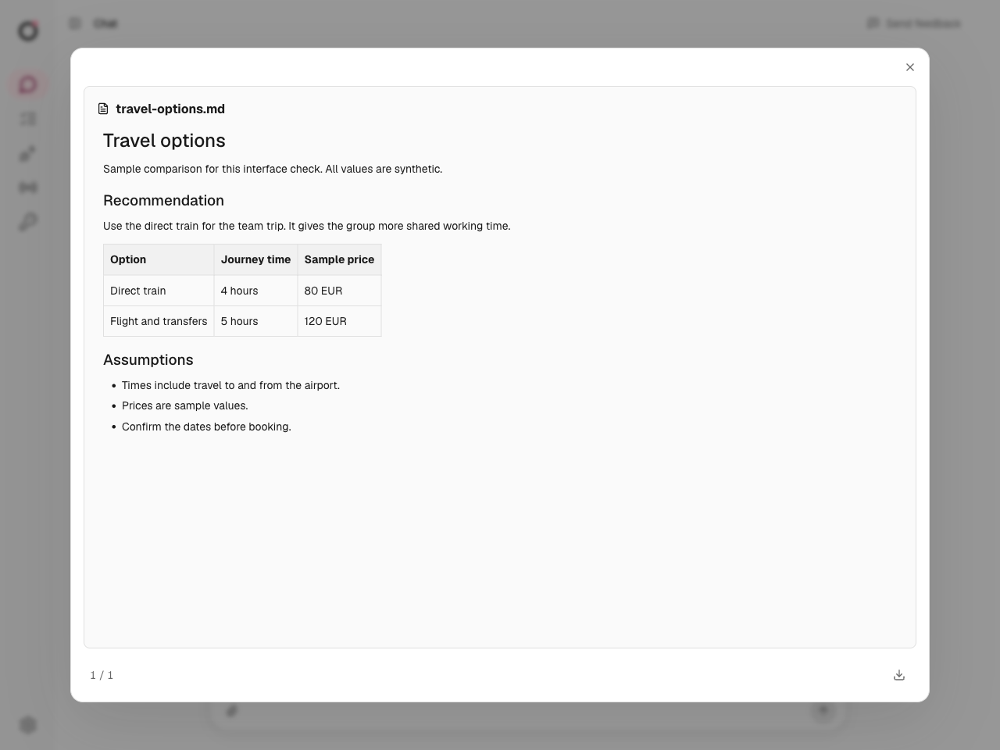
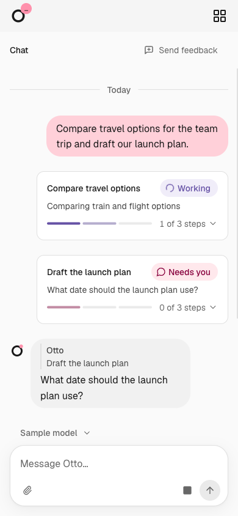
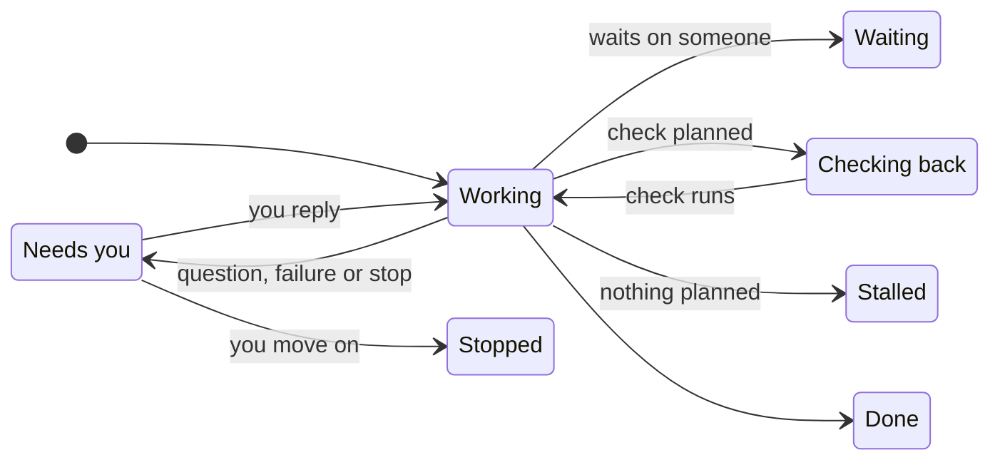

The **Tasks** page shows what nod is working on, what's scheduled and what's done.

Until there's something to show, the page helps you start instead. Select **something that takes a while** or **something that repeats** to ask nod in your own words or pick an idea. The views appear once nod has a task, a schedule or a past run.

nod starts a saved task session for substantial work with several steps, even when it can finish in one sitting. Research across several sources, comparisons, reports and app workflows can become tasks. Work that waits on someone or something, runs alongside other jobs, or that you ask nod to track also becomes a task. Quick answers, single lookups, brief summaries of supplied content and simple actions stay in chat. There is no fixed limit of three tasks.

For example, "Compare these options and make a report" becomes a task. So does "Ask three venues for quotes and tell me when they've all replied". "What time is this meeting?" stays in chat. The main chat stays available while tasks work. Each task keeps its goal and history, and its start message is its acknowledgement.

Tasks share one [workspace](/use/workspace/#one-workspace-for-all-tasks) and owner memory. Each task has its own working folder and saved session. See [Task sessions](/how-it-works/task-sessions/) for the architecture.

## Three views

| View          | Shows                                                                         |
| ------------- | ----------------------------------------------------------------------------- |
| **Current**   | Open task cards, with the ones that need you first                            |
| **Scheduled** | Your schedules and nod's planned check-ins. See [Schedules](/use/schedules/). |
| **Previous**  | Finished cards and past schedule runs, newest first                           |

## What a card shows

| Part           | What it tells you                                                                          |
| -------------- | ------------------------------------------------------------------------------------------ |
| Title          | The task in a few words                                                                    |
| Status         | Where the task stands, such as **Working** or **Needs you**                                |
| Now line       | What nod is doing, with the website it's on while it browses, or the question it asked you |
| **Waiting on** | Who nod is waiting for, and how, such as an email reply                                    |
| **Next check** | When nod will look again                                                                   |
| **Done when**  | What finished looks like                                                                   |

The same compact task preview appears in chat and on the Tasks page. It shows the title, status, current activity and, when steps are available, a segmented step bar. Select the preview to open its available steps and controls in place. Select it again to close the details. While a task works, its card and a bubble at the bottom of the chat show its current activity and, while it browses, the website it is on. Useful, verified milestones also arrive as chat messages, with what is complete and what remains. Inside the details, select **Show activity** to read nod's steps and messages, with its tool steps in between. This view does not show private model reasoning.

## Reply or stop one task

Reply to a task message to continue that task. You can reply to its first message, a question or a result. Telegram and WhatsApp use their reply controls. A message without a reply target goes to the main chat. nod can send that message to one or more open tasks when your intent is clear. If the target is unclear, nod asks. To pick up a finished or stopped task, reply to one of its messages.

An owner update has a revision. **Owner update queued** means the task has not received it at an execution boundary. An outside action that has already started can still finish. Other tasks continue while one task waits for your answer.

Open a task preview and select **Stop** to stop that task and its helpers. Other tasks continue. The main Stop control stops active work and closes all open tasks. You can also ask nod in the main chat to stop one task, or all background work, including scheduled runs and app checks. Reset also closes the old thread's open tasks.

A task checks in when its spending since your last message to it passes the amount you set in **Usage**, $5 by default, and asks whether to keep going. See [Task check-ins](/use/spending/#task-check-ins).

## Inspect task activity

On the **Tasks** page, open a preview and select **Show activity**. The details show planned steps, nod's steps and messages, and the tool and helper steps between them, such as _Searched the web_ or _Gmail: send email_. Select **Show in chat** to return to the task's message.

## Read task results

A task delivers its result where you asked for it. When you ask for something a connected app holds, such as a sheet, a document or email drafts, nod creates it in that app even if you don't name it. Other complete reports can be Markdown documents. nod sends the file and a short result to the conversation. A follow-up, such as completing a sign-in, continues the same saved session.

Select the file to read it in a panel next to the chat. Select **Download** to save it. Press **Escape** to close the panel. See [Get files from nod](/use/workspace/#get-files-from-nod) for every file type the panel opens.

nod previews Markdown files up to 4 MB. For a larger file, select **Download**.

A finished card has **Schedule task**, which turns the same work into a [schedule](/use/schedules/). The task's last message carries a receipt of what it did and cost; select it to open that task in [Usage](/use/spending/).

## Use tasks on mobile

Mobile web uses the same compact previews. Open a preview to read the steps, reply or stop one task.

## Telegram and WhatsApp without a task page

Telegram and WhatsApp show each task as messages nod writes in your language. The first one says what it is starting. Questions, approval requests and the result reply to that message, so they stay linked to the task.

Use the chat app's **Reply** control to send an update or answer to a task. Other messages go to the main chat. These commands answer from nod's task records, and nod words the reply:

| Command   | Result                                                                                                  |
| --------- | ------------------------------------------------------------------------------------------------------- |
| `/tasks`  | List open tasks and their current state.                                                                |
| `/status` | Show each open task's goal, steps and current state. Reply to a task message to see only that task.     |
| `/stop`   | Stop all active work and close open tasks. Reply to a task message with `/stop` to stop only that task. |

The task list sends one message per task. You can reply to that message, the task's first message, a question, a file, a result or a status response. If nod cannot match a reply to a task, `/stop` asks you to select a task. It does not stop all work.

A status message that shows a pending question keeps a link to that exact question. Your approval applies only to the saved action it shows. An old status message cannot approve a later action.

Telegram, WhatsApp and web use the same task record and saved session. Task commands do not grant permission for an outside action. Private sign-in and payment steps still use nod's private forms.

## Statuses

| Status            | Meaning                                                              |
| ----------------- | -------------------------------------------------------------------- |
| **Queued**        | The task is waiting for its session to run.                          |
| **Failed**        | The run failed. Reply to its message to continue.                    |
| **Working**       | nod is on it right now.                                              |
| **Needs you**     | nod asked you a question or needs an approval. Reply to its message. |
| **Waiting**       | nod is waiting on someone else.                                      |
| **Checking back** | nod has a check planned for later.                                   |
| **Stalled**       | Nothing is planned next. Tell nod to keep going or stop.             |
| **Done**          | Finished, with the result on the card.                               |
| **Stopped**       | Closed before it finished.                                           |

A question stays **Needs you** until you reply to it or continue its session. An unrelated chat message does not answer it. A failed or stalled task opens its card, so **Reply** and **Stop** are in view. A stopped task shows **Stopped**. Reply to the task to continue the same saved session. While a task works on your reply, the chat shows that nod is working.

## Task status and permission

A card is a view of the work. It does not grant permission or schedule a check. **Schedule task** creates an ordinary [schedule](/use/schedules/). Every outside action still goes through the [trust check](/trust/approvals/).

To change a task, tell nod in [chat](/use/chat/).

## Related resources

- [Chat with nod](/use/chat/)
- [Schedules and background work](/use/schedules/)
- [Approvals and the trust check](/trust/approvals/)
