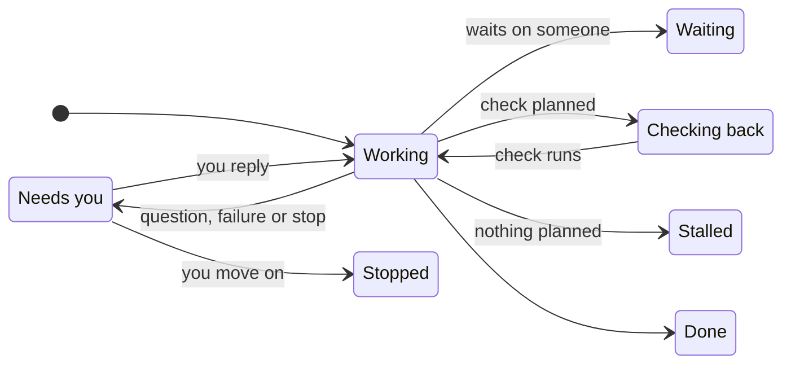

The **Tasks** page shows what Otto is working on, what's scheduled and what's done.

Otto starts a saved task session for independent work with a goal and a completion condition. The main chat stays available while the task runs. Quick questions stay in chat. There is no fixed limit of three tasks.

## Three views

| View          | Shows                                                                          |
| ------------- | ------------------------------------------------------------------------------ |
| **Current**   | Open task cards, with the ones that need you first                             |
| **Scheduled** | Your schedules and Otto's planned check-ins. See [Schedules](/use/schedules/). |
| **Previous**  | Finished cards and past schedule runs, newest first                            |

## What a card shows

| Part           | What it tells you                                           |
| -------------- | ----------------------------------------------------------- |
| Title          | The task in a few words                                     |
| Status         | Where the task stands, such as **Working** or **Needs you** |
| Now line       | What Otto is doing, or the question it asked you            |
| **Waiting on** | Who Otto is waiting for, and how, such as an email reply    |
| **Next check** | When Otto will look again                                   |
| **Done when**  | What finished looks like                                    |

The same task card appears in chat and on the Tasks page. It shows planned steps and current activity. Select **Show activity** to inspect tool and helper activity. This view does not show private model reasoning.

Reply to a task message to continue that task. You can reply to its first message, a question or a result. Telegram and WhatsApp use their reply controls. A message without a reply target goes to the main chat. Otto can send that message to one or more tasks when your intent is clear. If the target is unclear, Otto asks.

An owner update has a revision. **Owner update queued** means the task has not received it at an execution boundary. An outside action that has already started can still finish. Other tasks continue while one task waits for your answer.

Select **Stop** on a card to stop that task and its helpers. Other tasks continue. The main Stop control stops active work and closes all open tasks. Reset also closes the old thread's open tasks.

Complete reports can be Markdown documents. Otto sends the file and a short result to the conversation. A follow-up, such as completing a sign-in, continues the same saved session.

A finished card has **Schedule task**, which turns the same work into a [schedule](/use/schedules/).

## Statuses

| Status            | Meaning                                                               |
| ----------------- | --------------------------------------------------------------------- |
| **Queued**        | The task is waiting for its session to run.                           |
| **Failed**        | The run failed. Reply to its message to continue.                     |
| **Working**       | Otto is on it right now.                                              |
| **Needs you**     | Otto asked you a question or needs an approval. Reply to its message. |
| **Waiting**       | Otto is waiting on someone else.                                      |
| **Checking back** | Otto has a check planned for later.                                   |
| **Stalled**       | Nothing is planned next. Tell Otto to keep going or stop.             |
| **Done**          | Finished, with the result on the card.                                |
| **Stopped**       | Closed before it finished.                                            |

A question stays **Needs you** until you reply to it or continue its session. An unrelated chat message does not answer it. A failed or stopped task stays **Needs you** until you continue that work. Tell Otto to stop a task and it closes the card as **Stopped**.

## Tasks only report

A card is a view of the work. Apart from **Schedule task**, it doesn't schedule anything, grant any permission or post to chat. Otto's planned check-ins are ordinary [schedules](/use/schedules/), and every action still goes through the [trust check](/trust/approvals/).

To change a task, tell Otto in [chat](/use/chat/).

## Related resources

- [Chat with Otto](/use/chat/)
- [Schedules and background work](/use/schedules/)
- [Approvals and the trust check](/trust/approvals/)
