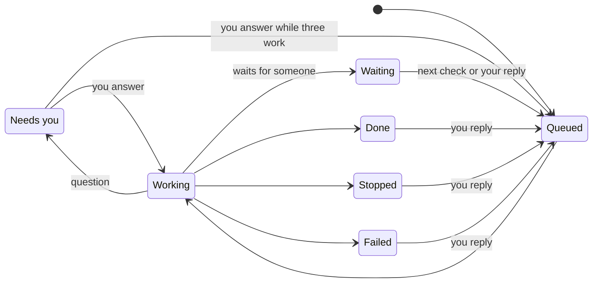

The **Tasks** page shows what Otto is working on, what's scheduled and what's done.

A task is long work that Otto hands off from the chat, so the chat stays free while the task runs. Tasks are in development. They appear only when Otto runs with `OTTO_TASKS` turned on. See [Configuration](/deploy/configuration/#server-and-data).

When Otto starts a task, it answers your message with a short "On it" message. The task's questions, confirmations from the [trust check](/trust/approvals/), sign-in and payment links, files and result reply to that message.

To answer a task or add to it, reply to any of its messages. Your reply goes to that task, not the chat. While the task works, it reads your reply before its next step, as the chat does with a follow-up. A reply with files waits and runs next. A reply to a done, stopped or failed task opens it again in a new browser: your saved logins and saved browser sessions still work, but the pages it had open are gone. When Otto sees that a message without a reply belongs to a task, it moves your message to that task word for word.

Up to three tasks work at the same time. When three are working, a new task waits as **Queued** until one of them finishes or stops to ask you something. So does a task you answer or open again while three others work. A task that waits for your answer or for someone else doesn't take a place, and the chat and your schedules never wait for tasks.

## Follow a task in the chat

The "On it" message holds a card for the task. Otto updates the card as the task works, without sending you a new message, so the card stays current even after newer messages push it up the chat.

- **Closed**, the card shows the task's title, its status, one line about where it stands and a bar with one segment for each step, such as **2 of 4 steps**.
- **Open**, after you select it, the card lists the steps and has **Stop task** while the task is open. When the task is done, it also shows the result and the result's document.

The task's questions aren't repeated in the card, because they reply to "On it" below it.

When two or more tasks are open, or a task needs you, the Tasks strip above the message box shows each one. See [Follow tasks from the message box](/use/chat/#follow-tasks-from-the-message-box).

## Open a task's document

When a task's result is a document, such as a report, the result's message carries a card for the document. Select the card to open the document in a panel next to the chat. Documents such as Markdown, PDF, text, spreadsheets and images show in the panel. Other files, web pages included, download. Select **Close**, or press Escape, to close the panel.

## Check-ins and Quiet

While a task works, it can send you a short check-in as a reply to "On it": a first finding that can change the plan, a change to the plan, cost or time that doesn't need your decision, or the start of a step that takes more than about two minutes. When the task needs your decision, it asks a question instead.

Choose how much you hear in **Settings → Preferences → Task updates**:

- **Check-ins**, the default, sends at most three check-ins before the task closes, at least two minutes apart.
- **Quiet** sends none.

Both send "On it", the task's questions and confirmations, its result and the notes when it stops or fails. During your [quiet hours](/use/schedules/#quiet-hours), a task sends no check-ins, and Otto doesn't send a skipped check-in later. A reply that opens a closed task again gives it three new check-ins. A change takes effect at once, also for tasks that already run. When you ask in the chat to change it, the [trust check](/trust/approvals/) reviews the change like any other notification setting.

## Answer a task's question

To answer a task's confirmation, select **Yes** or **No** under it, or in the task's card on the Tasks page. You can also reply yes or no to the confirmation or to any other message of that task. Anything else you reply to the task cancels the confirmation, and the task reads your reply instead.

**Yes** and **No** answer that one confirmation, and your answer shows in the chat as a reply to it. When a task has two confirmations open at once, neither has the buttons, so reply to the one you mean.

- A yes or no sent without a reply answers a task only when it's the only task question waiting in that conversation and the newest message you'd seen. With two or more, nothing runs and Otto asks which task you mean.
- A message you send without a reply never cancels a task's question.
- A task's confirmation stays open for 24 hours. A yes after that gets a short reply that the question expired, and nothing runs. Reply to the task again to pick it up.
- When a task finishes or stops, its open confirmations close without running.
- When a task needs you on a website, its question has an **Open browser** link to that task's own browser. Select **Done** when you're finished. Otto sends it as a reply to the question, so the task carries on. See [Take over the browser](/use/browser/#take-over-the-browser).

## When a task waits for someone else

Some work waits for other people, such as a reply to an email Otto sent for you. The task then shows **Waiting**, with who it's waiting on, how they'll answer and when it checks next.

- At the next check, the task looks again and carries on. If nobody has answered, it plans another check, at least 15 minutes and at most 30 days ahead.
- After 24 checks without a message from you, the task stops checking and gives you its result.
- To wake it sooner, reply to any of its messages. Your reply replaces the planned check and runs without waiting for its time, as soon as one of three places is free.
- A new email or app event doesn't wake a waiting task. Only the planned check or your reply does.

A planned check belongs to its task. It isn't a schedule, so it doesn't show in **Tasks → Scheduled**.

## Stop a task

To stop one task, select **Stop task** in its card, in the chat or on the Tasks page, or **Stop** next to its name in the Tasks strip. You can also reply "stop" to any of its messages. The task closes as **Stopped**, and the chat and your other tasks keep running.

**Stop** next to the send button stops only the chat, so your tasks keep running. **Stop all**, in the Tasks strip and on the Tasks page, stops everything: the chat, every task and the background runs that are working.

When a task stops, its open confirmations, sign-in forms and payment requests close without running, its browser closes and Otto posts a short note as a reply to "On it". Stopping can't undo anything that already reached a website or app. To pick the task up again, reply to any of its messages.

## When a task fails

When an error or a restart ends a task, it closes as **Failed**, its browser closes and Otto posts a short note as a reply to "On it". Its open confirmations close without running. Otto never runs a failed task again on its own, because it may have started something outside. Check what it did, then reply to any of its messages to pick it up again. The task reads the note with your reply.

## How long a task keeps its work

Each task works in its own folder of Otto's [workspace](/use/workspace/#files-for-a-task). The files it makes and the files you attach to a reply to the task go there, so two tasks never overwrite each other's files.

Otto deletes a task's browser when the task closes. It deletes the task's transcript, its record of what it read and did, and the task's folder 30 days after the task closes. You can still reply to the task after that. It then starts again from your messages and its own messages, without the tool results and files it had before.

## Three views

| View          | Shows                                                                           |
| ------------- | ------------------------------------------------------------------------------- |
| **Current**   | Open tasks, in groups: **Needs you**, **Working**, **Waiting** and **Queued**   |
| **Scheduled** | Your schedules and Otto's planned follow-ups. See [Schedules](/use/schedules/). |
| **Previous**  | Done, stopped and failed tasks, and past schedule runs, newest first            |

**Current** has **Stop all** while a task is open.

## What a card shows

The Tasks page uses the same card as the chat. Select a card to open it.

| Part           | What it tells you                                                                                              |
| -------------- | -------------------------------------------------------------------------------------------------------------- |
| Title          | The task in a few words                                                                                        |
| Status         | Where the task stands, such as **Working** or **Needs you**                                                    |
| Line           | The current step, the question it asked you, how long it took, such as **Finished in 4 min**, or why it failed |
| Step bar       | One segment for each step, filled as the task moves on                                                         |
| Steps          | Open card only. Each step, done, current or still to do                                                        |
| **Waiting on** | Open card only. Who a waiting task waits for, and how, such as an email                                        |
| **Next check** | Open card only. When a waiting task looks again                                                                |
| Result         | Open card only. The result of a done task, and its document                                                    |

On the Tasks page, an open card also has:

- The question of a task that needs you, with **Yes** and **No** when it's a confirmation.
- **Show in chat**, which scrolls the chat to the task's "On it" message.
- **Schedule task** for a done task, which turns the same work into a [schedule](/use/schedules/). The draft starts from your message that started the task and your later replies to that task. It never takes words from the chat or from other tasks. Cards from before tasks had an "On it" message don't have it.

## Statuses

| Status        | Meaning                                                   |
| ------------- | --------------------------------------------------------- |
| **Queued**    | Waiting for one of three places to free.                  |
| **Working**   | Otto is on it right now.                                  |
| **Needs you** | Otto asked you something. Answer or reply to it.          |
| **Waiting**   | Otto is waiting for someone else and has a check planned. |
| **Done**      | Finished, with the result on the card.                    |
| **Stopped**   | Closed before it finished.                                |
| **Failed**    | An error or a restart ended it.                           |

Only the task's own work and your replies to it change its status. A chat message about something else doesn't. Each action a task takes still goes through the [trust check](/trust/approvals/).

## Related resources

- [Chat with Otto](/use/chat/)
- [Schedules and background work](/use/schedules/)
- [Approvals and the trust check](/trust/approvals/)
