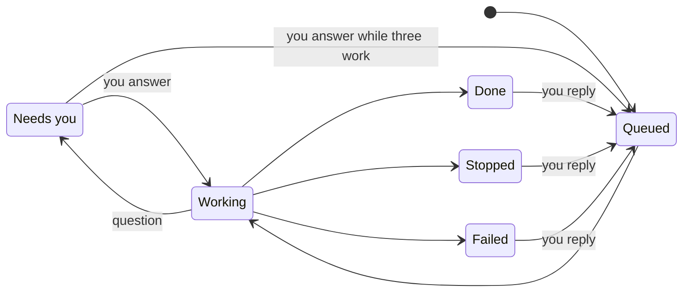

The **Tasks** page shows what Otto is working on, what's scheduled and what's done.

A task is long work that Otto hands off from the chat, so the chat stays free while the task runs. Tasks are in development. They appear only when Otto runs with `OTTO_TASKS` turned on. See [Configuration](/deploy/configuration/#server-and-data).

When Otto starts a task, it answers your message with a short "On it" message. The task's questions, sign-in and payment links, files and result reply to that message. A confirmation from the [trust check](/trust/approvals/) still appears as a plain message.

To answer a task or add to it, reply to any of its messages. Your reply goes to that task, not the chat. While the task works, your reply waits and runs next. A reply to a done, stopped or failed task opens it again. When Otto sees that a message without a reply belongs to a task, it moves your message to that task word for word.

To answer a task's confirmation, reply to the confirmation. Any other reply to the task cancels it, and the task reads your reply instead.

Up to three tasks work at the same time. When three are working, a new task waits as **Queued** until one of them finishes or stops to ask you something. So does a task you answer or open again while three others work. A task that waits for your answer doesn't take a place, and the chat and your schedules never wait for tasks.

## Three views

| View          | Shows                                                                          |
| ------------- | ------------------------------------------------------------------------------ |
| **Current**   | Open tasks, with the ones that need you first                                  |
| **Scheduled** | Your schedules and Otto's planned check-ins. See [Schedules](/use/schedules/). |
| **Previous**  | Done, stopped and failed tasks, and past schedule runs, newest first           |

## What a card shows

| Part     | What it tells you                                           |
| -------- | ----------------------------------------------------------- |
| Title    | The task in a few words                                     |
| Status   | Where the task stands, such as **Working** or **Needs you** |
| Now line | What Otto is doing, the question it asked you or the result |

A done task has **Schedule task**, which turns the same work into a [schedule](/use/schedules/). The draft starts from your message that started the task and your later replies to that task. It never takes words from the chat or from other tasks. Cards from before tasks had an "On it" message don't have it.

## Statuses

| Status        | Meaning                                  |
| ------------- | ---------------------------------------- |
| **Queued**    | Waiting for one of three places to free. |
| **Working**   | Otto is on it right now.                 |
| **Needs you** | Otto asked you something. Reply to it.   |
| **Done**      | Finished, with the result on the card.   |
| **Stopped**   | Closed before it finished.               |
| **Failed**    | An error ended it.                       |

Only the task's own work and your replies to it change its status. A chat message about something else doesn't. Each action a task takes still goes through the [trust check](/trust/approvals/).

## Related resources

- [Chat with Otto](/use/chat/)
- [Schedules and background work](/use/schedules/)
- [Approvals and the trust check](/trust/approvals/)
