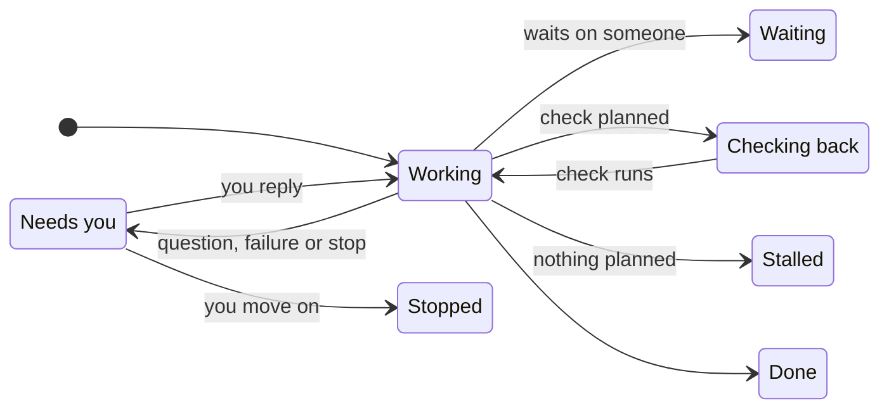

The **Tasks** page shows what Otto is working on, what's scheduled and what's done.

Otto adds a card when a request takes more than a few steps, or when you hand it work that continues later, such as chasing a reply. Quick answers don't get a card.

## Three views

| View          | Shows                                                                          |
| ------------- | ------------------------------------------------------------------------------ |
| **Current**   | Open task cards, with the ones that need you first                             |
| **Scheduled** | Your schedules and Otto's planned check-ins. See [Schedules](/use/schedules/). |
| **Previous**  | Finished cards and past schedule runs, newest first                            |

## What a card shows

| Part           | What it tells you                                           |
| -------------- | ----------------------------------------------------------- |
| Title          | The task in a few words                                     |
| Status         | Where the task stands, such as **Working** or **Needs you** |
| Now line       | What Otto is doing, or the question it asked you            |
| **Waiting on** | Who Otto is waiting for, and how, such as an email reply    |
| **Next check** | When Otto will look again                                   |
| **Done when**  | What finished looks like                                    |

Otto keeps the card current itself as it works, and a follow-up step, such as finishing a sign-in, continues the same card.

A finished card has **Schedule task**, which turns the same work into a [schedule](/use/schedules/).

## Statuses

| Status            | Meaning                                                                     |
| ----------------- | --------------------------------------------------------------------------- |
| **Working**       | Otto is on it right now.                                                    |
| **Needs you**     | Otto asked you something, or the task failed or was stopped. Reply in chat. |
| **Waiting**       | Otto is waiting on someone else.                                            |
| **Checking back** | Otto has a check planned for later.                                         |
| **Stalled**       | Nothing is planned next. Tell Otto to keep going or stop.                   |
| **Done**          | Finished, with the result on the card.                                      |
| **Stopped**       | Closed before it finished.                                                  |

A failed or stopped task shows **Needs you** until you write again. Tell Otto to stop a task and it closes the card as **Stopped**.

## Tasks only report

A card is a view of the work. Apart from **Schedule task**, it doesn't schedule anything, grant any permission or post to chat. Otto's planned check-ins are ordinary [schedules](/use/schedules/), and every action still goes through the [trust check](/trust/approvals/).

To change a task, tell Otto in [chat](/use/chat/).

## Related resources

- [Chat with Otto](/use/chat/)
- [Schedules and background work](/use/schedules/)
- [Approvals and the trust check](/trust/approvals/)
