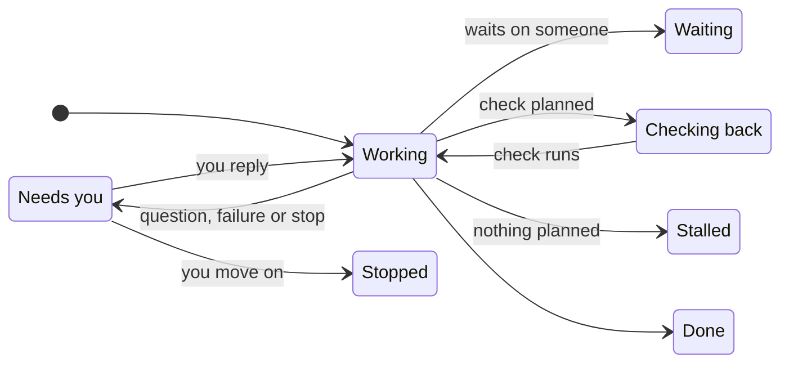

The **Tasks** page shows what Otto is working on, what's scheduled and what's done.

Otto starts a saved task session for independent work with a goal and a completion condition. The main chat stays available while the task runs. Quick questions stay in chat. There is no fixed limit of three tasks.

For example, "What does this sentence mean?" can stay in chat. "Compare these options and make a report" can become a task. The task keeps its goal and history while you discuss other work.

Tasks share one [workspace](/use/workspace/#one-workspace-for-all-tasks) and owner memory. Each task has its own working folder and saved session. See [Task sessions](/how-it-works/task-sessions/) for the architecture.

## Three views

| View          | Shows                                                                          |
| ------------- | ------------------------------------------------------------------------------ |
| **Current**   | Open task cards, with the ones that need you first                             |
| **Scheduled** | Your schedules and Otto's planned check-ins. See [Schedules](/use/schedules/). |
| **Previous**  | Finished cards and past schedule runs, newest first                            |


## What a card shows

| Part           | What it tells you                                           |
| -------------- | ----------------------------------------------------------- |
| Title          | The task in a few words                                     |
| Status         | Where the task stands, such as **Working** or **Needs you** |
| Now line       | What Otto is doing, or the question it asked you            |
| **Waiting on** | Who Otto is waiting for, and how, such as an email reply    |
| **Next check** | When Otto will look again                                   |
| **Done when**  | What finished looks like                                    |

The same compact task preview appears in chat and on the Tasks page. It shows the title, status, current activity and, when steps are available, a segmented step bar. Select the preview to open its available steps and controls in place. Select it again to close the details. Inside the details, select **Show activity** to inspect tool and helper activity. This view does not show private model reasoning.


## Reply or stop one task

Reply to a task message to continue that task. You can reply to its first message, a question or a result. Telegram and WhatsApp use their reply controls. A message without a reply target goes to the main chat. Otto can send that message to one or more tasks when your intent is clear. If the target is unclear, Otto asks.

An owner update has a revision. **Owner update queued** means the task has not received it at an execution boundary. An outside action that has already started can still finish. Other tasks continue while one task waits for your answer.

Open a task preview and select **Stop** to stop that task and its helpers. Other tasks continue. The main Stop control stops active work and closes all open tasks. Reset also closes the old thread's open tasks.

## Inspect task activity

On the **Tasks** page, open a preview and select **Show activity**. The details show planned steps, tool activity and helper activity. Select **Show in chat** to return to the task's message.


## Read task results

Complete reports can be Markdown documents. Otto sends the file and a short result to the conversation. A follow-up, such as completing a sign-in, continues the same saved session.


Select the file to read the document in Otto. Select **Download** to save it. Press **Escape** to close the preview.

Otto previews Markdown files up to 4 MB. For a larger file, select **Download**.


A finished card has **Schedule task**, which turns the same work into a [schedule](/use/schedules/).

## Use tasks on mobile

Mobile web uses the same compact previews. Open a preview to read the steps, reply or stop one task.


## Telegram without a task page

Telegram shows each task as a text message. The first message shows its name and status. Progress and completion messages reply to that message. A progress message shows the current step. A question or approval request also stays linked to the task.

```text
Working · Compare travel options
Check the train times
Step 2/3: Compare travel time and price
```

Use Telegram's **Reply** control to send an update or answer to a task. Other messages go to the main chat. These commands work without a model request:

| Command   | Result                                                                                                  |
| --------- | ------------------------------------------------------------------------------------------------------- |
| `/tasks`  | List open tasks and their current state.                                                                |
| `/status` | List open tasks. Reply to a task message with `/status` to see its goal, steps and current state.       |
| `/stop`   | Stop all active work and close open tasks. Reply to a task message with `/stop` to stop only that task. |

The task list sends one message per task. You can reply to that message, the task's first message, a progress message, a question, a file, a result or a status response. If Otto cannot match a reply to a task, `/stop` asks you to select a task. It does not stop all work.

A status message that shows a pending question keeps a link to that exact question. Your approval applies only to the saved action it shows. An old status message cannot approve a later action.

Telegram and web use the same task record and saved session. Task commands do not grant permission for an outside action. Private sign-in and payment steps still use Otto's private forms.

## Statuses

| Status            | Meaning                                                               |
| ----------------- | --------------------------------------------------------------------- |
| **Queued**        | The task is waiting for its session to run.                           |
| **Failed**        | The run failed. Reply to its message to continue.                     |
| **Working**       | Otto is on it right now.                                              |
| **Needs you**     | Otto asked you a question or needs an approval. Reply to its message. |
| **Waiting**       | Otto is waiting on someone else.                                      |
| **Checking back** | Otto has a check planned for later.                                   |
| **Stalled**       | Nothing is planned next. Tell Otto to keep going or stop.             |
| **Done**          | Finished, with the result on the card.                                |
| **Stopped**       | Closed before it finished.                                            |



A question stays **Needs you** until you reply to it or continue its session. An unrelated chat message does not answer it. A failed task shows **Failed**. A stopped task shows **Stopped**. Reply to the task to continue the same saved session.

## Task status and permission

A card is a view of the work. It does not grant permission or schedule a check. **Schedule task** creates an ordinary [schedule](/use/schedules/). Every outside action still goes through the [trust check](/trust/approvals/).

To change a task, tell Otto in [chat](/use/chat/).

## Related resources

- [Chat with Otto](/use/chat/)
- [Schedules and background work](/use/schedules/)
- [Approvals and the trust check](/trust/approvals/)
