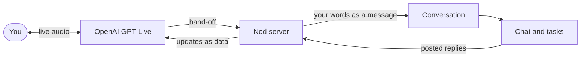

Select the phone button in the chat to talk with Nod live. A fast voice model answers right away and hands your requests to Nod, which works on them in the same conversation as your typed messages.

## Before you start

- **An OpenAI API key.** Calls use OpenAI GPT-Live, even when another provider runs Nod. Add a key in **Settings → Models**. A ChatGPT plan doesn't include GPT-Live. Without a key the phone button is hidden, and **Settings → Voice & audio** says what a call needs.
- **The Nod app.** Calls work in the desktop and web app, not in Telegram or WhatsApp.
- **Spending.** OpenAI bills each call by its length. **Usage** records each call's duration without a price. Because calls have no price in Nod, they don't count toward the monthly spending limit. Once that limit is reached by other spending, a new call doesn't start.

## Make a call

1. Select the phone button beside the microphone and allow microphone access. The call uses the microphone you chose for audio messages.
2. When the call connects, the chat shows that you're on a call and the voice says hello in your browser's or system's language.
3. Talk. The voice answers in the language you speak. If you chose the OpenAI **Marin** or **Cedar** voice in **Settings → Voice & audio**, the call uses it; otherwise it uses Marin.
4. Select the button again to hang up. Leaving the chat also ends the call.

While you're on a call:

- **Ask anything.** The voice keeps the conversation going and hands Nod anything that needs facts, your data, an app, the web or an action.
- **Start a task and keep talking.** When Nod replies, or a task posts a question, update or result, the voice tells you in a sentence or two and says the details are in the app. It skips a reply that only repeats what it already told you. It doesn't read out links, codes, files or long text.
- **Interrupt the voice** by talking over it. That only stops what the voice is saying.
- **Say "stop"** to stop Nod's work. Your words reach Nod as a message, and Nod stops its work as it does for a typed request. The **Stop** button keeps working during a call.

## What the chat keeps

Each request the voice hands to Nod shows in the chat as your message: what you said, as OpenAI transcribed it, not the voice's summary. Nod's replies show as usual. The voice's own small talk isn't saved, so a call never creates a second history.

## Confirmations stay in the app

When Nod needs your yes, the voice says that a confirmation is waiting in the app. Approve or decline it there. A spoken yes or no never answers a confirmation, and a spoken security code is never taken: enter codes in the app.

## How it works

The app sends your audio straight to OpenAI. The Nod server starts each call with your OpenAI key and gives the app only what it needs to connect. The key never reaches the app.

When the voice hands a request to Nod, the server takes OpenAI's transcript of what you said since the previous hand-off and posts it as your message in the app's conversation. It counts as typed: it steers work Nod is already doing, and the [trust check](/trust/approvals/) reads it as your words. Nothing the voice model says becomes your words.

The server watches the conversation and passes each new message from Nod to the call as [untrusted data](/trust/untrusted-content/), with links removed and long text cut short.

## Related resources

- [Chat with Nod](/use/chat/)
- [Approvals and the trust check](/trust/approvals/)
- [Threads and turns](/how-it-works/threads-and-turns/)
