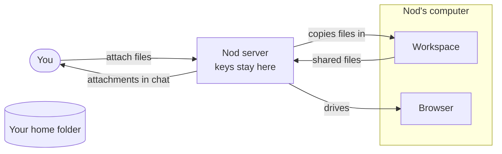

Nod has its own Linux computer, called the workspace, where it runs commands and keeps files for your conversation.

The workspace is separate from your computer. Nod can write documents, convert files, run code and keep notes there without touching your own files.

## What Nod can use

| For                     | The workspace has                                                                                     |
| ----------------------- | ----------------------------------------------------------------------------------------------------- |
| Office files            | LibreOffice, to convert, render and recalculate documents and sheets                                  |
| PDFs                    | qpdf, Ghostscript and pypdf, to fill forms and repair files                                           |
| Text in any language    | Noto fonts for other scripts and emoji                                                                |
| Video from a link       | `save-video`, which saves a video as an MP4 of 50 MB or less to send, or the full video with `--full` |
| Anything else in Python | `pip install`, which adds libraries to `~/.local`                                                     |

`save-video` refuses live streams and videos too long to fit at a watchable quality. `save-video --full` keeps the whole video at full quality in the workspace instead, for example to transcribe or cut it.

## What the workspace can't reach

- **Your files.** The workspace doesn't see your home folder. It only gets the files you attach or that Nod fetches.
- **Keys.** Model provider keys and Nod's access key never enter the workspace. If you connect a command-line tool, its token reaches only that tool, never code Nod writes.
- **The browser.** Nod's browser runs in its own container. The workspace can't read its saved sign-ins.

:::caution
The workspace can reach the internet. Code that Nod runs there can download files and call websites. Commands run without a [trust check](/trust/approvals/#workspace-commands), because the workspace holds no keys or sign-ins. A command can still send files that are in the workspace to an outside site.
:::

## Watch Nod's commands

You can watch the commands a task runs in the workspace. On **Scheduled**, open the task's preview and select **Show commands**.

Each row shows the command and its status. Select a row to open the command and its saved output.

| Status                | What it means                                                               |
| --------------------- | --------------------------------------------------------------------------- |
| **Exit 0**            | The command finished without an error                                       |
| **Exit** and a number | The command finished with that exit code. A nonzero code indicates an error |
| **Finished**          | The command finished, but Nod did not record an exit code                   |
| **Running**           | The command has not reported back, and its turn is still running            |
| **Failed**            | The command failed before Nod could record an exit code                     |
| **Interrupted**       | The turn ended before Nod could record the command's result                 |

Commands from a task's helpers have a **Helper** label. The task shows the latest 200 commands. Each output keeps at most the last 16,000 characters of the redacted command output. The exit code is saved when available. Output is saved when a command ends or fails. It does not stream while the command runs.

The view is read-only. Commands run in Nod's isolated workspace. To stop a running command, stop the task.

You can also open **Usage** and select a request to see its commands in the [step log](/use/spending/#see-your-spending). Select a command to open the same detail view. **Export** includes the recorded command, exit code, status and saved output in the CSV file. Older commands without a saved command record still appear as a Bash step.

Before Nod saves an entry, it removes known secrets from the command and output. This includes provider keys, tokens and values assigned to names such as `password`. Nod cannot identify every secret. Private file content can remain in the saved output and the CSV export.

The display limits do not delete older records. The command records remain in your local or self-hosted database until you [remove all data](/trust/privacy/#delete-your-data).

## Give Nod files

- **Attach them in chat.** Each file can be 90 MB or smaller. Nod gets a copy in the workspace and sees images directly.
- **From your apps.** Files from a connected app, such as an email attachment, are saved privately in the workspace.
- **From the web.** Files that Nod downloads in its [browser](/use/browser/) go into the workspace.

## Get files from Nod

When Nod shares a file, it appears as an attachment in the Nod app, up to 90 MB. Select it to open a panel next to the chat. Press Left or Right to move through the conversation's files and visuals. Drag the panel's edge to resize it, and press **Escape** to close it. Arrow keys keep their usual behavior in inputs, media controls, selected text, or a zoomed preview. Select **Download** to save a file.

File actions appear over previews in chat and in the panel's toolbar. Videos play directly in chat when your browser supports the format, with a preview frame when available. Playback starts when you select Play and pauses when the video leaves view. Use the expand control to open the larger player.

The panel remembers reading state for up to eight recently viewed files, with a total retention limit of 90 MB. Use the filename selector to jump between files during this conversation visit.

- **Use in message** adds an existing file to your draft.
- **Copy image** copies raster image data where the clipboard supports it. **Download** keeps the original file format.
- In the desktop app, drag a file card, image, or preview file icon to a folder to copy the file. **Save to Downloads** shows **Open** and **Show in folder** after the save completes. The file menu uses the system menu. Right-click a file card, a preview in chat, or an image, video or PDF in the panel to show the file menu. Links, fields and selected text keep their own menu.

Desktop file actions prepare private copies in the system temporary folder, up to eight files. They're removed when the cache needs room or the app quits. A forced stop can leave one behind. Saving creates a separate file in Downloads.

Native opening is limited to supported document and raster image types. Save other formats and open them from your file manager.

| File                                    | How it opens                                                       |
| --------------------------------------- | ------------------------------------------------------------------ |
| Images, video and audio                 | At full size. Select an image to zoom; audio shows its waveform    |
| PDF                                     | Every page, with zoom                                              |
| Word (`.docx`) and PowerPoint (`.pptx`) | As a page or slides. The layout is close to, not exactly, Office's |
| Excel, CSV and TSV                      | As a table with its sheets, up to the first 200 rows               |
| Markdown, HTML and SVG                  | Rendered, with a **Code** view                                     |
| n8n workflows (`.n8n.json`)             | As a canvas of nodes and connections, with a **Code** view         |
| Code, JSON and text                     | With syntax highlighting                                           |
| ZIP                                     | The list of files inside                                           |

Ask for a page, a specification, a runbook, a reference page, a weekly update or meeting notes to view on screen, and Nod writes one HTML file that follows your light or dark theme and prints cleanly. Ask for PowerPoint, Word or PDF when you plan to edit or forward the file. Slides come as PowerPoint.

HTML files run in a sandbox, apart from Nod. Their scripts work, but they can't reach Nod or your accounts, load anything from the internet, send forms or open windows. If a page navigates to a website, its preview closes. Other files open without running any code.

Previews have size limits: 4 MB for text, Markdown, HTML and spreadsheets, 25 MB for Word documents and 60 MB for presentations. Download larger files to open them.

When Nod puts a full workspace file path in a link or inline code in a reply, the server checks the file and attaches it. The link opens the attachment. A path the server can't attach, such as a folder, a missing file or a location outside this conversation's workspace, stays as plain text and the rest of the reply still arrives. File paths in code blocks remain examples.

Files Nod saves along the way stay private in the workspace until it shares them. Ask for one by name if you want it. Telegram and the WhatsApp QR connection receive shared files up to 50 MB each. With the WhatsApp Cloud API, open Nod to get files. See [Telegram and WhatsApp](/use/channels/).

## Find a file again

Every file Nod shares is kept on **Pages**, outside the conversation it came from: pages, documents, presentations, spreadsheets, images and other files. Each one shows a small preview, its title, its type, its version and when it was last saved. Select one to open it in the panel. Type in **Search** to show only the ones whose title contains those words.

The buttons next to the search box change how the files are shown. Nod remembers both choices in this browser.

| Button           | What it does                                                                     |
| ---------------- | -------------------------------------------------------------------------------- |
| **Sort**         | Orders files by newest first, oldest first or title. Newest first is the default |
| **Show as list** | Switches between a grid of previews and a compact list                           |

Select a type under the search box to show only that type, and select it again to show everything.

| Type       | What it holds                                                     |
| ---------- | ----------------------------------------------------------------- |
| **Docs**   | HTML pages, PDF, Word, Markdown, text and code files              |
| **Slides** | PowerPoint presentations                                          |
| **Data**   | Excel and CSV files                                               |
| **Images** | Pictures and charts                                               |
| **Files**  | Everything else, such as archives, audio, video and n8n workflows |

Contact cards and locations Nod sends to a chat app are not kept.

When you ask Nod to change a file it made, it saves a new version of the same entry instead of a new one. Nod matches a file to its earlier version by its name within the conversation, so two different results need different names. Use the picker in the panel's title to open an earlier version. To ask for a change from **Pages**, select **Use in message** in the panel: Nod opens the chat with that page attached.

| What you see  | What it means                                     |
| ------------- | ------------------------------------------------- |
| **Version 3** | The page has been changed twice since Nod made it |
| The date      | When the latest version was saved                 |

### Download in another format

Select **Download** in the panel's toolbar. Some files offer a second format next to the original:

| File                              | Formats                        |
| --------------------------------- | ------------------------------ |
| HTML page                         | **HTML file** or **PDF**       |
| Markdown                          | **Markdown file** or **PDF**   |
| CSV or TSV                        | The original or **Excel file** |
| Excel or OpenDocument spreadsheet | **Excel file** or **CSV file** |

Other files download as they are. Files over 4 MB download only in their original format.

**PDF** opens your system's print window. Choose **Save as PDF** there. The file prints in the light theme. Nod prints a page in a separate locked frame where the page's own scripts do not run, so a printed page shows what is on it before any script changes it. A Markdown file prints without its images.

**Excel file** keeps every cell as written. Plain numbers become numbers; dates, percentages and codes with leading zeros stay as text. **CSV file** holds the first sheet only.

The second format is made in your browser and isn't saved in Nod.

Pages are private to you. Nod has no link that another person can open. To give someone a page, download it and send the file. A page is one file that needs no internet connection, so it opens the same way on their computer.

### Delete a file

A file keeps every version until you delete it. Select the bin on its card in **Pages**, then **Delete**. This removes every version and also takes the file out of the chat it was made in. It cannot be undone. The file Nod wrote in its workspace stays there, so Nod can share it again if you ask. [Remove all data](/trust/privacy/#delete-your-data) deletes every page.

## One workspace for all tasks

The main chat and all saved tasks use the same conversation workspace. Each task has a folder under `tasks/`, with `drafts/` for working files and `outputs/` for results. `shared/` holds common files.

A task can read files from another task's output folder. These folders organize work; they do not create separate computers or file access boundaries. Each task keeps its own saved conversation history. Sharing a file does not automatically add its content to every active task's context.

See [Task sessions](/how-it-works/task-sessions/#shared-information-separate-histories) for how files, memory and owner updates keep the work connected.

## How long files stay

Files stay in the workspace for the whole conversation. Nod can come back to them days later.

## Related resources

- [Chat with Nod](/use/chat/)
- [Nod's browser](/use/browser/)
- [Your data and privacy](/trust/privacy/)
- [Sandbox and browser](/how-it-works/sandbox-and-browser/)
