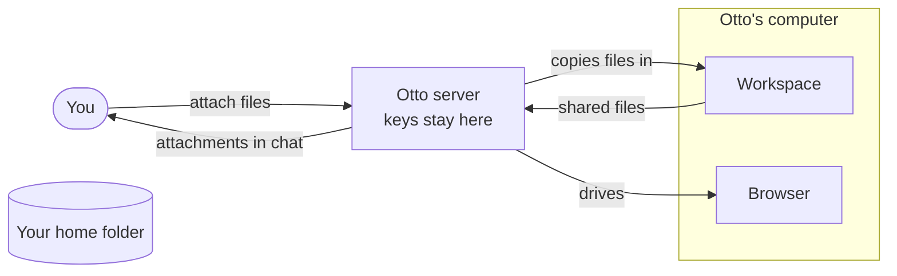

Otto has its own Linux computer, called the workspace, where it runs commands and keeps files for your conversation.

The workspace is separate from your computer. Otto can write documents, convert files, run code and keep notes there without touching your own files.

## What Otto can use

| For                     | The workspace has                                                    |
| ----------------------- | -------------------------------------------------------------------- |
| Office files            | LibreOffice, to convert, render and recalculate documents and sheets |
| PDFs                    | qpdf, Ghostscript and pypdf, to fill forms and repair files          |
| Text in any language    | Noto fonts for other scripts and emoji                               |
| Video from a link       | `save-video`, which saves a video as an MP4 of 15 MB or less         |
| Anything else in Python | `pip install`, which adds libraries to `~/.local`                    |

`save-video` refuses live streams and videos too long to fit at a watchable quality.

## What the workspace can't reach

- **Your files.** The workspace doesn't see your home folder. It only gets the files you attach or that Otto fetches.
- **Keys.** Model provider keys and Otto's access key never enter the workspace. If you connect a command-line tool, its token reaches only that tool, never code Otto writes.
- **The browser.** Otto's browser runs in its own container. The workspace can't read its saved sign-ins.

:::caution
The workspace can reach the internet. Code that Otto runs there can download files and call websites.
:::

## Give Otto files

- **Attach them in chat.** You can attach up to 20 files per message, each 15 MB or smaller. Otto gets a copy in the workspace and sees images directly.
- **From your apps.** Files from a connected app, such as an email attachment, are saved privately in the workspace.
- **From the web.** Files that Otto downloads in its [browser](/use/browser/) go into the workspace.

## Get files from Otto

When Otto shares a file, it appears as an attachment in chat, up to 15 MB. Select it to preview or download it.

Files Otto saves along the way stay private in the workspace until it shares them. Ask for one by name if you want it. On Telegram, shared files arrive as documents. WhatsApp can't receive files from Otto, so open Otto to get them. See [Telegram and WhatsApp](/use/channels/).

## How long files stay

Files stay in the workspace for the whole conversation. Otto can come back to them days later.

In a development run, **Clear messages** gives Otto a new, empty workspace folder. See [Start with an empty chat](/use/chat/#start-with-an-empty-chat).

## Related resources

- [Chat with Otto](/use/chat/)
- [Otto's browser](/use/browser/)
- [Your data and privacy](/trust/privacy/)
- [Sandbox and browser](/how-it-works/sandbox-and-browser/)
