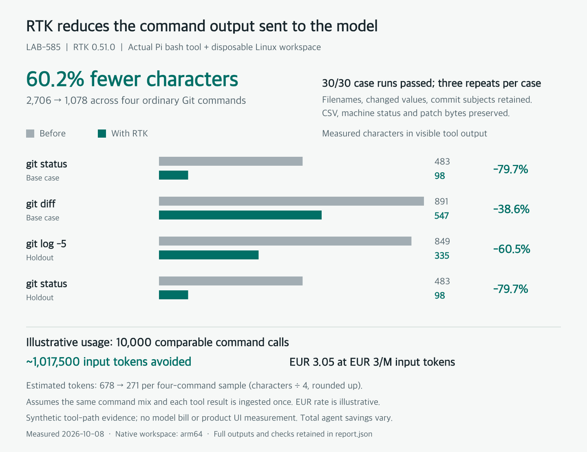

# RTK acceptance and measured output savings

The native RTK 0.51.0 workspace passes **45/45 case runs** on committed runtime source `57c6cbdef56190bd61b6470ca275c0c654f1c6a7`: 15 frozen cases, three repetitions each. The nine equally used display commands produced **5,736 → 3,703 characters (35.4% less)**. Actual RTK execution is verified for Git, listings, file reading, search and find. The Cloudflare image also passes the same 15 cases once with a Linux UID-1001 evaluator and UID-1000 workspace on an ext4 volume.



This is controlled execution of the actual Pi bash tool through `createSandbox` and `createDockerWorkspace`, using synthetic repositories and disposable Linux containers with networking disabled. No model, connected account, UI or live user workload ran. The chart is generated from recorded output, not a product screenshot. The requested agent-eval-loop method supplies frozen cases, observable checks, retained failures and repeat runs; this does not establish end-to-end language-model task quality.

## Evidence and provenance

| Record                                                                                                  | Scope                                                             |
| ------------------------------------------------------------------------------------------------------- | ----------------------------------------------------------------- |
| [Frozen cases](baseline/cases.json)                                                                     | Matrix v6 prompts, checks, applicability and repetitions          |
| [Original baseline](baseline/report.json)                                                               | Source `437687bb` and workspace without RTK                       |
| [Final candidate](candidate/report.json)                                                                | Full native arm64 workspace; 45/45                                |
| [Cloudflare smoke](cloudflare-smoke/report.json)                                                        | Full amd64 Cloudflare workspace; 15/15 with Linux UID mismatch    |
| [Computed summary](summary.json)                                                                        | Actual characters, estimated tokens and usage assumptions         |
| [Wrapper/machine-output red](wrapper-check-red.json)                                                    | Historical real-binary wrapper checks and the `ls --zero` failure |
| [Merge-history red](candidate-red-v5/report.json)                                                       | Earlier runtime loses a merge; R7 fails 3/3                       |
| [Original rewrite failures](candidate-red-v1/report.json), [extended red](candidate-red-v2/report.json) | Porcelain newline loss and patch corruption                       |

All prior matrix versions remain under `baseline-v1` through `baseline-v5` and matching available candidate directories. The first v6 run is retained as `baseline-v6-initial` / `candidate-v6-initial`. The reports before the C5 wording clarification and pretty-format fix are retained as `baseline-v6-before-c5`, `candidate-v6-before-pretty` and `cloudflare-smoke-v6-before-pretty`. The prior results before the Linux permission repair remain in `baseline-v6-before-linux-permissions`, `candidate-v6-before-linux-permissions` and `cloudflare-smoke-v6-before-linux-permissions`. The final run freezes directory timestamps before listing so the raw comparison remains reproducible across minutes. The earlier [controlled overlay](candidate-controlled-overlay/report.json) is v3 evidence, not the expanded v6 workload.

Each current attempt records raw and Pi-visible output, output hashes, exit and semantic checks, timestamps, exported content/hashes where applicable, and RTK invocations. A disposable PATH shim logs arguments and immediately execs the installed `/usr/local/bin/rtk`; rewrite probes alone cannot pass the RTK-used check. It does not manufacture command output. Current reports capture commit, source state, runtime source hash and harness hash at run start. Final runtime SHA-256: `daa81373ef3fe34e8bce3ad0e32692ba1d258d3154774c2a6c32aa02530880e9`. Final harness SHA-256: `e99c252efe1c114a047046621293209da63d6479892b6209c65b8bcb817bbb0f`.

Historical reports including `candidate-red-v2/report.json` predate `sourceState` and `harnessSha256`. These fields have not been backfilled. Their adjacent patches reconstruct the runtime against the recorded base commit, not the exact earlier harness or entire dirty working tree. Historical outputs and scores remain intact. The [manifest annotation](manifest-annotations.md) clarifies the old C5 wording without changing frozen manifest bytes or their recorded hashes.

## Gates and observed results

All 15 cases pass at least once and all 15 pass every repetition. The display group must reduce aggregate characters in each repetition, and each display case must execute the real RTK command, succeed, and retain its independent expected facts. Individual outputs may grow. Separate regression gates preserve machine-readable bytes, staged and unstaged patch content, a real merge commit, and failure exit status. C5 compares machine status with raw output, CSV bytes with the independent input, and patch bytes with raw Git output. C7 independently checks expected staged and unstaged semantic facts; it does not supply an independently authored complete patch oracle.

| Group               | Required outcomes                                                          | Final |
| ------------------- | -------------------------------------------------------------------------- | ----- |
| B1.v2, H2.v2        | All paths and staged, unstaged, deleted and untracked status classes       | 6/6   |
| B2.v1, H1.v1        | Changed values and all five bounded-history subjects                       | 6/6   |
| R6.v2, B3.v1        | Main directory entries through actual RTK listings                         | 6/6   |
| H3.v1, B4.v1, H4.v1 | Expected code, search matches and source files through RTK                 | 9/9   |
| R1.v1, R2.v1        | Exact 120-row CSV export and porcelain status                              | 6/6   |
| R3.v2, R5.v2        | Raw-Git-identical patches plus independent staged/unstaged semantic checks | 6/6   |
| R4.v1, R7.v1        | Exit 23 retained; complete raw history includes a real merge               | 6/6   |

The original baseline passes semantic and data checks but fails all case gates because RTK is absent; the display group also lacks compression and actual RTK execution. Repetitions are deterministic tool-integration checks, not estimates of model reliability.

## Changes informed by evidence

- v1/v2 exposed porcelain newline removal and `git diff --output` corruption. Exact data/output forms bypass automatic RTK.
- v3 strengthened status-class checks and preserved ordinary listing format under the initial conservative scope.
- v4 corrected an evaluator gap: the earlier “full patch” only covered unstaged changes. R3.v2 and R5.v2 use `git diff HEAD` and independently check staged content as well as unstaged modifications/deletion. Earlier results remain limited evidence.
- v5 added a separate merge repository and preserved a 3/3 red for automatic bare `git log`; full-history output stays raw.
- v6 follows the user's explicit direction to use RTK broadly even when imperfect. R6.v2 accepts an enriched listing, four additional display tasks exercise actual tools, and savings use the equally weighted aggregate rather than requiring every command to shrink. Earlier stricter cases and their scores remain preserved.

A separate [real-binary pretty-format reproduction](pretty-format-red.json) records RTK adding a newline to custom Git history output in all four quoted/count variants. The [focused pre-fix test failure](pretty-format-test-red.txt) records the missing bypass. These are preserved synthetic red records, separate from the frozen matrix; they did not record full source/harness provenance. Commit `57c6cbde` adds the raw-output bypass, and the matrix above was rerun against that committed source.

The CI setup failure was reproduced with a UID-1001-owned directory behind Cloudflare's `/workspace` symlink. The Git safe-directory entry now uses the fixture's canonical `pwd -P` path. A subsequent [full Linux ownership reproduction](linux-uid-setup.json) caught host-owned 0644 input files rejecting workspace writes even though the top directory was writable. The repaired harness explicitly shares write access to synthetic directories and host-written files before sandbox access. The preserved [setup error](linux-uid-setup-red.txt) occurs before scoring; the same UID-1001 runner and UID-1000 workspace now pass all 15 cases on an ext4 Docker volume. This run uses Linux ownership throughout fixture setup and execution; the earlier macOS bind-mount runs did not establish that compatibility. Cleanup was checked by forcibly removing a real evaluation container during setup: the run failed as expected and both temporary host directories were removed. The renderer validates complete case/repetition grids, derives one versus three runs from actual records, and rejects duplicates, missing records and gaps.

## Output and illustrative cost

| Command/case                       | Before characters | RTK characters |     Change |
| ---------------------------------- | ----------------: | -------------: | ---------: |
| `git status` (RTK-B1.v2)           |               483 |             98 |     −79.7% |
| `git diff` (RTK-B2.v1)             |               891 |            547 |     −38.6% |
| `git log -5` (RTK-H1.v1)           |               849 |            335 |     −60.5% |
| `git status` (RTK-H2.v2)           |               483 |             98 |     −79.7% |
| `ls` (RTK-R6.v2)                   |                73 |            107 |     +46.6% |
| `ls -la` (RTK-B3.v1)               |               613 |            186 |     −69.7% |
| `cat src/alpha.ts` (RTK-H3.v1)     |              1285 |           1285 |      −0.0% |
| `rg 'invoiceRate' src` (RTK-B4.v1) |              1020 |           1020 |      −0.0% |
| `find src -type f` (RTK-H4.v1)     |                39 |             27 |     −30.8% |
| **Nine-command sample**            |         **5,736** |      **3,703** | **−35.4%** |

Plain `ls` grows on this small directory; file reading and search are unchanged on these fixtures. Those results are included in the aggregate. Token estimates use `ceil(characters / 4)` per output: **1,438 → 929**, about **509 input tokens avoided per nine-command sample**. No model tokenizer or provider meter ran.

| Comparable command calls | Estimated input tokens avoided | At €1/M | At €3/M | At €10/M |
| ------------------------ | -----------------------------: | ------: | ------: | -------: |
| 1,000                    |                         56,556 |   €0.06 |   €0.17 |    €0.57 |
| 10,000                   |                        565,556 |   €0.57 |   €1.70 |    €5.66 |
| 100,000                  |                      5,655,556 |   €5.66 |  €16.97 |   €56.56 |

Rates are illustrative assumptions, not current provider prices. Each table row is used equally often (two status cases and one of each other display command), and each result is ingested once as uncached input. This estimates the affected tool-output component only. Other instructions/tools, model output, caching, repeated history ingestion, added tool-description tokens, rewrite latency, runtime and image-build costs are excluded. It is not a net-bill measurement; whole-agent savings depend on the workload.

## Local tool latency

The separate [latency record](latency.json) measured the actual Pi bash path in one warm native arm64 Docker workspace: five warmup pairs followed by 40 alternating baseline/candidate pairs per command, with command order rotated. It compared baseline commit `437687bb` (source SHA-256 `4e2f5b03d47211ea85653ec88c021c539ad98d9df4738e7df5c6456a3fc48604`) with the earlier Git-only implementation at `768ec5a0` (source SHA-256 `0f1e3f5491c3741bc0e944e8623b6468306a6b7bc5412a9646a5245de9884049`). This is a separate historical measurement, not a timing claim for later runtime changes.

| Command      | Baseline median | RTK median | Paired median overhead | Paired p95 overhead |
| ------------ | --------------: | ---------: | ---------------------: | ------------------: |
| `git status` |         88.7 ms |   108.6 ms |               +19.6 ms |            +39.4 ms |
| `git diff`   |         88.1 ms |   108.6 ms |               +19.2 ms |            +32.8 ms |
| `git log -5` |         86.1 ms |   100.4 ms |               +13.9 ms |            +33.5 ms |

These are local synthetic tool timings, excluding container startup, builds and model processing. Host background load was not isolated. No production repository, E2B latency, model quality or end-to-end answer time was measured. Output savings do not eliminate tool runtime or image-build cost.

## Reproduce

```sh
docker build -f Dockerfile.workspace -t otto-rtk-candidate .
npx tsx scripts/eval-rtk.ts --image otto-rtk-candidate --output /tmp/rtk-candidate
```

`--smoke` runs all 15 cases once and needs no historical Git ref. `--phase baseline --baseline 437687bb17a3944ce9aa01ac37239e5163515365 --image <image-without-rtk>` runs the original baseline. `--case-version 1` through `--case-version 5` reproduce prior matrices; `--source-ref <commit>` selects a committed runtime explicitly. Temporary fixtures use no credentials or normal database.

The renderer requires matching manifests, fixture hashes and raw outputs, plus complete and passing candidate attempts:

```sh
node scripts/eval-rtk-report.mjs docs/testing/rtk-eval
```

The chart runtime uses the direct pinned development dependency `@napi-rs/canvas@1.0.9`. An evidence-only commit may differ from the tested runtime commit; the source hash identifies the implementation that ran.
