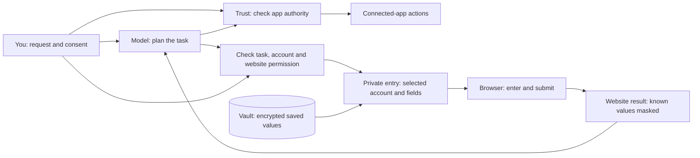
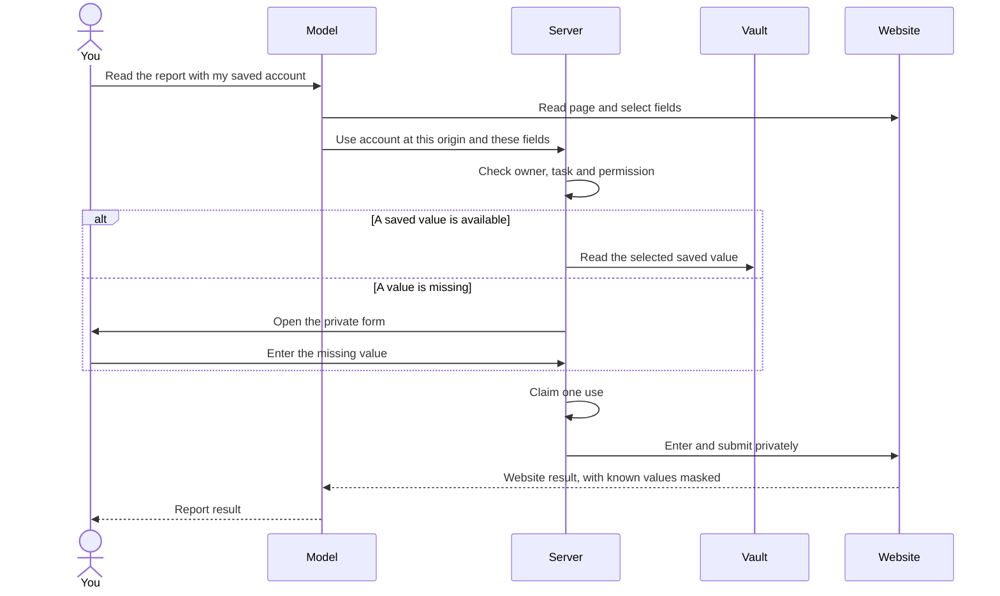
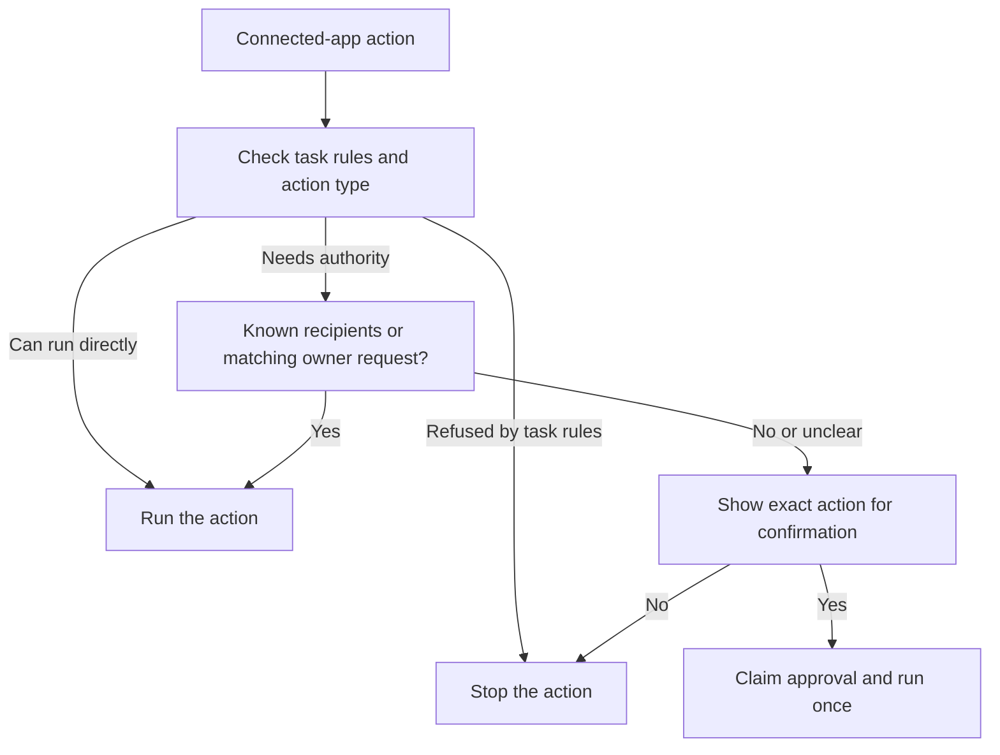
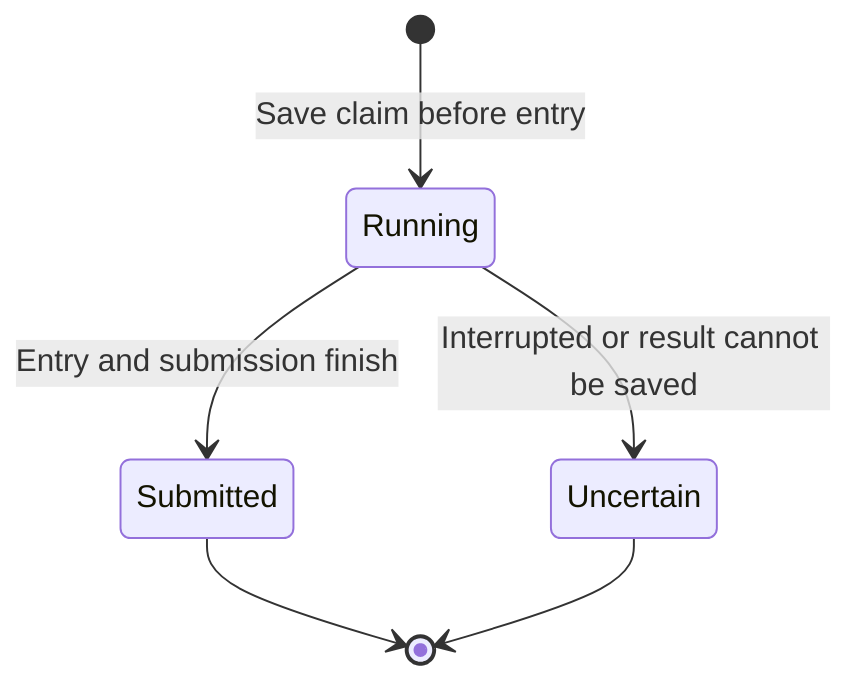
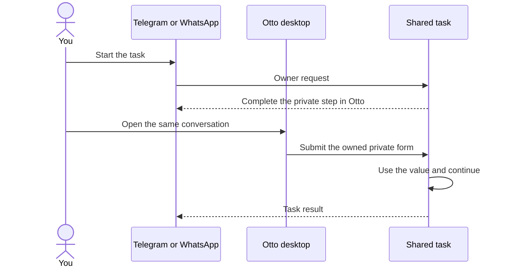
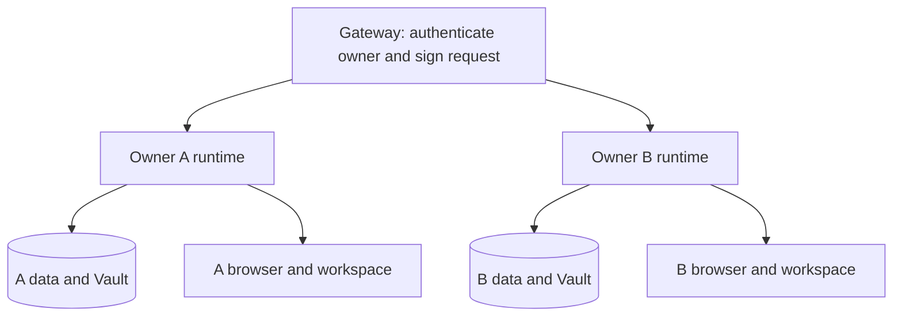

# Otto Trust and Vault

**Give Otto the task. Keep control of your accounts, secrets and actions.**

Otto can sign in to a service, read a report, prepare a reply and complete a checkout. Trust and Vault make that work possible with clear controls.

**Trust controls what Otto can do.** It checks connected-app actions against your request and asks for confirmation when needed.

**Vault controls how Otto uses secrets.** It stores website logins and local cards, checks permission, and enters private values into the selected website fields.

The model plans the work. The server controls access and execution. Vault sends saved values to the browser. Its tools return status and account information to the model.

This guide explains the user experience, the main controls and the architecture behind them. For the complete engineering reference, see [Architecture](architecture.md).

## The design in one picture

The two paths have different jobs. An app action needs authority to run. Private entry needs permission to use a saved item at its destination. The model receives the information it needs to continue the task.

## Add once. Use when needed.

Open **Vault → Saved** to add a website login or a card. Give each account a clear name, such as **Work reports** or **Personal travel**.

| What you need            | Where to set it up                                                        | How Otto uses it                                         |
| ------------------------ | ------------------------------------------------------------------------- | -------------------------------------------------------- |
| Website login            | Add a login in Vault                                                      | Uses the selected account on its exact website origin    |
| Existing saved passwords | Import a CSV from Chrome, 1Password or another supported password manager | Creates saved website logins                             |
| Verification code        | Enter it in the private form when Otto asks                               | Uses it for the current sign-in step                     |
| Saved website session    | Sign in through Otto's private browser and save the session               | Reuses the owned browser profile after permission checks |
| Payment card             | Add a card in local or desktop Otto                                       | Requests approval for one checkout                       |
| App or model connection  | Open **Apps** or **Models**                                               | Keeps connection credentials in the server path          |

CSV import reads login records. It does not copy your existing Chrome profile, cookies, passkeys or other password-manager items. A saved browser session comes from signing in through Otto's browser.

You can also add a login when a task needs it. Otto opens a private form for that account and website. Enter the values there, then submit. Otto continues the same task.

### Example: read a report

Save the login for `https://reports.example.com`. Then ask:

> Use my Work reports account and tell me the weekly active users.

Otto reads the page and selects the login method and fields. It reuses a uniquely applicable saved account. If two accounts or methods could apply, it asks which one you want.

The server checks the task, account and website. It then enters the values privately. Otto reads the result and continues to the report.

A **website origin** is the protocol, host and port. `https://reports.example.com` and `https://login.example.com` are separate origins. Pages at different paths on the same origin share that origin. The provider checks the actual field origin, including fields inside frames.

Task permission is specific to the task and selected item. **Sign in without asking** is an explicit ongoing permission for a website. You can turn it off in Vault.

## Secrets have their own path

The model chooses accounts, methods, fields and submit controls. Vault tools return status and account metadata. They do not return saved passwords, verification codes or full card numbers.

| Information      | What the model receives                                                           |
| ---------------- | --------------------------------------------------------------------------------- |
| Saved login      | Account name, website and username hint                                           |
| Saved card       | Card name, brand, last four digits and expiry metadata                            |
| Password or code | Status of the private operation                                                   |
| Page after entry | The current page, with known secret values removed from text and masked in images |

Private entry checks the selected document and field origin before it types. It keeps the selected field identity stable, so a focus change cannot redirect the entry to another control. Observations and other browser actions pause during the operation.

After private submission, the live page remains open. Otto can use normal browser tools, page scripts, downloads, uploads and file tools to finish the task. This also preserves pages that keep sign-in state in memory. The private operation adds no fixed wait to guess when the website has finished: Otto checks the page result.

### Storage

Saved login and local card values use **AES-256-GCM**, an encryption method that also detects changes to ciphertext. Each encrypted value binds to its owner, record and purpose. Moving it to another owner's record does not make it usable there.

The encryption key stays outside the database. Local deployments use the system key store or a configured server key. Hosted deployments use a key derived for each owner. Otto checks the key against existing encrypted data before it permits use or new writes.

Saved browser profiles are browser state. They have their own access and network controls; they are not imported password records. Protect the runtime's data and backups as part of your deployment.

## Authority comes from you

A page, email or file can contain text that looks like an instruction. Otto treats external tool results as data. They cannot create an owner request or approve an action.

Before a connected-app action runs, the server classifies the actual action and arguments. This includes the destination, payload and resolved command. A review model can check intent, using your messages and the action. It does not receive the tool results that proposed the action.

| Action or task                            | Server behavior                                                             |
| ----------------------------------------- | --------------------------------------------------------------------------- |
| Read a connected app                      | Runs directly                                                               |
| Create or update your own app data        | Runs directly in a normal task                                              |
| Send, reply, share, invite or post        | Checks known recipients and your request; asks when authority is missing    |
| Delete data or run an unclassified action | Checks your request; asks when authority is missing                         |
| Run a schedule                            | Checks actions against the instruction that created the schedule            |
| React to an event Otto noticed            | Reads and drafts directly; other app actions need confirmation              |
| Read-only or onboarding task              | Refuses app actions classified as writes; refuses Vault sign-in and payment |
| Submit a saved card                       | Always needs approval for the specific checkout                             |

A confirmation binds the owner, action and arguments. Changing the destination or payload requires new authority. A suspicious instruction pattern in external content makes the server hold app sends and deletions for confirmation until your next message.

The connected-app action check covers app tools. Website clicks follow Otto's task instructions. The server checks site permission before it uses saved secrets or a saved browser profile. For saved browser profiles, a network proxy limits access to the permitted exact origins. Additional asset, API or sign-in origins need permission.

## Approve one payment

A payment request shows the selected card, shop, amount, currency and the destinations that receive card fields. It also binds the checkout document, selected submit control and saved card revision. The request expires after ten minutes.

Approve with the security code in Otto's private payment form or secure web reply. If you explicitly enable **Do it for me** for that card, Otto can use its saved code after your yes. This setting saves the code; each payment still needs approval. Turning it off removes the saved code.

A changed card, revoked permission, expired request or stopped task cannot use the old approval. Saving a new card does not approve a purchase.

Vault records **card submitted** when private entry and submission finish. Otto then checks the merchant's response before it reports the purchase result. Your bank and the merchant determine payment acceptance and settlement.

Saved-card storage and payment use are available in local and desktop mode. Hosted mode refuses new card storage, card changes and saved-card payment use.

## One use. A clear result.

Before private browser work starts, the server saves a durable use claim. Only one executor can claim that operation. Two tabs, concurrent replies or a lost response cannot execute the same claim twice.

**Submitted** means the provider finished entry and submission. The website result establishes whether sign-in or purchase succeeded.

**Uncertain** means the operation may have reached the website. Otto keeps the claim and does not replay it. Ask Otto to inspect the result before you start a new attempt. If entry failed, the browser holds further observation until the filled document changes.

Stop cancels waiting tasks and prevents a late form from starting or resuming them. It cannot undo an operation that has already reached the website. After a process interruption, startup changes unfinished claims to uncertain.

## Start in Telegram. Finish the private step on desktop.

Web, desktop, Telegram and WhatsApp share one owner conversation. Each task keeps its original reply channel.

For a private step in a Telegram or WhatsApp task, Otto directs you to desktop. Open the same conversation, use the private action, and submit. Otto continues and replies in the original channel. Private form URLs and payment codes do not travel through the chat-app flow.

There is one browser holder at a time: the conversation, a background task or you. Private entry and browser handoff use that same ownership rule. A background task cannot take the browser while the conversation waits for your input.

## Review and change access

**Vault → Activity** shows uses, questions, held attempts, reveals and permission changes. **Vault → Saved** lets you edit or remove logins and cards, manage website permission, and sign out saved browser sessions.

**Settings → Trust** shows model spending and connected-app actions. You can set a monthly spending limit. New model work stops when priced usage reaches the limit; work already in progress can finish.

Usage analytics are off until you opt in. When enabled, recordings mask private content and block credential forms and remote-browser views. See [Analytics](analytics.md) for the collection contract.

## Control what Otto remembers

Automatic learning uses your own messages. It does not use assistant text or tool results. New facts stay tentative until a second message repeats them. Sensitive topics need your opt-in or an explicit request to remember them.

When you connect Gmail, Otto can learn your writing style from your own sent email. It saves one short style preference, with no names, facts or quotes. That preference is labelled **Learned from your sent email**.

You can inspect and change saved memory. Automatic changes archive earlier entries. A request to forget removes the selected memory.

## Deploy with a clear data boundary

In desktop and local mode, Otto's runtime runs on your computer. Commands and file tools run in the sandbox workspace. Provider keys stay in the server. Local API access to owner data requires the owner access key. Connected CLI credentials reach only a separate, sealed installation from the declared source. The server checks a download's SHA-256 when that source includes a checksum.

Hosted mode gives each owner a separate runtime, SQL role, schemas, browser and workspace. The gateway authenticates the owner and sends signed requests to that owner's runtime. The runtime owner does not change between requests.

Model requests go to the provider you select. Connected services receive the requests you authorize. Otto's server and browser handle private values, and the destination website receives submitted values. A website can retain or transform them, so use destinations you trust. The infrastructure operator is trusted with stored data and key access.

## Evidence you can inspect

The controls are implemented in the server and browser provider. They have tests for owner isolation, exact-origin entry, cancellation, stale approvals, concurrent claims, process interruption, secret masking and task continuation.

Task evaluations use the real agent and browser against synthetic websites and disposable data. Native UI checks exercise the private forms. The [Vault test report](vault/deep-test.md) records tested revisions, results and performance measurements. It keeps automated tests, UI checks and model task evaluations separate.

| Control                                   | Engineering reference                                                                                   |
| ----------------------------------------- | ------------------------------------------------------------------------------------------------------- |
| Action authority and confirmations        | [Trust check](../src/server/trust.ts) · [Approvals](../src/server/approvals.ts)                         |
| Account, task and website permission      | [Vault access](../src/server/vault-access.ts) · [Sign-in](vault/sign-in.md)                             |
| Durable private use                       | [Use executor](../src/server/vault-use.ts) · [Storage and keys](vault/storage-and-keys.md)              |
| Field origin, document checks and masking | [Browser provider](../src/providers/agent-browser/index.ts) · [Security model](vault/security-model.md) |
| Payment approval                          | [Payments](vault/payments.md)                                                                           |
| Automatic memory sources                  | [Memory learning](../src/server/memory-learning.ts)                                                     |
| Owner and tenant isolation                | [Architecture](architecture.md#hosted-mode)                                                             |

This guide describes the Vault redesign in [PR #218](https://github.com/n8n-io/otto/pull/218).
