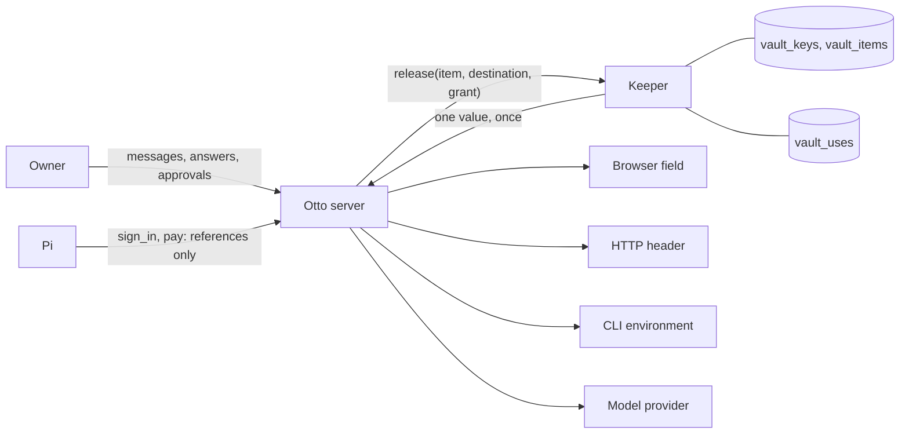

# Vault

Status: design, 10 October 2026. The first steps are built: `sign_in` without values, scoped grants from the owner's words and answers, held background work, a browser that stays signed in only while the owner is working with it, sessions under grants, Vault activity, the Activity and Saved views, website sessions in Vault, login updates instead of duplicates, a fail-closed key check, consented security codes and CSV import from Chrome, 1Password and other password managers. [Migration](migration.md#steps) lists what is built and what remains; [architecture](../architecture.md) describes the system as it runs.

The Vault holds every secret the owner gives Otto: website logins, payment cards, API keys, OAuth grants and channel tokens. Otto can use all of them without the model ever seeing one, and the owner can see everything Otto did with them.

## Goals

- The model never holds a secret value. No tool returns one.
- Keys live only in the keeper, a separate process. The server and Pi can only ask it for single, recorded releases.
- Nothing Otto reads can widen what Otto may do with a secret.
- The owner can see every item, every use and its reason, every held attempt and every permission, and can remove any of them.
- A lost or changed key never silently destroys data.
- Cards follow PCI DSS v4.0.1.
- The owner sets nothing up, and is asked only when Otto wants something the owner did not ask for, or wants to spend money.

Where trust and ease conflict, trust wins, and the design looks for the easiest trustworthy option.

## Four ideas

**Release, never reveal.** Every item has destinations: the origins of a login, the merchant of an approved payment, the base URL or CLI path of a token, the provider of a model key. One call, `release`, decrypts an item for one destination under one grant and records it. The value goes straight into a browser field, an HTTP header, a sealed CLI environment or a provider client. Pi works with references only: item IDs, labels, origins, username hints, card brand and last four digits.

**Authority comes from the owner's words.** A release needs a grant, and grants come only from trusted input: the owner's messages, the instruction that created a schedule, and the owner's answers and approvals. Page content and tool results can never create one. When a release does not match what the owner asked, Otto asks once.

**A payment is a signed mandate.** A payment needs a mandate bound to the merchant, amount, currency and card, used once within ten minutes. The owner approves it in Otto by typing the card's security code, or with one tap when they chose to remember the code on their own install, or in the card issuer for one-time cards. Hosted mode never stores a security code.

**Everything is visible.** Every release, question, held attempt and permission is a row the owner can read in plain words, with its reason. The chat stays quiet: activity lives in Vault.

## How it fits together

## Documents

| Document                                | Contents                                                                                                          |
| --------------------------------------- | ----------------------------------------------------------------------------------------------------------------- |
| [Experience](experience.md)             | What the owner sees and does, with the exact interface text                                                       |
| [Security model](security-model.md)     | Trust boundaries, invariants, policy, threats and residual risks                                                  |
| [Storage and keys](storage-and-keys.md) | Key hierarchy, keeper, ciphertext format, tables, startup, rotation and recovery                                  |
| [Sign-in](sign-in.md)                   | Grants, release, uses, secure forms, two-factor codes, sessions and connected-app secrets                         |
| [Payments](payments.md)                 | Card storage, PCI mapping, mandates, card sources and hosted mode                                                 |
| [Research](research.md)                 | How password managers, secret managers, agent products and payment networks do this, and how this design compares |
| [Migration](migration.md)               | Current state, steps, tests, evals and decisions                                                                  |

## Terms

| Term           | Meaning                                                                                     |
| -------------- | ------------------------------------------------------------------------------------------- |
| Owner          | The one person a runtime serves.                                                            |
| Item           | One stored secret: a `login`, a `card` or a `secret` such as an API key.                    |
| Destination    | Where an item may be released: an origin, a merchant, a base URL, a CLI path or a provider. |
| Release        | One decryption of one item for one destination under one grant.                             |
| Grant          | Permission for a release, from the owner's words, answers or approvals.                     |
| Standing grant | A grant the owner gave with Sign in without asking.                                         |
| Mandate        | A grant for one payment, bound to merchant, amount, currency and card.                      |
| Use            | The record of a release or a secure form: its state, its reason and its outcome.            |
| Activity       | The owner's view of uses and grants.                                                        |
| Keeper         | The process that alone holds the keys.                                                      |
| Outer key      | The key in Keychain, safe storage, `OTTO_VAULT_KEY` or the hosted derivation.               |
| Data key       | The random key, wrapped by the outer key, that encrypts items.                              |
| Tripwire       | The existing prompt-injection flag on untrusted results.                                    |
