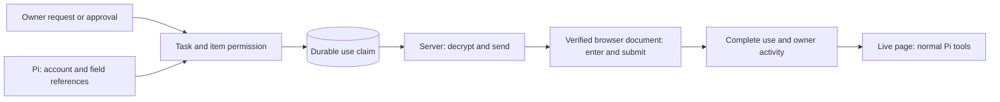

# Vault

Read [Trust and Vault](../trust-and-vault.md) for the user guide and architecture diagrams.

Implemented design, 10 October 2026. See [architecture](../architecture.md) for the full system.

**Pi can use a saved login without receiving its password.** The server checks permission, claims one durable use, and sends the value to the selected browser field. Pi selects the method, account, fields and submit control. It then checks the website result with its normal tools.

This is the product distinction: separate the agent's ability to do the task from its access to the saved value. Keep scripts, browser control, files, downloads, uploads and multi-step work. Pause observations during private entry. A failed entry keeps the lock until the filled document changes.

There is no separate key process in this implementation. The server and browser provider are trusted with values. The website receives the submitted value. This boundary does not make a hostile destination safe. See [security model](security-model.md).

| Document                                | Scope                                          |
| --------------------------------------- | ---------------------------------------------- |
| [Security model](security-model.md)     | Boundaries, guarantees and limits              |
| [Storage and keys](storage-and-keys.md) | Encryption, key checks and use records         |
| [Sign-in](sign-in.md)                   | Permission, forms, codes and saved sessions    |
| [Payments](payments.md)                 | Approval, private entry and uncertain outcomes |
| [Experience](experience.md)             | Owner controls and activity                    |
| [Research](research.md)                 | Primary sources and the engineering assessment |
| [Migration](migration.md)               | Compatibility and validation                   |
| [Deep test](deep-test.md)               | Repeated tasks, fault probes and native UI     |
