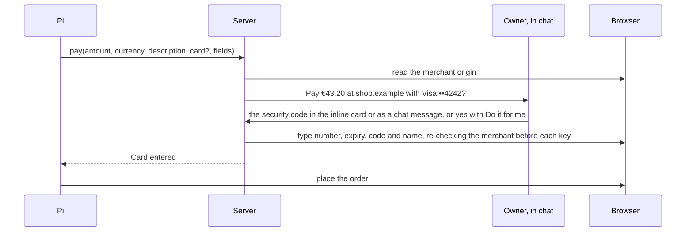

# Payments

Otto pays only under a mandate the owner approved, and the model never sees a card number or security code.

## Card storage

Own installs are the desktop app and any server the owner runs for themselves. Hosted mode is the operator's service.

| Field                      | Stored                                                                                              |
| -------------------------- | --------------------------------------------------------------------------------------------------- |
| Number                     | Encrypted                                                                                           |
| Cardholder                 | Encrypted                                                                                           |
| Expiry                     | Encrypted, and in clear in the hint                                                                 |
| Brand and last four digits | In clear in the hint                                                                                |
| Number lookup              | HMAC under the lookup key                                                                           |
| Security code              | Hosted mode: never. Own installs: encrypted, only when the owner chose to remember it for that card |
| First six digits           | Never                                                                                               |
| Unkeyed hash of the number | Never                                                                                               |

## PCI DSS v4.0.1

| Requirement                                                                                                                             | How                                                                                                                          |
| --------------------------------------------------------------------------------------------------------------------------------------- | ---------------------------------------------------------------------------------------------------------------------------- |
| 3.3.1: no sensitive authentication data after authorization                                                                             | Hosted mode never stores a security code. Own installs store one only with the owner's consent, under the FAQ 1574 exclusion |
| 3.3.2: sensitive authentication data before authorization is encrypted                                                                  | The code is staged encrypted on the use and wiped when the use ends                                                          |
| 3.4.1: display masked to first six and last four at most                                                                                | Only brand and last four are shown                                                                                           |
| 3.5.1: the stored number is unreadable                                                                                                  | AES-256-GCM per item                                                                                                         |
| 3.5.1.1: hashes of the number are keyed                                                                                                 | HMAC under the lookup key                                                                                                    |
| 3.5.1, FAQ 1308: hashed and truncated forms cannot be correlated                                                                        | The hash is keyed; the first six digits are not stored                                                                       |
| 3.6.1.2: keys wrapped by a key-encrypting key at least as strong, kept apart                                                            | Data key wrapped by the outer key; the outer key is outside the database                                                     |
| FAQ 1574: no stored security codes for consumers, password vaults included, except consumers storing their own card on their own device | Hosted mode never stores one. An own install is the owner's own device, and stores one only when the owner asks              |

## Mandates

Built for stored cards. A mandate is one payment: the merchant origin, amount, currency, card and task. It is used once and expires after ten minutes.

- **Tool.** `pay {amount, currency, description, card?, fields: {number, expiry | expiryMonth and expiryYear, securityCode?, name?}, paymentId?}`. `card` is the card the owner named; with one card, or one used before at the merchant, Otto picks it.
- **Merchant.** The server reads the merchant origin from the browser, not from Pi, and checks it again before every keystroke. Fields inside payment frames such as `js.stripe.com` work by their snapshot references.
- **Approval, in the chat.** The question appears as a payment card in Otto's chat: the card, a security code field, Do it for me, Pay and Don't pay. The owner can also type the code as a chat message; Otto catches it before it is saved or reaches the model and keeps only "Security code sent securely." A link to a separate page remains for other surfaces.
- **Do it for me.** A per-card switch on the owner's own installs. Otto keeps the card's security code, and each payment is approved with a yes, in Otto, Telegram or WhatsApp. Telegram and WhatsApp never carry a security code: without Do it for me they say "Open Otto to continue securely."
- **Steered tasks.** When a page in the task had instructions for AI assistants, a yes is not enough: the owner types the code in Otto, and the card shows a warning.
- **Fill.** One use. Snapshots hide the card number in any spacing and the filled card fields; screenshots and page scripts pause until the page changes; Pi cannot type into card fields itself.
- **Order.** Pi places the order. A 3-D Secure challenge goes to the browser handoff.
- **Turns.** Background and read-only work never pay. A schedule can ask and waits for the owner.
- **Activity.** Each question, payment, decline and held attempt is a Vault activity row with the amount, and the card shows its own history.

## Card sources

| Source                    | Where                                    | Approval                                               | What enforces the amount                       |
| ------------------------- | ---------------------------------------- | ------------------------------------------------------ | ---------------------------------------------- |
| Stripe Link one-time card | Where the owner uses Link; US only today | In Link                                                | The issuer: one card for the exact amount      |
| Stored card               | Own installs                             | In chat: the security code, or a yes with Do it for me | The owner's approval and the card's own checks |

A one-time card's number is never stored; it is released straight into the fields and discarded. Standing approvals for schedules, such as "up to €50 a month at utility.example", need a one-time card source, because only the issuer can enforce the amount. A remembered security code does not change that.

## Hosted mode and PCI

- **Own installs.** Cards, and security codes the owner chose to remember, stay on the owner's own device. PCI FAQ 1574 treats a consumer's own device like their payment card.
- **Hosted.** A hosted service that stores many owners' card numbers is a PCI service provider. That means SAQ-D or a QSA assessment, keys in a hardware-backed key service, and a random outer key per tenant so a deleted tenant can be crypto-shredded.
- **Decision.** Hosted mode offers only one-time card sources and stores no card numbers or security codes. Revisit when hosted owners need saved cards, or when agent card tokens from Visa and Mastercard are generally available.
- **Handoff.** Compliance should also review checkout handoffs: an owner who types a card into the hosted browser sends it through operator infrastructure.

## Limits

- With a stored card, Otto cannot check the final total on the page without reading it, so the approved amount is what Pi reported. One-time cards enforce it at the issuer.
- With Do it for me, whoever controls the owner's Telegram or WhatsApp can approve a payment with a yes. Keep it off for cards where that matters.
- Hosted mode can still save cards from before this design; it never keeps their codes, so every hosted payment needs the code typed in Otto. The decision above to offer only one-time cards in hosted mode still has to be enforced before hosted launch.
- Agent-specific card tokens from Visa and Mastercard are not generally available yet. They would be another card source.
