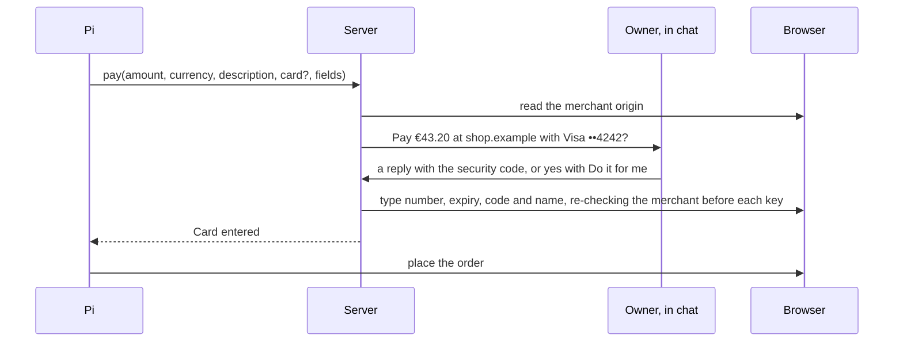

# Payments

Otto pays only under a mandate the owner approved, and the model never sees a card number or security code.

## Card storage

Own installs are the desktop app and any server the owner runs for themselves. Hosted mode is the operator's service.

| Field                      | Stored                                                                                              |
| -------------------------- | --------------------------------------------------------------------------------------------------- |
| Number                     | Encrypted                                                                                           |
| Cardholder                 | Encrypted                                                                                           |
| Expiry                     | Encrypted, and in clear in the hint                                                                 |
| Brand and last four digits | In clear in the hint                                                                                |
| Number lookup              | HMAC under the lookup key                                                                           |
| Security code              | Hosted mode: never. Own installs: encrypted, only when the owner chose to remember it for that card |
| First six digits           | Never                                                                                               |
| Unkeyed hash of the number | Never                                                                                               |

## PCI DSS v4.0.1

| Requirement                                                                                                                             | How                                                                                                                          |
| --------------------------------------------------------------------------------------------------------------------------------------- | ---------------------------------------------------------------------------------------------------------------------------- |
| 3.3.1: no sensitive authentication data after authorization                                                                             | Hosted mode never stores a security code. Own installs store one only with the owner's consent, under the FAQ 1574 exclusion |
| 3.3.2: sensitive authentication data before authorization is encrypted                                                                  | The code is staged encrypted on the use and wiped when the use ends                                                          |
| 3.4.1: display masked to first six and last four at most                                                                                | Only brand and last four are shown                                                                                           |
| 3.5.1: the stored number is unreadable                                                                                                  | AES-256-GCM per item                                                                                                         |
| 3.5.1.1: hashes of the number are keyed                                                                                                 | HMAC under the lookup key                                                                                                    |
| 3.5.1, FAQ 1308: hashed and truncated forms cannot be correlated                                                                        | The hash is keyed; the first six digits are not stored                                                                       |
| 3.6.1.2: keys wrapped by a key-encrypting key at least as strong, kept apart                                                            | Data key wrapped by the outer key; the outer key is outside the database                                                     |
| FAQ 1574: no stored security codes for consumers, password vaults included, except consumers storing their own card on their own device | Hosted mode never stores one. An own install is the owner's own device, and stores one only when the owner asks              |

## Mandates

Built for stored cards. A mandate is one payment: the merchant origin, amount, currency, card and task. It is used once and expires after ten minutes.

- **Tool.** `pay {amount, currency, description, card?, fields: {number, expiry | expiryMonth and expiryYear, securityCode?, name?}, paymentId?}`. `card` is the card the owner named; with one card, or one used before at the merchant, Otto picks it, and otherwise Pi asks which card.
- **Merchant.** The server reads the merchant origin from the browser, not from Pi, and checks it again before every keystroke. Fields inside payment frames such as `js.stripe.com` work by their snapshot references.
- **Approval, in plain text.** Otto asks "Pay €43.20 at shop.example with Visa ••4242? Reply with its security code." in Otto, Telegram or WhatsApp. The reply goes through the same path as sign-in verification codes: it is caught before it is saved or reaches the model, and chat keeps only "Security code sent securely." A "no" or any other reply is an ordinary message, and the payment is no longer accepted.
- **Chat apps.** A task from Telegram pays only at a shop the owner has already paid at and always needs the security code, even with Do it for me. Otto deletes every code reply it catches from Telegram. WhatsApp cannot delete messages, so a task from WhatsApp never pays. The first payment at a shop, and a yes with Do it for me, happen only in the Otto app, where only the owner's own session can answer. Someone who takes over a chat app cannot send the card to a site of their choosing or pay without the code.
- **One open payment.** Each request is bound to the checkout page it was made on and replaces any earlier open request in the thread. The card is entered only while the task still waits and the browser is on that same page; otherwise the request fails and Pi asks again.
- **Do it for me.** A per-card choice on the owner's own installs. On: Otto keeps the card's security code and each payment in the Otto app is approved with a yes. The first payment with a card in Otto asks: "Add “keep” and next time a yes in Otto is enough." A reply of "737 keep" turns it on; a bare "737" saves it as off. The owner can change it by asking Otto (`payment_setting`) or with the switch in Vault; turning it on from chat keeps the code from the next payment.
- **Steered tasks.** When a page in the task had instructions for AI assistants, a yes is not enough and the question says so; the code reply never changes Do it for me, and Do it for me cannot be turned on from that task.
- **Fill.** One use. From the first key until that page document is gone, even after a failed fill, snapshots hide every text field value, and screenshots and page scripts pause. The card number is hidden in any spacing everywhere. Pi cannot type into card fields itself.
- **Order.** Pi places the order. A 3-D Secure challenge goes to the browser handoff.
- **Turns.** Event and read-only turns never pay. A schedule can ask and waits for the owner.
- **Activity.** Each question, payment and held attempt is a Vault activity row with the amount, and the card shows its own history.

## Card sources

| Source                    | Where                                    | Approval                                                   | What enforces the amount                       |
| ------------------------- | ---------------------------------------- | ---------------------------------------------------------- | ---------------------------------------------- |
| Stripe Link one-time card | Where the owner uses Link; US only today | In Link                                                    | The issuer: one card for the exact amount      |
| Stored card               | Own installs                             | A reply with the security code, or a yes with Do it for me | The owner's approval and the card's own checks |

A one-time card's number is never stored; it is released straight into the fields and discarded. Standing approvals for schedules, such as "up to €50 a month at utility.example", need a one-time card source, because only the issuer can enforce the amount. A remembered security code does not change that.

## Hosted mode and PCI

- **Own installs.** Cards, and security codes the owner chose to remember, stay on the owner's own device. PCI FAQ 1574 treats a consumer's own device like their payment card.
- **Hosted.** A hosted service that stores many owners' card numbers is a PCI service provider. That means SAQ-D or a QSA assessment, keys in a hardware-backed key service, and a random outer key per tenant so a deleted tenant can be crypto-shredded.
- **Decision.** Hosted mode offers only one-time card sources and stores no security codes; `pay` refuses saved cards there. Revisit when hosted owners need saved cards, or when agent card tokens from Visa and Mastercard are generally available.
- **Handoff.** Compliance should also review checkout handoffs: an owner who types a card into the hosted browser sends it through operator infrastructure.

## Limits

- With a stored card, Otto cannot check the final total on the page without reading it, so the approved amount is what Pi reported. One-time cards enforce it at the issuer.
- Someone who controls the owner's Telegram and knows the card's security code can pay at a shop the owner has paid at before.
- Telegram deletion is best effort: a message older than 48 hours, or a failed call, stays in Telegram.
- Hosted mode can still store cards from before this design for the owner to view, but cannot pay with them.
- The merchant check covers the page's top origin. Fields inside a payment frame are filled by their snapshot reference without checking the frame's own origin, so a merchant page that embeds a hostile frame could receive the card.
- Agent-specific card tokens from Visa and Mastercard are not generally available yet. They would be another card source.
