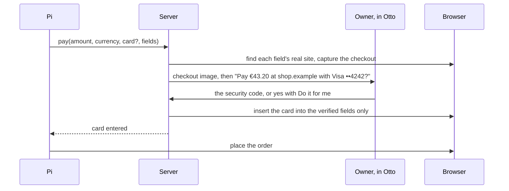

# Payments

Otto pays only under a mandate the owner approved, and the model never sees a card number or security code.

## Card storage

Own installs are the desktop app and any server the owner runs for themselves. Hosted mode is the operator's service.

| Field                      | Stored                                                                                              |
| -------------------------- | --------------------------------------------------------------------------------------------------- |
| Number                     | Encrypted                                                                                           |
| Cardholder                 | Encrypted                                                                                           |
| Expiry                     | Encrypted, and in clear in the hint                                                                 |
| Brand and last four digits | In clear in the hint                                                                                |
| Number lookup              | HMAC under the lookup key                                                                           |
| Security code              | Hosted mode: never. Own installs: encrypted, only when the owner chose to remember it for that card |
| First six digits           | Never                                                                                               |
| Unkeyed hash of the number | Never                                                                                               |

## PCI DSS v4.0.1

| Requirement                                                                                                                             | How                                                                                                                          |
| --------------------------------------------------------------------------------------------------------------------------------------- | ---------------------------------------------------------------------------------------------------------------------------- |
| 3.3.1: no sensitive authentication data after authorization                                                                             | Hosted mode never stores a security code. Own installs store one only with the owner's consent, under the FAQ 1574 exclusion |
| 3.3.2: sensitive authentication data before authorization is encrypted                                                                  | The code is staged encrypted on the use and wiped when the use ends                                                          |
| 3.4.1: display masked to first six and last four at most                                                                                | Only brand and last four are shown                                                                                           |
| 3.5.1: the stored number is unreadable                                                                                                  | AES-256-GCM per item                                                                                                         |
| 3.5.1.1: hashes of the number are keyed                                                                                                 | HMAC under the lookup key                                                                                                    |
| 3.5.1, FAQ 1308: hashed and truncated forms cannot be correlated                                                                        | The hash is keyed; the first six digits are not stored                                                                       |
| 3.6.1.2: keys wrapped by a key-encrypting key at least as strong, kept apart                                                            | Data key wrapped by the outer key; the outer key is outside the database                                                     |
| FAQ 1574: no stored security codes for consumers, password vaults included, except consumers storing their own card on their own device | Hosted mode never stores one. An own install is the owner's own device, and stores one only when the owner asks              |

## Mandates

Built for stored cards. A mandate is one payment: the shop, the checkout page, the site of each card field, the amount, the currency and the card. It is used once and expires after ten minutes.

- **Tool.** `pay {amount, currency, card?, fields: {number, expiry | expiryMonth and expiryYear, securityCode?, name?}}`. With one card, or the one the owner named, Otto uses it; otherwise Pi asks which.
- **Where the card goes.** The server focuses each field and asks Chrome DevTools, from an isolated world the page cannot touch, which document holds it. Each field's site and the checkout page's identity (Chrome's loader ID) are bound to the mandate, and a site other than the shop is named in the question ("Card details go to js.stripe.com.").
- **Entry.** Otto inserts each character inside the verified field's own document, never as global keystrokes, so nothing can reach another frame. If the model ran a script on that checkout page, Otto asks it to reload first.
- **Approval, in Otto, in plain text.** Otto posts the checkout page (field values hidden) and asks. While the question is open, a message with one three- or four-digit number is the code; it never reaches the model or chat history, which keeps "Security code sent securely." Telegram and WhatsApp can ask for a purchase but never approve one; a code typed there is refused.
- **Do it for me.** Per card, on own installs. On, Otto keeps the security code and a yes in Otto is enough. After the first payment with a card, Pi asks whether a yes should be enough and saves the answer with `payment_setting`; the owner can ask at any time or use the switch in Vault. It turns on only from the Otto app, and the code is kept from the next payment, whose question says so.
- **While the card is on a page.** In every tab, until that page is gone, the model can only look and click: snapshots hide field values, and typing, scripts, dragging and screenshots are paused. The card number is hidden in any spacing everywhere, and Otto turns off form restore on the fields it filled.
- **Limits of the request.** A new request replaces the open one. Event and read-only turns never pay; a schedule can ask and wait. A page that tried to steer the task needs the code. Pi places the order; a 3-D Secure challenge goes to the browser handoff.
- **Activity.** Each question, payment and held attempt is a Vault activity row with the amount, and the card shows its own history.

## Card sources

| Source                    | Where                                    | Approval                                                   | What enforces the amount                       |
| ------------------------- | ---------------------------------------- | ---------------------------------------------------------- | ---------------------------------------------- |
| Stripe Link one-time card | Where the owner uses Link; US only today | In Link                                                    | The issuer: one card for the exact amount      |
| Stored card               | Own installs                             | A reply with the security code, or a yes with Do it for me | The owner's approval and the card's own checks |

A one-time card's number is never stored; it is released straight into the fields and discarded. Standing approvals for schedules, such as "up to €50 a month at utility.example", need a one-time card source, because only the issuer can enforce the amount. A remembered security code does not change that.

## Hosted mode and PCI

- **Own installs.** Cards, and security codes the owner chose to remember, stay on the owner's own device. PCI FAQ 1574 treats a consumer's own device like their payment card.
- **Hosted.** A hosted service that stores many owners' card numbers is a PCI service provider. That means SAQ-D or a QSA assessment, keys in a hardware-backed key service, and a random outer key per tenant so a deleted tenant can be crypto-shredded.
- **Decision.** Hosted mode offers only one-time card sources and stores no security codes; `pay` refuses saved cards there. Revisit when hosted owners need saved cards, or when agent card tokens from Visa and Mastercard are generally available.
- **Handoff.** Compliance should also review checkout handoffs: an owner who types a card into the hosted browser sends it through operator infrastructure.

## Limits

- With a stored card, as when the owner pays by hand, the shop decides the final charge. Otto shows the real checkout and the amount it read; only an issuer, with one-time cards, can cap the charge.
- Otto guarantees which site receives each card detail, not which field on that site; Pi chooses the fields.
- Hosted mode can still store cards from before this design for the owner to view, but cannot pay with them.
- Agent-specific card tokens from Visa and Mastercard are not generally available yet. They would be another card source.
