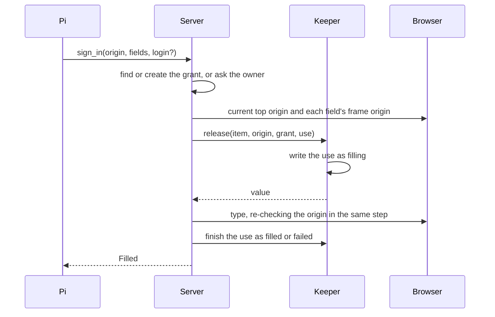
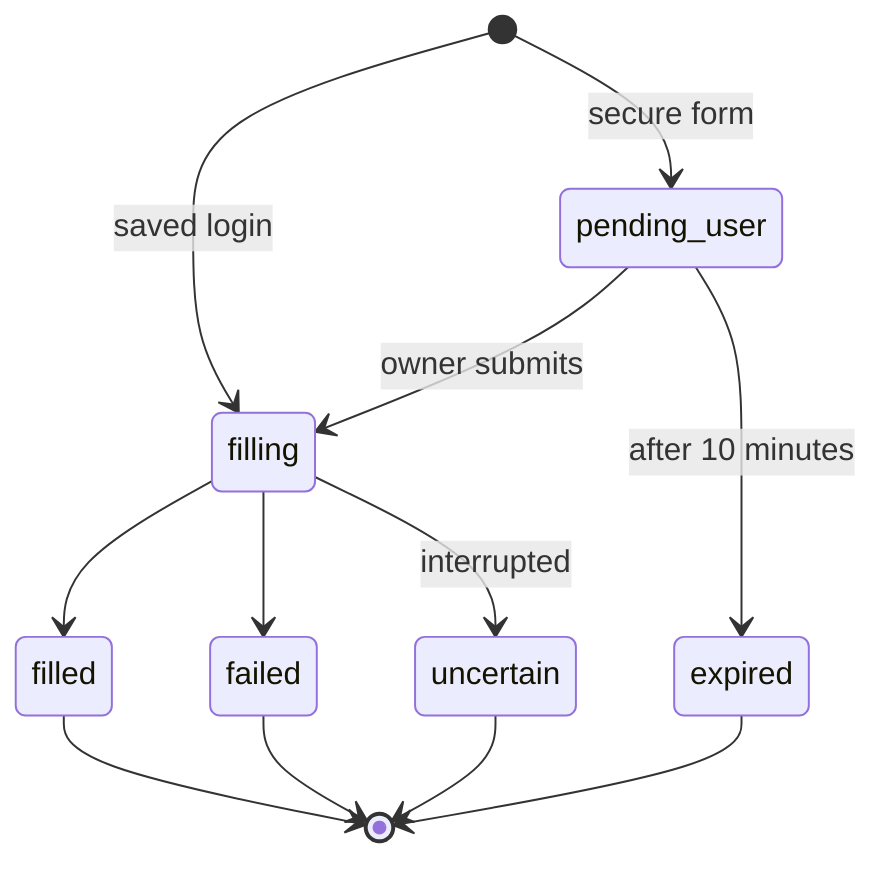

# Sign-in

This covers how Otto gets permission to use a secret, how a login reaches a website field, and how tokens reach connected apps. Payments are in [payments](payments.md).

## Agent tools

| Tool                  | Input                                                                                                      | Result                                                                 |
| --------------------- | ---------------------------------------------------------------------------------------------------------- | ---------------------------------------------------------------------- |
| `manage_apps list`    | —                                                                                                          | References: login IDs, labels, origins, username hints, saved sessions |
| `sign_in`             | `origin`, `fields: {username?, password?, code?}` with an `@eN` ref or CSS selector each, optional `login` | "Filled", a question to the owner, or a secure form                    |
| `browser_session use` | `url`, `connectionId`                                                                                      | Opens a saved session on its own site after the same grant check       |

`get_credential` is removed. No tool returns a value.

## Grants

| Source   | Created when                                                                                                   | Scope                                                            |
| -------- | -------------------------------------------------------------------------------------------------------------- | ---------------------------------------------------------------- |
| Named    | The site's host name or registrable domain appears in one of the owner's last five messages of the day         | The task: its turn chain                                         |
| Reviewed | The review model matches the sign-in to the owner's request; a business name instead of the site is left to it | The task                                                         |
| Answer   | The owner answers yes, in Otto, Telegram or WhatsApp                                                           | In a conversation, a day from the latest; in a schedule, its run |
| Entered  | The owner types or picks a login or code in a secure form, or uses Otto's live browser on the site             | In a conversation, a day from the latest; in a schedule, its run |
| Standing | The owner turns on Sign in without asking                                                                      | Conversation and schedule turns, until removed                   |
| Schedule | The check runs against the instruction that created the schedule                                               | That run                                                         |

- The review model is the existing trust review. It sees only the owner's recent messages and the requested sign-in, never assistant text, page content or tool results.
- A miss becomes a question, never a silent release.
- Asking for a secure form creates no grant; the owner's entry does.
- Event, read-only and onboarding turns hold no grants.
- A tripwire flag suspends every grant until the owner's next message.
- A question raised by a schedule expires after 30 minutes, with the browser hold.

## Release

1. **Grant.** Find a grant for the site, or create one from the sources above, or ask.
2. **Destination.** The top origin and each field's frame origin must be among the login's origins. A different origin under the same registrable domain needs a question, and the answer adds it to the login.
3. **Claim.** The keeper writes the use as `filling` and commits before releasing the value.
4. **Type.** The server re-reads the origin in the same step as typing and types with agent-browser. Codes are typed as keystrokes. Authenticator codes are generated here.
5. **Protect.** The values join the thread's egress registry, and the filled fields are masked in every screenshot by their bounding boxes.
6. **Finish.** The use becomes `filled` or `failed`. An interrupted release becomes `uncertain` and is never repeated.

No database lock is held while typing. Otto does not parse the page: it uses the fields Pi chose and the origins the browser reports.

## Choosing an account

| Saved logins for the origin            | Result                              |
| -------------------------------------- | ----------------------------------- |
| One                                    | Filled                              |
| Several, and Pi or the owner named one | Filled                              |
| Several, none named                    | The secure form shows a picker      |
| None                                   | The secure form asks for new values |

## Uses

- A secure form is a use in `pending_user` with a hashed single-use token.
- The account chosen for a turn chain and origin is its latest filled use.
- A value carried to the next step, such as a username before the password page, is `staged` and wiped when the use ends.
- The unique index on `(root_turn_id, origin, step, item_id)` keeps automatic fills to one attempt.
- Each use stores its `reason`, which the activity shows.

## Secure forms

- A link to `/vault/<token>`, valid once for 10 minutes, bound to owner, turn, origin and step.
- It shows the exact address and a preview of the page Otto is on.
- It asks only for the missing values. "Remember in Vault" is on by default.
- It needs the owner's session. Telegram and WhatsApp receive "Open Otto to continue securely."
- The submitted value goes to the keeper to be sealed and staged, then is released like any other.

## Two-factor codes

| Method                                 | Handling                                                                                                                                                       |
| -------------------------------------- | -------------------------------------------------------------------------------------------------------------------------------------------------------------- |
| Authenticator app                      | The owner adds the seed to the login in a secure form. The keeper generates the code at release. Otto never enrolls an authenticator itself.                   |
| Email code                             | The existing private path: an owned, verified mailbox, the expected recipient, a sender matching the site and a five-minute window. The code never reaches Pi. |
| SMS code                               | Secure form.                                                                                                                                                   |
| Push approval, passkey or security key | Browser handoff to the owner.                                                                                                                                  |

## Saved sessions

A saved browser session signs Otto in as the owner, so opening one needs the same grant as signing in. Event turns cannot open one, and a session opens pages only on its own site. Forgetting a website removes its login, its session and its grants together.

## The signed-in browser

Otto's browser keeps its cookies between turns. The server tracks each site the browser has been signed in to since it last signed out: logins it typed, codes, saved sessions it bound and sites the owner used in the live browser. When a turn first takes the browser, every one of those sites must pass the same check as a sign-in, without asking. If one fails, the browser signs out first: it closes, its own profile, downloads and cache are deleted, a saved session it had open is released, and the turn starts signed out. Saved sessions stay in Vault.

Work Otto starts on its own and read-only turns always start signed out, whatever was tracked. Schedules that do not name a site never see it signed in, and a conversation keeps a site only while the owner's say-so lasts.

In the live browser, the site the owner acted on counts as their say-so, and so does the page it led to when that is on the same site. A page on another site is tracked but not trusted.

Turning off Sign in without asking removes every grant for the site, and so does deleting its last login.

## Connected-app secrets

`secret` items are released the same way into other sinks:

| Secret                | Sink                                                            |
| --------------------- | --------------------------------------------------------------- |
| HTTP API or MCP token | Header on requests to the connection's base URL and path prefix |
| CLI token             | The sealed environment of the CLI's install                     |
| OAuth grant           | The provider client                                             |
| Model provider key    | The model client                                                |
| Channel token         | The channel client                                              |

The grant is the connection the owner made. Every action still passes the trust check.

## Egress registry

Each thread keeps the passwords, codes, card numbers and tokens released in it. Every outbound path checks the registry, including URL-encoded and base64 forms:

- messages and channel replies;
- browser navigation and `fetch_content` URLs;
- app arguments and discovered-connection requests.

A match is blocked unless the path is the value's destination. The registry replaces the separate redaction lists for tool errors, browser output and bug reports. It is a backstop, because Pi never receives released values.

## Signed-in turns

After a turn releases a login, it can hold that site's private data. Until the turn ends, opening or fetching an origin outside the turn's grants and the owner's messages goes through the review, and falls back to a question. Turns that never sign in are not affected.
