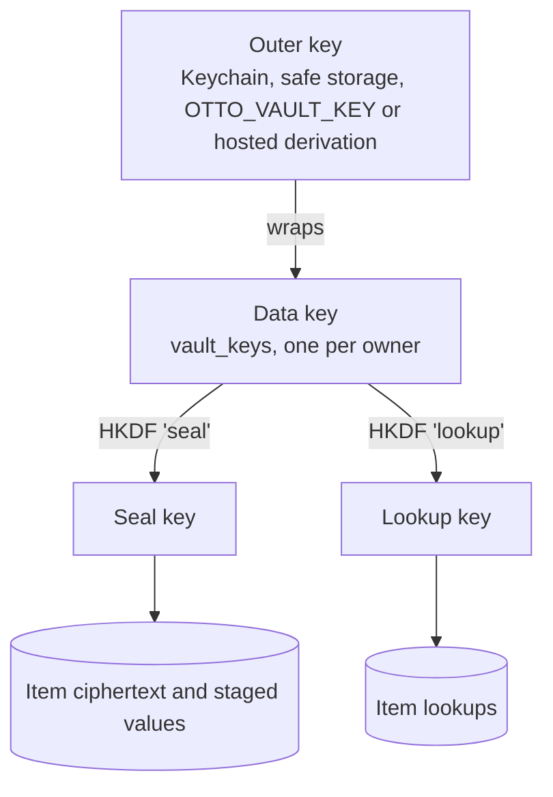
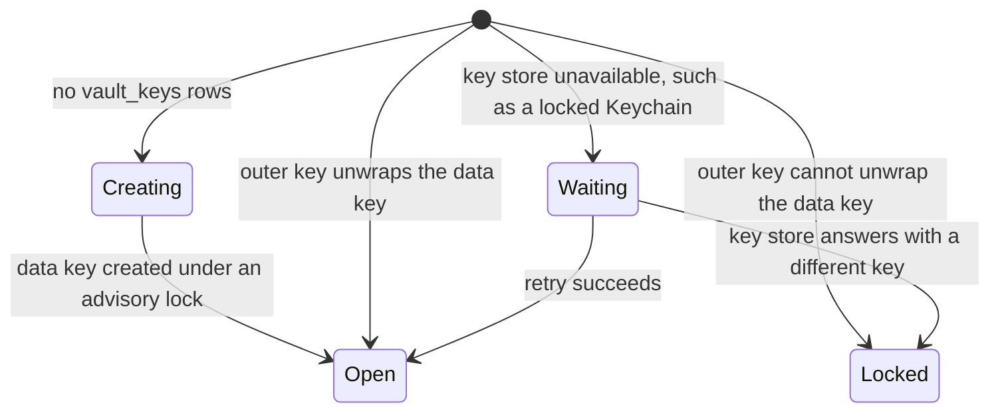

# Storage and keys

## Key hierarchy



| Mode              | Outer key                                                                        |
| ----------------- | -------------------------------------------------------------------------------- |
| macOS local       | Keychain item `dev.otto.vault`, read and written by the keeper                   |
| Desktop app       | Electron safe storage, passed only to the keeper. Linux `basic_text` is refused. |
| Linux and servers | `OTTO_VAULT_KEY`, passed only to the keeper                                      |
| Hosted            | Derived per tenant from the operator's master key, passed only to the keeper     |

The data key is 32 random bytes. Changing the outer key rewraps one row and never re-encrypts items.

## Keeper

The keeper is a small process the server starts and talks to over a local socket. It alone loads the outer key, unwraps the data key and runs every seal, open and lookup.

| Call                                           | Returns                                                 |
| ---------------------------------------------- | ------------------------------------------------------- |
| `seal(kind, itemId, value)`                    | Ciphertext                                              |
| `lookup(kind, canonical)`                      | HMAC                                                    |
| `release(itemId, destination, grantId, useId)` | The value, once, after writing the use row              |
| `reveal(itemId)`                               | The value for the owner's Vault page, recorded as a use |
| `stage(useId, value)` and `unstage(useId)`     | Encrypted value carried between sign-in steps           |
| `status()`                                     | `open`, `locked` or `waiting`                           |

It refuses a release whose grant is missing, expired, used, suspended or for another destination, and limits releases per item per minute.

## Startup



- The keeper creates a Keychain item or a data key only when `vault_keys` is empty.
- When locked, every Vault route and release returns 503, and the owner sees one banner. Restoring the old outer key opens the Vault again.
- A temporary key-store error never creates a key.
- Built today: `vault_key_check` holds one value sealed with the current key, checked by the one key store every sealed table uses. While sealed data exists, a key that cannot open it is refused, so the Vault returns 503 and nothing is sealed beside the old items.

## Ciphertext

```
v1.<keyId>.<base64url(nonce ‖ ciphertext ‖ tag)>
```

- AES-256-GCM with a random 96-bit nonce.
- Associated data: the canonical JSON of `[version, keyId, kind, ownerId, itemId]`. A ciphertext cannot move between items, owners or kinds.
- One owner encrypts far fewer than 2³² values per key.
- The version prefix allows a later move to XAES-256-GCM without a migration.
- The wrapped data key uses the same format with kind `data-key`.

## Tables

```
vault_keys(id uuid, owner_id text, wrapped_key text, outer_key_id text, status text, created_at timestamptz)
vault_items(id uuid, owner_id text, kind text, label text, destinations text[], hint jsonb,
            lookup bytea, ciphertext text, key_id uuid, created_at, updated_at, last_used_at timestamptz)
vault_grants(id uuid, owner_id text, root_turn_id uuid, schedule_id uuid, action text, item_id uuid,
             destination text, max_amount numeric, currency text, source text, standing boolean,
             expires_at, used_at, suspended_at timestamptz)
vault_uses(id uuid, owner_id text, turn_id uuid, root_turn_id uuid, item_id uuid, grant_id uuid,
           action text, step text, origin text, state text, reason text, token_hash text,
           staged text, expires_at, created_at, finished_at timestamptz)
```

Unique indexes: `vault_items(owner_id, kind, lookup)` and `vault_uses(root_turn_id, origin, step, item_id)` for automatic fills.

`vault_uses` is described in [sign-in](sign-in.md#uses), `vault_grants` in [sign-in](sign-in.md#grants) and [payments](payments.md#mandates).

## Items

| Kind     | Encrypted                                                                             | Hint in clear                        | Destinations                                          | Lookup                      |
| -------- | ------------------------------------------------------------------------------------- | ------------------------------------ | ----------------------------------------------------- | --------------------------- |
| `login`  | username, password, authenticator seed                                                | first two characters of the username | exact origins                                         | HMAC of origin and username |
| `card`   | number, cardholder, expiry, and the security code when the owner chose to remember it | brand, last four digits, expiry      | none; each mandate names its merchant                 | HMAC of the number          |
| `secret` | value                                                                                 | provider or connection name          | provider, HTTPS base URL and path prefix, or CLI path | none                        |

- **Lookups** are HMAC-SHA-256 under the lookup key. Logins use the origin and the trimmed username, with email addresses lowercased. Cards use the digits of the number.
- **No duplicates.** Saving a login for an existing account updates its password. The same card cannot be saved twice.
- **Cards** never store the first six digits or an unkeyed hash of the number. The security code is stored only on own installs, only when the owner chose to remember it for that card, and never in hosted mode.
- **Authenticator seeds** are added only by the owner.
- **Secrets** replace `vault_app_grants` and the ciphertext in `channel_settings`. Model connections, discovered connections, direct OAuth accounts and channel settings keep their own tables and point to an item. They stay where they are managed today; the Vault page lists logins and cards.

## Import

The Vault page parses a CSV export from Chrome, 1Password, Bitwarden or Apple Passwords in the browser and saves each row through the normal save. Lookups merge duplicates. The file never reaches the server. A later option reads a dedicated 1Password vault through a read-only service account and fetches each item at release time.

## Rotation

Rotation follows events, not a calendar.

| Event                                                     | Action                                                                                |
| --------------------------------------------------------- | ------------------------------------------------------------------------------------- |
| Outer key changes, such as a move to desktop safe storage | Rewrap the data key, record the new `outer_key_id`                                    |
| Suspected data-key exposure                               | New data key; re-encrypt every item and lookup in one transaction; retire the old key |
| Operator master key changes (hosted)                      | Rewrap each tenant's data key                                                         |

## Deletion

- Deleting an item deletes its row and its staged values.
- Deleting an owner deletes their `vault_keys` row, which makes every remaining ciphertext unreadable.
- Backups keep wrapped data keys. A hosted tenant's data can be crypto-shredded from backups only if its outer key is random and stored in a key service, not derived from the master key. That is required before hosted mode stores cards.

## Recovery

- Local and Linux installs: back up the outer key, as the README says today.
- Desktop: safe storage is tied to the OS account.
- Hosted: the operator's master key.

## Retention

| Data          | Kept                                                            |
| ------------- | --------------------------------------------------------------- |
| Items         | Until the owner deletes them                                    |
| Grants        | For their turn chain or schedule; standing grants until removed |
| Uses          | 90 days                                                         |
| Staged values | Until the use ends                                              |
